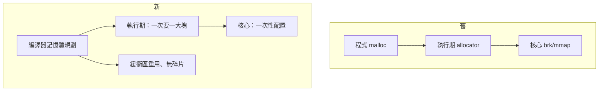
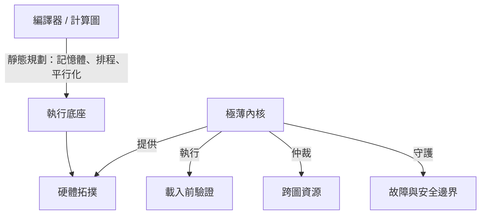

# 3.3　OS 與編譯器邊界的重劃

> 本節導論：如果編譯器能靜態規劃記憶體、排程、快取、平行化，甚至生成硬體電路，那作業系統還剩下什麼？本節重新劃定這條邊界。

## 3.3.1 歷史上的邊界

傳統上，OS 與編譯器的分工很清晰：

* **編譯器**：把「單一程式的原始碼」翻譯成「機器碼」。它只關心「這一個程式內部」的最佳化。它對「同時有其他程式在跑」一無所知。
* **作業系統**：管理「多個程式共享硬體」這件事。它關心資源分配、隔離、排程、I/O。它對「單一程式內部」的結構一無所知。

用一句話概括：**編譯器管「程式內（intra-program）」，OS 管「程式間（inter-program）」**。

這條邊界之所以穩定，是因為它建立在一個「資訊分割」上：編譯器只看得到一個程式，OS 只看得到多個程式的「外部行為」。誰也無法越界。

## 3.3.2 邊界為什麼鬆動

當編譯器開始能「看到多個程式」或「看到整個計算圖」時，這條邊界就鬆動了。三個變化：

**（1）編譯單位變大。**
傳統編譯器一次編譯一個 `.c` 檔。但 AI 框架的編譯（如 XLA、TorchInductor、TVM）一次編譯 **整張計算圖**——它看得到整個程式的資料流，因此可以做跨算子的最佳化（算子融合、記憶體重用）。這讓編譯器的視野從「一個函式」擴大到「整個工作負載」。

**（2）目標變明確。**
傳統編譯器要生成「通用」的機器碼，不知道會跑在哪台機器上。但 MLIR 假設「目標已知」，可以為特定硬體做特化。這讓編譯器能「代替 OS 做資源決策」——因為它知道資源的細節。

**（3）執行模型變簡單。**
AI 計算圖是資料流圖，沒有複雜的控制流、沒有動態記憶體配置的任意模式。這種「結構化」讓編譯器能靜態分析的程度大幅提升，能做 OS 原本在執行期做的事。

## 3.3.3 邊界重劃的第一刀：記憶體管理

**舊邊界**：OS 管實體記憶體與頁面映射；程式用 `malloc` 向執行期要記憶體；執行期向核心要頁面。

**新邊界**：編譯器在編譯期就計算出「整個計算圖的記憶體需求」，靜態規劃出一組「緩衝區」，並決定哪些可以重用。執行期只需要「一次性向 OS 要一塊大記憶體」，然後在編譯器規劃好的緩衝區之間切換。

這個轉變的深遠意義是：**記憶體配置從「動態、分散、有碎片」變成「靜態、集中、無碎片」**。這對 AI 計算特別有利——因為 AI 計算的記憶體模式是「大量、連續、可預測」的。

## 3.3.4 邊界重劃的第二刀：排程

**舊邊界**：OS 排程器決定「哪個執行緒跑、跑多久、在哪個核心」。這是 **時間片排程（time-slicing）**，以毫秒為單位。

**新邊界**：編譯器分析計算圖的依賴關係，靜態決定「哪些運算可以平行、怎麼映射到執行單元」。對於異質硬體，排程器決定「這個子圖去 GPU、那個去 NPU」。這是 **計算圖排程（graph scheduling）**，以「運算」為單位。

OS 排程器仍然存在，但它的角色退化成「把執行單元分配給不同的計算圖」，而非「在計算圖內部做決策」。

## 3.3.5 邊界重劃的第三刀：隔離

**舊邊界**：OS 用硬體機制（頁表、權限環）隔離行程。這是為「不確定的人類程式」設計的防線。

**新邊界**：編譯器 + 驗證器在「載入前」證明程式的安全性（記憶體邊界、迴圈有界、資源預算）。若證明通過，就可以「信任」它，不需要昂貴的執行時隔離。

這就是 eBPF Verifier 的哲學（第 6 章）。它的前提是：**程式是結構化的、可靜態分析的**——而這正是編譯器產出的 IR 的特性。

## 3.3.6 那 OS 還剩下什麼

把上述三刀切完，OS 剩下什麼？答案是 **四件事**：

**（1）硬體拓撲的發現與抽象。**
編譯器需要知道「有哪些硬體、它們如何連接」。這個資訊由 OS（或韌體）提供。OS 是「硬體真相」的來源。

**（2）載入前驗證的最終執行。**
編譯器生成 IR，但「驗證並放行」這個動作，需要一個可信的執行者。這個執行者就是極薄的內核（第 9 章）。

**（3）跨計算圖的資源仲裁。**
單一計算圖內部由編譯器排程；但「多個計算圖同時要同一張 GPU」，需要一個全域的仲裁者。這是 OS 的職責。

**（4）故障與安全的邊界。**
硬體錯誤、超時、惡意行為——這些需要一個「最後防線」。OS 提供這個防線。

換句話說，**OS 從「萬能的總管」退化成「硬體真相的提供者、驗證的執行者、資源的仲裁者、安全的守護者」**。這正是「極薄」的含義。

## 3.3.7 一個思想實驗：如果編譯器知道一切

設想一個極端情況：編譯器知道所有程式的完整結構、所有硬體的完整細節、所有輸入的完整形狀。在這種情況下，OS 還需要做什麼？

答案幾乎是「什麼都不用做」——因為所有決策都能在編譯期做完，執行期只是「照著編譯好的計畫跑」。這時 OS 退化成一個「啟動器」：載入計畫、配置資源、開始跑。

當然，現實不會這麼極端（有動態輸入、有資源競爭、有故障）。但這個思想實驗揭示了方向：**OS 的職責，正隨著編譯器能力的提升而縮小**。OS 與編譯器的邊界，會從「程式內 vs 程式間」，變成「靜態可決定 vs 動態不可決定」。

## 3.3.8 邊界不是消失，是移動

需要強調：這不是「OS 消失」，而是「邊界移動」。歷史上每次編譯器變強，都會吃掉一些原本屬於 OS 或手工程式設計的職責：

* 暫存器分配：原本程式設計師手動做，現在編譯器做。
* 指令排程：原本手動，現在編譯器做。
* 向量化：原本手動寫 SIMD，現在編譯器自動做。
* 記憶體管理：正在從執行期轉向編譯期。
* 排程：正在從 OS 轉向計算圖排程器。

每一次移動，都是「把能靜態決定的變成靜態」。這是編譯器技術的長期趨勢，而 AI 與異質計算只是加速了它。

## 3.3.9 本節小結

* 舊邊界：編譯器管程式內，OS 管程式間。
* 邊界鬆動的三個原因：編譯單位變大、目標變明確、執行模型變簡單。
* 三刀重劃：記憶體管理（靜態規劃）、排程（計算圖排程）、隔離（載入前驗證）。
* OS 剩下的四件事：硬體拓撲、驗證執行、跨圖仲裁、故障安全。
* OS 從「萬能總管」退化成「硬體真相提供者 + 驗證者 + 仲裁者 + 守護者」。
* 邊界不是消失，是移動：從「程式內 vs 程式間」變成「靜態可決定 vs 動態不可決定」。

第一部到此結束。我們拆掉了驅動模型、POSIX 包袱，並看到編譯器如何接管 OS 職責。第二部轉向另一股力量：**AI 寫 Code 如何改變軟體的生產方式**。第 4 章從「一次性軟體」談起。
