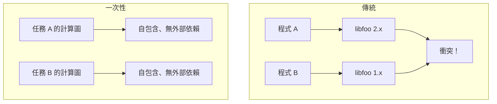

# 4.2　告別套件管理與版本依賴地獄

> 本節導論：套件管理員、動態連結、語意化版本——這些是「重用」時代的偉大發明。但如果「重用」被「即時生成」取代，它們還剩下什麼意義？

## 4.2.1 依賴地獄的解剖

先看「依賴地獄（dependency hell）」到底長什麼樣。這是每個軟體工程師都遇過的惡夢：

```text
你的程式需要 libfoo 2.x
libfoo 2.x 需要 libbar >= 1.5
libbaz 需要 libbar < 1.3
→ 衝突：找不到同時滿足 libfoo 與 libbaz 的 libbar 版本
```

這個衝突的根源，是 **「全域共享的版本」與「各自的版本需求」之間的矛盾**：

* 多個程式（或同一個程式的多個依賴）共享同一份函式庫。
* 每個依賴者對版本有不同要求（有的要新、有的要舊）。
* 版本之間可能有不相容的 API 變更（semver 的 breaking change）。

這個矛盾催生了一整套「補丁」：虛擬環境（Python venv）、鎖檔（package-lock.json）、容器（Docker）、Nix 的純函式式套件管理……每一個都是在「共享」與「隔離」之間找平衡。

## 4.2.2 依賴地獄的三層成因

把成因拆成三層：

**（1）技術層：動態連結的符號解析。**
動態連結（dynamic linking）讓多個程式在執行期共享同一份 `.so`。核心的動態連結器（`ld.so`）在載入時解析符號（函式名稱 → 位址）。如果多個函式庫定義了同名符號，就會有「符號衝突」；如果版本不同，就會有「ABI 不相容」。這是技術上的地獄。

**（2）經濟層：版本化的成本。**
每次改動 API，都要考慮「向後相容」。這催生了 semver（`major.minor.patch`）與大量的相容性工作。維護者要嘛花力氣保持相容（成本高），要嘛直接 breaking（讓依賴者痛苦）。

**（3）社會層：全域生態的協調。**
一個套件可能有數千個依賴者，一次 breaking change 會影響整個生態。這種「全域協調」在分散式的開源世界極難達成。

## 4.2.3 一次性軟體如何繞過這三層

AI 生成的一次性軟體，從根本上繞過了依賴地獄，因為它 **不需要「共享」**：

**（1）技術層：靜態、內聯、單體。**
生成的程式可以是「完全自包含」的：所有邏輯都在一份計算圖裡，沒有外部函式庫、沒有動態連結、沒有符號解析。這消除了符號衝突與 ABI 不相容的問題。

**（2）經濟層：沒有「向後相容」的负担。**
因為程式用完即丟，沒有「舊的使用者」需要照顧。每次生成都是「當下最佳」的版本，不需要維護歷史相容性。這讓「版本」這個概念本身變得模糊——每次生成都是一個新快照，而非一個版號。

**（3）社會層：沒有「全域生態」。**
每個生成的程式是為單一任務而生，不與其他程式共享依賴。因此沒有「全域協調」的問題。



## 4.2.4 「重寫」取代「重用」的權衡

傳統軟體工程有一句名言：「不要重複發明輪子（Don't reinvent the wheel）」。這在邊際成本高的時代是金科玉律。但在邊際成本趨近於零的時代，它可能反過來：

* **重寫的邊際成本低**：生成一段專用邏輯，可能比整合一個通用套件更快。
* **重寫的風險可控**：生成的程式精簡，更容易驗證；通用套件龐大，驗證成本高。
* **重寫避免「遺產」**：通用套件累積了數十年的相容性包袱；生成的程式從零開始，沒有包袱。

當然，「重寫」也有代價：可能漏掉通用套件處理過的邊界情況。所以這不是「重寫永遠更好」，而是 **「重寫變成一個可行的選項」**——而在過去，它往往不是選項。

## 4.2.5 套件管理員的未來

這不意味著套件管理員會消失，而是它的角色會改變：

* **從「執行期依賴」到「驗證過的生成原料」**：套件管理員可能變成「提供可信任的生成元件庫」，確保生成時用的模板/片段是安全的。
* **從「版本解析」到「能力描述」**：不再需要精細的版本號，而是描述「我需要什麼能力」，由系統選擇或生成。
* **從「全域安裝」到「任務本地」**：不需要全域安裝共享函式庫，每個任務有自己的自包含計算圖。

一個可能的未來圖景是：**套件管理員退化為「生成器的知識庫」**——它管理的不是「可執行的函式庫」，而是「可被 AI 參考與組合的高品質程式片段與規格」。

## 4.2.6 動態連結的命運

動態連結的原始動機是「節省記憶體」（多個程式共享同一份函式庫在記憶體中的映像）。但這個動機在今天已經很弱：

* **記憶體便宜**：節省幾 MB 的共享記憶體，已不是主要考量。
* **容器化**：每個容器有自己的檔案系統，共享的意義降低。
* **靜態連結回歸**：Go、Rust 等語言預設靜態連結，正是因為「動態連結的便利」不值得它的複雜度。

在一次性軟體的世界裡，動態連結幾乎沒有存在的理由：既然程式用完即丟，「共享」的意義就消失了。

## 4.2.7 一個反例：什麼仍然需要重用

要誠實，不能把「重用」完全否定。有些東西仍然需要重用，而且重用的價值不因生成成本降低而消失：

* **經過形式化驗證的核心元件**：例如經過 CompCert 驗證的編譯器、經過 seL4 驗證的微內核。這些的價值在「正確性證明」，而不是「程式碼本身」。
* **對效能至關重要的底層**：手寫的、極致最佳化的函式庫（如 BLAS、FFT），生成器很難憑空超越。
* **標準與協定**：需要多方協調一致的介面（如網路協定、檔案格式），不能各自生成。

所以更精確的結論是：**「重用」從「預設策略」退位為「特定場合的策略」**。在大多數「一次性、任務導向」的場景，生成取代重用；但在「正確性、效能、標準化」的場景，重用仍不可取代。

## 4.2.8 本節小結

* 依賴地獄的根源：全域共享版本 vs 各自版本需求的矛盾。
* 三層成因：動態連結符號解析、版本化成本、全域生態協調。
* 一次性軟體繞過三層：靜態自包含、無向後相容負擔、無全域生態。
* 「重寫取代重用」成為可行選項，因為重寫的邊際成本低、風險可控、無遺產包袱。
* 套件管理員角色改變：從執行期依賴到驗證過的生成原料、從版本解析到能力描述。
* 動態連結的原始動機（省記憶體）已弱，在一次性軟體下幾乎無存在理由。
* 但「重用」在正確性驗證、效能關鍵、標準化場景仍是必要的。

下一節，我們把這些拼成完整的圖像：**「生成 → 驗證 → 執行 → 銷毀」的無狀態算力流，長什麼樣子**。
