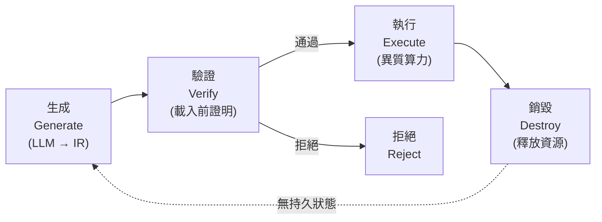

# 4.3　生成驗證執行銷毀的無狀態算力流

> 本節導論：把前面鋪陳的線索拼起來：一次性軟體的完整生命週期，是一條「生成 → 驗證 → 執行 → 銷毀」的無狀態算力流。本節描述它的結構與對 OS 的要求。

## 4.3.1 生命週期的四階段

傳統軟體的生命週期是「開發 → 建置 → 部署 → 執行 → 維護」（以年為單位）。一次性軟體的生命週期是「生成 → 驗證 → 執行 → 銷毀」（以毫秒到秒為單位）：

四個階段的時間尺度、技術需求都不同：

| 階段 | 時間尺度 | 核心技術 | 對 OS 的需求 |
| --- | --- | --- | --- |
| 生成 | 毫秒–秒 | LLM、編譯器 | 提供意圖介面、IR 標準 |
| 驗證 | 微秒–毫秒 | 靜態分析、形式驗證 | 提供驗證器原語（第 6、9 章） |
| 執行 | 毫秒–小時 | 異質算力調度 | 統一記憶體、計算圖排程（第 7、8 章） |
| 銷毀 | 微秒 | 資源回收 | 無狀態、零殘留 |

## 4.3.2 階段一：生成（意圖 → IR）

生成階段的核心問題是：**如何把「意圖」變成「可執行的 IR」**。

「意圖」可能是：
* 自然語言描述（「把這批資料算平均」）。
* 一個範例輸入輸出（few-shot）。
* 一個高階 API 呼叫（「呼叫這個模型的推論」）。
* 一個部分完成的計算圖（補全）。

生成器的任務，是把意圖翻譯成 **標準 IR**（第 5 章會詳談為什麼是 IR 而非高階語言）。這個 IR 是後續驗證與執行的共同語言。

生成的關鍵要求：
* **可驗證性**：生成的 IR 必須是結構化的、可靜態分析的。
* **確定性**：同樣的意圖，應該生成語意等價的 IR（即使表面不同）。
* **可組合性**：生成的 IR 片段應該能與其他片段組合。

## 4.3.3 階段二：驗證（載入前證明）

驗證階段，是整條流最關鍵、也最容易被忽略的一環。它的任務是：**在執行之前，用數學證明這個 IR 是安全的**。

驗證的內容包括：
* **記憶體安全**：所有記憶體存取都在邊界內。
* **終止性**：所有迴圈都有界（不會無限迴圈）。
* **資源預算**：不會耗盡記憶體、不會超過時間限制。
* **語意正確**：符合某種規格（例如「只讀取輸入、不寫入輸出以外的記憶體」）。

驗證的時間預算很緊：如果每次執行前都要花數秒驗證，就失去了「即時」的意義。所以驗證必須是 **毫秒級的**。這是 eBPF Verifier 設計的核心約束（第 6 章詳談）。

## 4.3.4 階段三：執行（異質算力）

執行階段，把驗證過的 IR 分派到異質算力上：

* **排程**：計算圖排程器決定「哪個子圖去 CPU、哪個去 GPU、哪個去 NPU」（第 8 章）。
* **記憶體**：張量在統一記憶體中流動，沒有拷貝（第 7 章）。
* **執行**：各節點依排程執行，透過共享記憶體傳遞資料。

執行的關鍵要求：
* **低啟動成本**：不能像傳統 OS 那樣 `fork` + `exec` + 動態連結，那太慢了。
* **可觀測**：能追蹤每個計算節點的執行狀態（但不留持久狀態）。
* **可中斷**：如果超時或出錯，能迅速終止並回收資源。

## 4.3.5 階段四：銷毀（零殘留）

銷毀階段，釋放所有資源：

* **記憶體**：所有張量緩衝區歸還到記憶體池。
* **算力**：所有加速器的工作佇列清空。
* **狀態**：沒有全域狀態需要清理（因為整個執行是無狀態的）。

「零殘留」是無狀態設計的核心保證：**執行前後，系統狀態應該完全一致**（除了輸入輸出）。這讓多次執行可以完全獨立、可以平行、可以重試，不會有「這次執行污染了下一次」的問題。

## 4.3.6 「無狀態」的三個層次

「無狀態」不是一句口號，它有三個具體層次：

**（1）執行無狀態。**
單次執行不依賴、也不產生全域狀態。輸入從入口進，輸出從出口出。

**（2）排程無狀態。**
排程決策只依賴「當前有哪些資源、當前有哪些任務」，不依賴「歷史」。這讓排程可重現、可平行。

**（3）儲存無狀態。**
不依賴持久檔案系統。需要持久化的資料，明確地從外部傳入；執行完的結果，明確地寫回外部。中間不碰檔案系統樹。

這三個層次合起來，讓「執行」變成一個 **純函式（pure function）**：同樣的輸入，必然得到同樣的輸出，不因環境而異。這正是第 2 章「消除隱性狀態」的終極目標。

## 4.3.7 對作業系統的四個要求

把四階段的技術需求整理起來，對 OS 提出四個明確要求：

**（1）低延遲的「生成-載入」路徑。**
從 IR 到執行的時間必須極短。這要求 OS 拋棄「載入 ELF、解析動態連結、建立行程」這套沉重的啟動流程，改用「直接把 IR 交給排程器」。

**（2）毫秒級的「載入前驗證」。**
驗證必須在執行前完成，且不能太慢。這要求 OS 內建驗證器原語（第 9 章的 Micro-Verifier Kernel）。

**（3）統一記憶體與計算圖排程。**
執行階段需要跨裝置的統一記憶體與計算圖排程器（第 7、8 章）。

**（4）零殘留的資源回收。**
銷毀階段要求快速、徹底的資源回收，不能有狀態殘留。

這四個要求，正好對應本書第 6–9 章的四個核心原語：驗證、統一記憶體、計算圖排程、極薄內核。

## 4.3.8 一個對照：Serverless 是它的雛形

「生成-驗證-執行-銷毀」不是憑空想像，它與 **Serverless（無伺服器計算）** 有驚人的相似：

* Serverless 的函式也是「短命、無狀態、任務導向」。
* 冷啟動（cold start）問題，就是「生成-載入」延遲的體現。
* 資源按需分配、用完即回收。

差別在於：Serverless 的函式還是「人類寫的、預先部署的」，而一次性軟體的函式是「AI 即時生成的」。但 Serverless 已經暴露了「短命無狀態計算」的核心挑戰（冷啟動、隔離、調度），可以作為理解未來 OS 的參照。

## 4.3.9 本節小結

* 一次性軟體生命週期：生成 → 驗證 → 執行 → 銷毀，時間尺度毫秒到秒。
* 生成：意圖翻譯成標準 IR，要求可驗證、確定、可組合。
* 驗證：執行前的數學證明（記憶體安全、終止性、資源預算），必須毫秒級。
* 執行：異質算力排程，要求低啟動成本、可觀測、可中斷。
* 銷毀：零殘留，無狀態設計的三層次（執行、排程、儲存）。
* 對 OS 的四個要求：低延遲載入、毫秒級驗證、統一記憶體排程、零殘留回收。
* Serverless 是這個模式的雛形，暴露了冷啟動、隔離、調度的核心挑戰。

第 4 章到此，我們建立了「一次性軟體」的完整圖像。下一章，我們追問一個更根本的問題：**如果 AI 直接對接執行底座，為什麼高階語言會退場，而 IR 會成為新的系統介面**。
