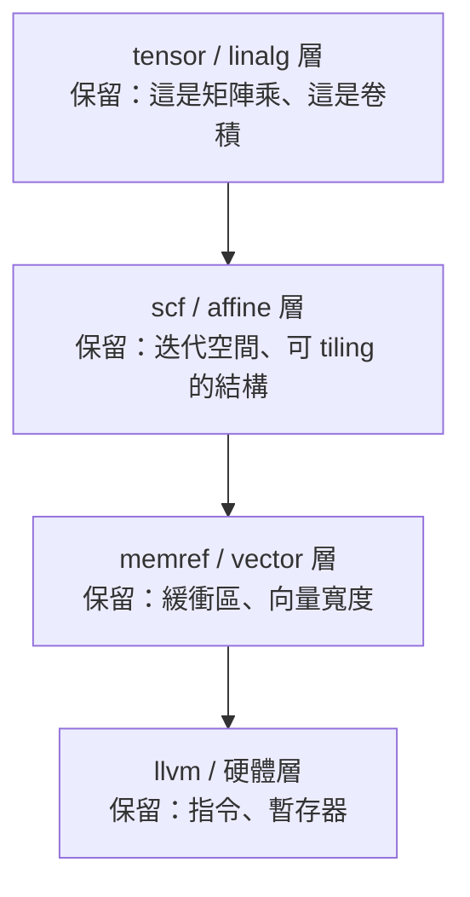
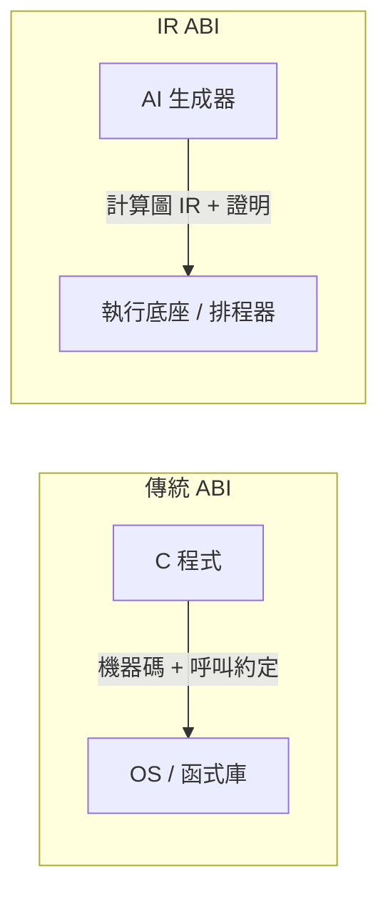

# 5.2　多層 IR 作為人機之間的標準介面

> 本節導論：如果 AI 與執行底座之間需要一個共同語言，為什麼是「多層 IR」而不是「高階語言」或「機器碼」？本節給出五個理由。

## 5.2.1 介面設計的基本矛盾

一個「人機介面」要同時滿足兩個相互衝突的需求：

* **對人類友好**：可讀、可寫、可除錯。
* **對機器友好**：可分析、可最佳化、可驗證。

高階語言偏向前者（人類友好），機器碼偏向後者（機器友好）。傳統上，編譯器充當這兩者之間的翻譯。

但在 AI 時代，出現了一個新角色：**AI 生成器**。它既不是「人類」，也不是「機器」，而是「介於兩者之間的生成主體」。它需要一個介面，既要 **能精確表達高階語意**（不被編譯器抹掉），又要 **能被機器直接分析驗證**。

多層 IR 正好滿足這個需求。

## 5.2.2 理由一：保留高階語意

高階語言 → 機器碼的過程，會丟失高階語意（第 5.1 節）。但 IR 可以在 **多個層級** 保留語意：

在任一層，你都能「看見」該層對應的語意。這讓 AI 生成的 IR 可以「在高階層表達意圖」，而執行底座「在低階層執行」。中間的降階過程由編譯器完成，且每一步都是「語意保持」的。

## 5.2.3 理由二：可驗證性

一個好的介面，必須是「可驗證的」。多層 IR 的結構化特性，讓驗證變得可行：

* **型別系統**：每個值都有明確型別（`tensor<4x8xf32>`），驗證器可以檢查型別一致性。
* **資料流**：IR 是 SSA（Static Single Assignment）形式，每個值只被定義一次，資料流清晰。
* **邊界明確**：記憶體存取（`memref`）有明確的邊界與形狀，驗證器可以檢查越界。
* **結構化控制流**：`scf` 的迴圈有明確的邊界，驗證器可以證明終止性。

這些特性，讓「載入前驗證」（第 6 章）成為可能。相比之下，高階語言有太多「動態特性」（反射、eval、指標算術），驗證極難；機器碼則太低階，語意已丟失，驗證只能檢查「指令是否合法」，無法檢查「高階意圖是否正確」。

## 5.2.4 理由三：與目標無關，又與目標有關

多層 IR 有一個看似矛盾、實則精妙的特性：**它在高層與目標無關，在低層與目標有關**。

* 高層（`linalg`）不知道目標是 CPU 還是 GPU。它只描述「數學運算」。
* 低層（`gpu`、`llvm`、自訂 NPU 方言）綁定特定目標。

這意味著：**同一份高層 IR，可以降階到多種目標**（第 3.2 節）。AI 只需要生成高層 IR，不需要為每個目標生成不同的程式碼。這是「一次生成、多處執行」的基礎。

## 5.2.5 理由四：可組合與可重寫

多層 IR 的另一個關鍵特性是 **可重寫（rewritable）**。每個 IR 層級都可以被「模式重寫（pattern rewrite）」或「方言轉換（dialect conversion）」改寫：

* 高階：把 `matmul` + `bias_add` 融合成 `matmul_bias`。
* 中階：把 `linalg.matmul` 降階成 tiled 的 `scf.for`。
* 低階：把 `vector` 降階成 `llvm` 的 SIMD 指令。

這種「可重寫性」讓 IR 不只是一份「靜態的程式」，而是「一棵可以被編譯器自由改造的樹」。AI 生成一棵樹，編譯器把它改造成最適合目標的形狀。這比「生成機器碼」靈活得多。

## 5.2.6 理由五：可作為「證明載體」

這是多層 IR 最前瞻的一個特性：**IR 可以攜帶「證明（proof）」**。

所謂 **帶證明的 IR（Proof-Carrying IR）**，是指在 IR 中附帶「這個程式滿足某些性質的證明」。例如：
* 「這個記憶體存取不會越界」的證明。
* 「這個迴圈必然終止」的證明。
* 「這個函式是純函式（無副作用）」的證明。

當 IR 攜帶證明，驗證器就不需要「重新推導」這些性質，只需「檢查證明是否有效」——這比「從頭分析」快得多。這正是第 6 章與第 9 章「載入前驗證」的技術核心。

高階語言很難攜帶證明（因為語意複雜、動態特性多）；機器碼則丟失了高階結構，無從證明。多層 IR 恰好在中間：**結構足夠清晰，可以承載證明；抽象足夠高階，值得證明**。

## 5.2.7 IR 作為「新的 ABI」

把上述五個理由合起來，可以得出一個結論：**IR 正在成為「新的 ABI（應用二進位介面）」**。

傳統的 ABI 是「機器碼層級的約定」：呼叫約定（calling convention）、資料佈局（data layout）、符號命名。它讓「編譯好的程式」能與「作業系統、函式庫」互動。

IR 作為新 ABI，則是「計算圖層級的約定」：
* **計算的介面**：不是「函式呼叫」，而是「計算圖的輸入輸出張量」。
* **資料的介面**：不是「指標與 struct」，而是「帶形狀的張量」。
* **安全的介面**：不是「權限檢查」，而是「載入前驗證的證明」。

這個 ABI 的轉變，是本書的核心論點之一：**系統介面從「機器碼」升級到「IR」**。它讓「生成」與「執行」之間，有了一個既可讀、可驗證、又可最佳化的共同語言。

## 5.2.8 誠實的挑戰

這個願景有三個真實挑戰：

* **標準化**：IR 有許多方言（MLIR 生態碎片化），缺乏一個「所有 AI 都生成、所有 OS 都接受」的統一標準。這需要產業共識。
* **工具鏈成熟度**：IR 的驗證器、除錯器、效能分析工具，仍不如高階語言成熟。
* **人類可讀性的喪失**：當 IR 成為主要介面，人類要理解「系統在做什麼」會更難。這需要在控制面保留人類友好的介面。

## 5.2.9 本節小結

* 人機介面要同時對人類友好與對機器友好，多層 IR 是折衷。
* 五個理由：保留高階語意、可驗證、與目標無關又與目標有關、可組合可重寫、可作為證明載體。
* IR 正在成為「新的 ABI」：計算介面是計算圖、資料介面是張量、安全介面是證明。
* 挑戰：標準化、工具鏈成熟度、人類可讀性。

下一節，我們把焦點放在「系統呼叫」上：**從底層 C 函式介面，如何演化為帶高階語意的宣告式計算圖請求**。
