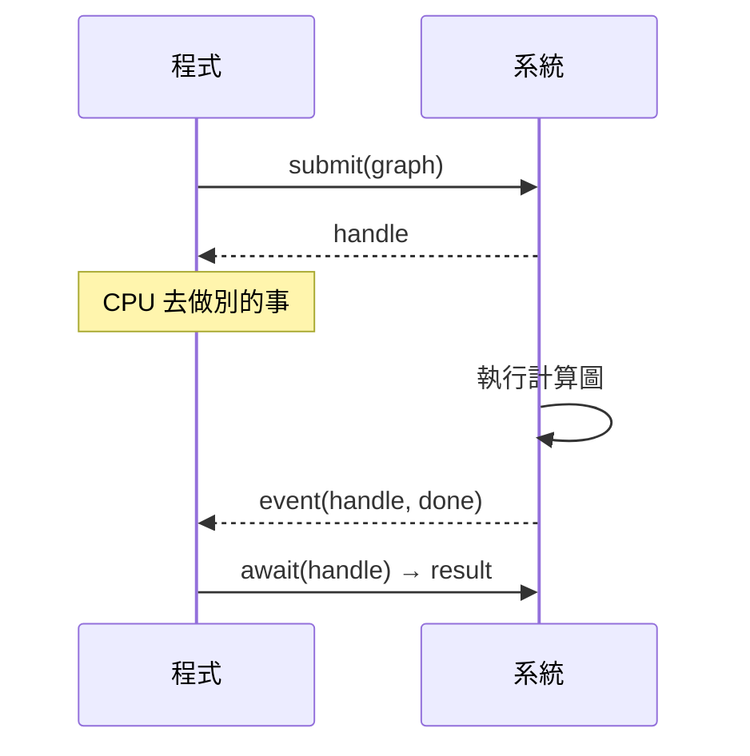

# 5.3　系統呼叫的演化

> 本節導論：系統呼叫是「程式與 OS 的唯一介面」。如果 IR 成為新 ABI，系統呼叫本身也必然演化。本節描繪這條演化路徑。

## 5.3.1 傳統系統呼叫的形態

傳統系統呼叫是「C 函式介面」：程式呼叫 `read(fd, buf, count)`，核心執行，回傳結果。它的特徵是：

* **命令式（imperative）**：告訴核心「做這個動作」（讀這個 fd）。
* **低階（low-level）**：參數是「位元組、位址、長度」，語意極薄。
* **同步（synchronous）**：呼叫後通常阻塞，直到完成。
* **逐次（one-at-a-time）**：一次一個動作，無法批次。

這個形態，是為「命令式程式設計」設計的。程式設計師寫「先讀、再算、再寫」，系統呼叫就是這些動作的執行者。

## 5.3.2 演化方向一：從命令到宣告

第一個演化方向，是從「命令式」轉向「宣告式（declarative）」：

* **傳統**：「讀這個 fd 的這些位元組。」
* **演化**：「我要這個計算的結果，輸入是這些張量。」（不指定怎麼做）

差別在於 **「誰決定怎麼做」**。命令式由程式決定；宣告式由系統（編譯器 + 排程器）決定。這正是第 3 章「編譯器接管 OS 職責」的體現——程式只描述「要什麼」，系統決定「怎麼做」。

宣告式系統呼叫的例子：

```text
%result = compute(
    graph = @my_graph,
    inputs = { x = %x, w = %w },
    constraints = { latency < 10ms, memory < 4GiB }
)
```

程式不說「用 GPU 跑這個 kernel」，只說「在 10ms 內、用 4GiB 記憶體完成這個計算」。系統負責選擇硬體、排程、最佳化。

## 5.3.3 演化方向二：從逐次到批次（計算圖）

第二個演化方向，是從「一次一個動作」轉向「整張計算圖」：

* **傳統**：`read`、`write`、`ioctl` 各一次。
* **演化**：提交一整張計算圖，一次完成。

這正是第 2.2 節「批次化攤平邊界跨越成本」的結論。計算圖提交讓多個運算在 **一次系統呼叫** 中完成，大幅減少邊界跨越。

系統呼叫的「參數」也從「位元組流」變成「計算圖 + 張量 + 約束」。

## 5.3.4 演化方向三：從同步到非同步（事件驅動）

第三個演化方向，是從「同步阻塞」轉向「非同步事件」：

* **傳統**：`read` 阻塞直到資料到來。
* **演化**：提交計算圖，回傳一個 **future / handle**，之後等待事件。

這是 `io_uring` 與 CUDA Stream 的思想：提交一批工作，之後統一等待完成。它的好處是 **CPU 不用在等待期間閒置**，可以把時間用在別的計算上。



## 5.3.5 演化方向四：從低階到高階語意

第四個演化方向，是從「低階位元組」轉向「高階資料語意」：

* **傳統**：`read(fd, buf, 4096)`——我不知道這是什麼資料，只知道這是 4096 位元組。
* **演化**：`load(path) -> tensor<...>`——我知道這是一個張量，有形狀、有型別。

高階語意讓系統能做更多事：根據形狀選擇最佳的記憶體佈局，根據型別選擇最佳的硬體單元，根據語意做驗證。

## 5.3.6 四個演化方向的整合

把四個方向整合起來，未來的「系統呼叫」可能長這樣：

```text
submit(
  graph = @transformer_layer,
  inputs = { hidden : tensor<1x2048xf16>, weights : tensor<2048x2048xf16> },
  constraints = { latency < 5ms, precision >= fp16, device_pref = auto },
  security = proof { memory_safe, bounded_loops }
) -> future<tensor<1x2048xf16>>
```

這個「系統呼叫」：
* **宣告式**：說「要什麼」，不說「怎麼做」。
* **批次**：整張計算圖一次提交。
* **非同步**：回傳 future。
* **高階語意**：輸入輸出是張量。
* **可驗證**：附帶安全性證明。

這已經完全不是「C 函式介面」，而是「計算圖請求」。這正是本節標題「從底層 C 函式介面到宣告式計算圖請求」的含義。

## 5.3.7 系統呼叫的「消失」

更激進的觀點是：**在極致的情況下，系統呼叫會「消失」**。

怎麼可能？因為如果整個計算圖在編譯期就被完整驗證、排程、降階，執行期只需要「啟動」一次。這「啟動」可能只是一個 **單一的控制轉移**（例如跳到一段已經配置好的程式碼），而不需要任何系統呼叫。

這與 **Unikernel** 的思想一致（第 10 章）：把 OS 與應用編譯成一體，執行時沒有系統呼叫邊界。這是「系統呼叫演化」的終點：**從「頻繁跨越邊界」到「零邊界」**。

當然，極端情況不會完全實現——總有一些動態決策（如資源仲裁）需要執行期介入。但方向是清楚的：**系統呼叫的數量會大幅減少，每次的語意會大幅提升**。

## 5.3.8 本節小結

* 傳統系統呼叫：命令式、低階、同步、逐次。
* 四個演化方向：命令→宣告、逐次→批次、同步→非同步、低階→高階語意。
* 整合後的未來系統呼叫：宣告式、批次、非同步、高階語意、可驗證的計算圖請求。
* 終點：系統呼叫「消失」，變成單一控制轉移（Unikernel 思想）。
* 方向：系統呼叫數量減少、語意提升。

第 5 章到此，我們完成了「IR 作為新系統介面」的論證。下一章，我們處理最關鍵的安全模型轉變：**從權限硬隔離到載入前驗證**。
