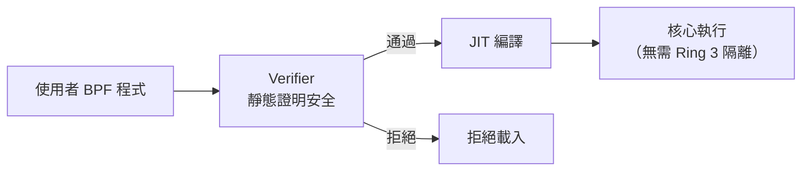

# 6.1　Ring 0 與 Ring 3 隔離的歷史成本

> 本節導論：權限環（protection ring）是 OS 安全的基石，也是一筆持續支付的效能稅。本節檢視它為何存在、成本多高、在什麼條件下可被取代。

## 6.1.1 Ring 的起源：Multics 的遺產

**權限環（protection ring）** 的概念來自 Multics（1960 年代），原本設計了多層環（Ring 0 到 Ring 7），越內層權限越高。這個設計的動機是 **「分層信任」**：核心在最內層，裝置驅動在中間，使用者程式在最外層，每一層只能存取有限的能力。

x86 架構繼承了這個概念，實作了 Ring 0–3 四層，但現代作業系統幾乎只用兩層：

* **Ring 0（核心態）**：可以執行特權指令、存取所有記憶體、控制硬體。
* **Ring 3（使用者態）**：受限的指令集、不能直接存取核心記憶體、不能碰硬體。

兩層之間的邊界，由硬體強制：從 Ring 3 進入 Ring 0 只能透過「陷入（trap）」——系統呼叫、中斷、異常。反過來，從 Ring 0 回到 Ring 3 需明確指令。

## 6.1.2 隔離解決了什麼問題

Ring 隔離解決的核心問題是：**「不確定的人類程式」可能做壞事**。

* **惡意程式**：想存取別的程式的資料、想控制硬體、想破壞系統。
* **有 bug 的程式**：因為指標錯誤而越界寫入，可能破壞其他程式或核心。
* **意外行為**：程式邏輯錯誤導致它做了不該做的事。

硬體隔離提供了一道「最後防線」：即使程式想亂來，硬體也會阻止它（例如使用者態不能執行 `hlt`，不能寫入核心頁面）。這是「深度防禦（defense in depth）」的基石。

## 6.1.3 隔離的成本：一筆持續的稅

這道防線不是免費的，它有多層成本：

**（1）邊界跨越（每次系統呼叫）。**
Ring 3 → Ring 0 的陷入，是昂貴的：儲存暫存器、切換堆疊、權限檢查、可能的 TLB/頁表操作。第 2.2 節估算單次約數百奈秒。高頻呼叫時成本累積。

**（2）KPTI 的額外成本。**
2018 年 Spectre/Meltdown 漏洞揭露後，Linux 引入 **KPTI（Kernel Page-Table Isolation）**：核心與使用者態使用不同的頁表，每次進出核心都要切換頁表，並使部分 TLB 失效。這讓系統呼叫的成本進一步上升（在某些工作負載上可達數十%）。

**（3）隔離本身的資源開銷。**
每個行程有獨立的位址空間、頁表、檔案描述子表。建立行程（`fork` + `exec`）要配置這些結構；切換行程要切換頁表。

**（4）無法跨邊界共享的資料。**
隔離意味著「核心里看不到使用者記憶體，除非透過特定機制（如 `copy_from_user`）」。這讓「讓核心直接處理使用者資料」變得昂貴。

## 6.1.4 隔離的「必要性」正在動搖

關鍵問題是：**這道防線，對於「AI 生成的、經過驗證的程式」還必要嗎？**

傳統隔離的邏輯是「因為無法證明程式安全，所以隔離它」。但如果我們能 **在載入前證明程式安全**（第 6.3 節），那隔離的必要性就下降了：

* 如果驗證器已證明「這個程式不會越界存取」，那就不需要靠硬體頁表來「防止越界」。
* 如果驗證器已證明「這個程式不會執行特權指令」，那就不需要靠 Ring 3 來「禁止特權指令」。

換句話說，**驗證是「靜態的證明」，隔離是「動態的防線」**。當靜態證明足夠可靠，動態防線就可以放寬。

## 6.1.5 eBPF 的示範：驗證取代隔離

eBPF 是一個活生生的例子。傳統上，「讓使用者程式在核心裡跑」是瘋狂的——一個 bug 就毀掉整個系統。但 eBPF 做到了：使用者可以載入一段 BPF 程式，在核心裡執行，而 **不需要 Ring 0 的完整權限**。

它的秘訣就是：**在載入前，用驗證器（verifier）證明這段程式是安全的**。驗證器檢查：
* 記憶體存取是否越界。
* 迴圈是否有界。
* 是否呼叫了不該呼叫的函式。
* 是否使用了未初始化的暫存器。

一旦通過驗證，程式就可以「安全地」在核心執行——因為它已經被證明不會做壞事。

這是「驗證取代隔離」的第一次大規模實踐。

## 6.1.6 隔離不會完全消失：分層防禦

但這不是說「隔離從此不要了」。成熟的系統會保留 **分層防禦（defense in depth）**：

* **第一層：驗證**。載入前證明安全。
* **第二層：型別與記憶體模型**。即使驗證有漏洞，型別系統與記憶體模型也能限制損害。
* **第三層：硬體隔離**。作為最後防線，防止「驗證器沒抓到的漏洞」擴散。

所以「驗證取代隔離」的精確含義是：**驗證成為「主要」的安全機制，隔離退為「次要」的防線**。這不是「不要隔離」，而是「不要為每個小程式都付高昂的隔離成本」。

## 6.1.7 成本效益的計算

做個粗略的成本效益分析：

| 方案 | 每次執行的安全成本 | 保護強度 |
| --- | --- | --- |
| 純硬體隔離（傳統行程） | 高（fork/exec、頁表、系統呼叫） | 強（硬體強制） |
| 純驗證（eBPF 式） | 中（驗證時間，但一次） | 中（依賴驗證器正確性） |
| 驗證 + 輕量隔離 | 中低 | 中強 |

對於「高頻、短命、任務導向」的一次性軟體，純硬體隔離的成本太高（每個小程式都要 fork/exec），而純驗證的保護強度可能不足。**「驗證 + 輕量隔離」是折衷**：用驗證處理大部分安全性，用輕量隔離（如記憶體保護鍵 MPK、或單一位址空間的沙箱）作為最後防線。

## 6.1.8 本節小結

* Ring 起源於 Multics，x86 只用 Ring 0/3 兩層。
* 隔離解決「不確定的人類程式」的惡意、bug、意外。
* 隔離的成本：邊界跨越、KPTI、資源開銷、無法共享。
* 隔離的必要性，在「能載入前驗證」的前提下動搖。
* eBPF 示範了「驗證取代隔離」：通過驗證的程式可在核心安全執行。
* 但隔離不會完全消失，成熟系統採分層防禦（驗證 + 型別 + 硬體）。
* 成本效益：對高頻短命程式，「驗證 + 輕量隔離」是折衷。

下一節，我們深入 eBPF Verifier 的設計哲學：**它如何做到「毫秒級證明一個程式安全」**。
