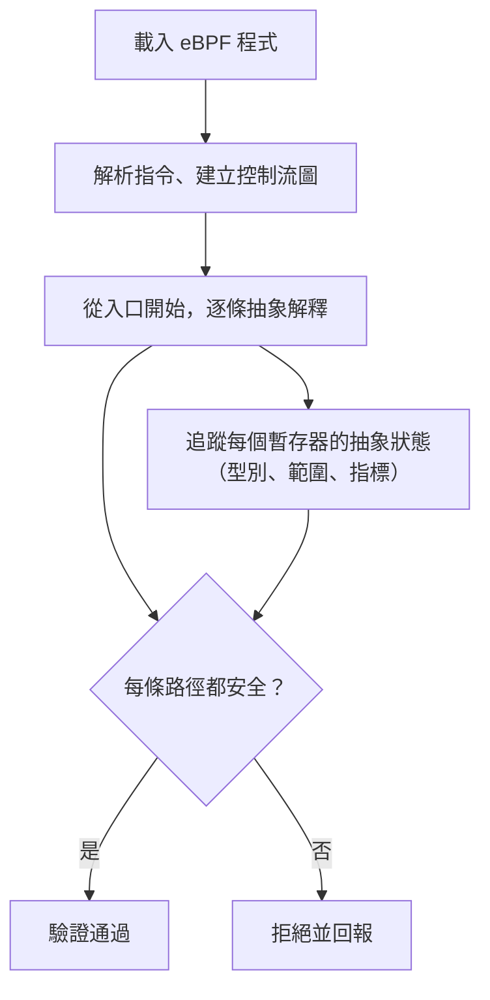

# 6.2　eBPF Verifier 的設計哲學

> 本節導論：eBPF Verifier 是「載入前驗證」的典範實作。它如何在毫秒內、靜態地證明一段程式安全？本節拆解它的核心機制與哲學。

## 6.2.1 從 BPF 到 eBPF：一段歷史

**BPF（Berkeley Packet Filter）** 是 1992 年由 Steven McCanne 與 Van Jacobson 提出的技術，用於「在核心裡高效過濾網路封包」。它的原始形態是簡單的、暫存器為基礎的虛擬機指令集。

**eBPF（extended BPF）** 是 2014 年由 Alexei Starovoitov 等人引入 Linux 核心的擴展版本。它把 BPF 從「封包過濾」擴展成「通用核心態程式設計」：可以用來做網路、追蹤、安全、觀測等各種事。

eBPF 的關鍵設計，就是 **Verifier（驗證器）**：在使用者載入 eBPF 程式時，核心先執行驗證器，靜態檢查程式是否安全；通過後，才 JIT 編譯成原生指令並執行。

## 6.2.2 為什麼需要驗證器

如果讓使用者任意載入程式到核心執行，那就是一場災難：一個越界寫入、一個無限迴圈，就能毀掉整個系統。

傳統的解法是「不要讓使用者程式進核心」。但 eBPF 的目標恰恰相反：**讓使用者程式安全地進核心執行**，以獲得核心態的高效能與深度整合。

唯一的出路，就是 **「在載入前證明它是安全的」**。這就是驗證器的角色。

## 6.2.3 驗證器的核心技術：抽象解釋（Abstract Interpretation）

驗證器不是「執行程式看看」，而是 **「靜態分析程式的所有可能行為」**。它的核心技術是 **抽象解釋（abstract interpretation）**。

抽象解釋的基本想法是：**不要追蹤具體的值，而是追蹤值的「抽象性質」**。

例如，對一個暫存器，驗證器不追蹤「它的值是 42」，而是追蹤：
* 它的型別（是 scalar、是指標、是 map 值指標？）。
* 如果是 scalar，它的範圍（例如「0 到 1023 之間」）。
* 如果是指標，它指向哪個物件、偏移量是多少。

因為是「抽象的」，所以可以覆蓋 **所有可能的值**，而不需要列舉。這就是「靜態證明」的威力。

## 6.2.4 三個核心檢查

驗證器主要檢查三件事：

**（1）記憶體邊界（memory bounds）。**
每個記憶體存取，驗證器都要確認「位址 + 偏移 + 大小」在對應物件的邊界內。對於指標，它追蹤「這個指標指向什麼物件、偏移多少」；對於算術運算，它追蹤「結果的範圍」。例如，如果它知道 `offset` 在 `[0, 1023]` 且物件大小是 1024，那 `base[offset]` 就是安全的。

**（2）迴圈有界（bounded loops）。**
早期的 eBPF 完全禁止迴圈（必須展開）。現在（Linux 5.3+）支援有界迴圈，但驗證器必須證明「迴圈必然終止」——通常靠「迴圈計數器有明確上界」來證明。

**（3）呼叫合法（valid calls）。**
eBPF 程式只能呼叫「被允許的 helper 函式」（如 `bpf_map_lookup_elem`），不能呼叫任意核心函式。驗證器檢查每個呼叫是否合法，且參數型別正確。

## 6.2.5 驗證器的執行流程

驗證器會走訪程式的所有可能路徑（控制流圖的所有分支），對每條路徑追蹤暫存器的抽象狀態，確認每一步都安全。如果所有路徑都安全，驗證通過。

關鍵在於 **「所有路徑」**：驗證器不能只檢查「一條代表路徑」，而要覆蓋所有可能的控制流。這讓驗證變得昂貴，也是為什麼驗證器有「狀態爆炸」的問題。

## 6.2.6 狀態爆炸與其對策

「所有路徑」會導致 **狀態爆炸（state explosion）**：分支越多，路徑數量指數增長。驗證器有幾個對策：

* **狀態剪枝（state pruning）**：如果兩條路徑的抽象狀態「等價」，就合併它們，不再重複探索。這是 eBPF 驗證器的關鍵最佳化。
* **驗證複雜度上限（verification complexity limit）**：核心對驗證的「工作量」設上限（例如最多處理 100 萬條指令），超過就拒絕。這防止惡意程式耗盡驗證器的時間。
* **限制程式大小與迴圈**：限制指令數量、迴圈層數，從源頭控制複雜度。

這些對策讓驗證時間可控在毫秒級，但也犧牲了「表達能力」（不能寫太複雜的程式）。

## 6.2.7 設計哲學：可判定性優先

eBPF Verifier 最深刻的設計哲學是：**「寧可拒絕，不可放過」**。

驗證器是一個 **保守的（conservative）** 分析：如果它無法證明程式安全，就拒絕它（即使程式實際上是安全的）。這種「保守」確保了「絕不誤放危險程式」——代價是「可能誤拒安全程式」。

這個哲學的深層理由，是 **可判定性（decidability）優先**。驗證器不追求「證明所有安全程式」，只追求「對所有載入的程式，都能在有限時間內給出『安全』或『拒絕』的答案」。這是「可判定」的保證。

用一句話概括：**驗證器不是「完備的（complete）」，但是「可靠的（sound）」且「可終止的（terminating）」**。

## 6.2.8 對 AI 生成 IR 的直接啟示

eBPF Verifier 的設計，幾乎可以直接套用到「AI 生成的 IR 驗證」：

* **抽象解釋**：對 IR 的值追蹤抽象性質（型別、範圍、形狀）。
* **邊界檢查**：對張量存取檢查形狀邊界（`tensor<4x8xf32>` 的索引必須在範圍內）。
* **有界迴圈**：對 `scf.for` 檢查上界是否明確。
* **保守拒絕**：無法證明安全就拒絕。
* **驗證預算**：設定驗證的計算上限，防止惡意 IR 拖垮驗證器。

差別在於：IR 的抽象層級更高，有更多結構資訊可用（形狀、型別、資料流），所以驗證可能比 eBPF 更容易、更精確。

## 6.2.9 本節小結

* BPF（1992）→ eBPF（2014），Verifier 是 eBPF 的關鍵設計。
* 驗證器讓使用者程式能安全進核心，靠「載入前證明」。
* 核心技術：抽象解釋——追蹤值的抽象性質（型別、範圍、指標），覆蓋所有值。
* 三個檢查：記憶體邊界、迴圈有界、呼叫合法。
* 走訪所有控制流路徑，用狀態剪枝與複雜度上限對抗狀態爆炸。
* 哲學：保守（寧可拒絕）、可判定、可靠但完備。
* 對 AI 生成 IR 的啟示：直接套用抽象解釋、邊界檢查、有界迴圈、保守拒絕、驗證預算。

下一節，我們把視野拉高：**eBPF Verifier 之外，形式化驗證（CompCert、seL4）如何提供更強的「載入前數學證明」**。
