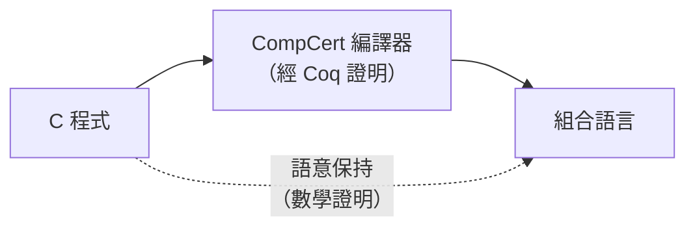
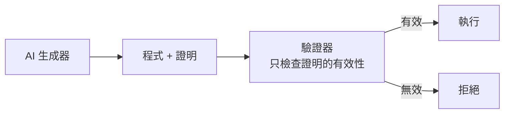
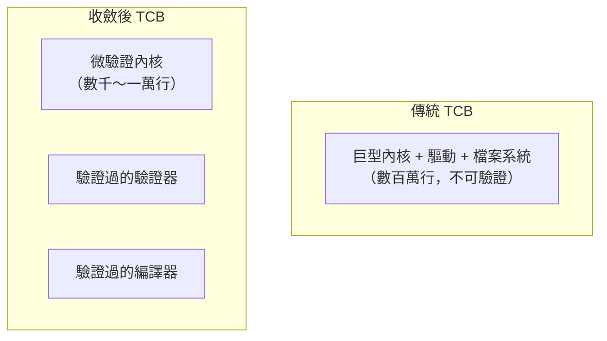

# 6.3　形式化驗證與載入前數學證明

> 本節導論：eBPF Verifier 是「工程化」的驗證，CompCert 與 seL4 是「數學化」的驗證。本節探討形式化方法如何為「載入前驗證」提供更強的基礎。

## 6.3.1 兩種驗證路線

「驗證程式安全」有兩條路線：

**（1）工程化驗證（engineering verification）。**
用靜態分析、抽象解釋、型別檢查等技術，在實務上「夠可靠」地檢查程式。eBPF Verifier 是代表。它的優點是快、可自動化、可整合進系統；缺點是「不是數學證明」，可能有漏洞。

**（2）形式化驗證（formal verification）。**
用數學邏輯，嚴謹地證明「程式滿足某個規格」。CompCert、seL4 是代表。它的優點是「數學上保證正確」；缺點是「成本高、需要專業、難以自動化」。

這兩條路線不是對立，而是 **互補**：形式化驗證提供「最強保證」的基礎設施，工程化驗證提供「可規模化」的實用工具。在 AI 時代，我們需要兩者結合。

## 6.3.2 CompCert：經過驗證的編譯器

**CompCert** 是 Xavier Leroy 自 2006 年起在 INRIA 領導開發的 C 編譯器，它的獨特之處是：**整個編譯器在 Coq 證明助理中被形式化，並證明了「編譯過程保持語意（semantics-preserving）」**。

這意味著什麼？如果 CompCert 把一段 C 程式編譯成組合語言，那麼「這段組合語言的執行結果」在數學上保證「與 C 程式的語意一致」——編譯器本身不會引入 bug。

這對「載入前驗證」的意義在於：**如果一個程式的正確性依賴編譯器，那編譯器本身必須被信任**。CompCert 提供了這種信任的基礎——你可以信任「編譯後的程式」與「原始程式」語意相同。

CompCert 的代價是：它只支援 C 的一個子集（不含某些 UB、不含 inline asm 的完整支援），編譯速度較慢，生成的程式碼效能略遜於 GCC/LLVM。

## 6.3.3 seL4：經過驗證的微內核

**seL4** 是 NICTA（現 CSIRO Data61）開發的微內核，2009 年完成了「功能正確性（functional correctness）」的形式化證明：**證明了「C 實作」與「抽象規格」行為一致**。

這個證明的份量：它涵蓋了 seL4 核心的完整行為——記憶體管理、執行緒排程、IPC、權限。數學上保證「核心不會做出規格以外的行為」。

seL4 的意義在於：**它證明了「一個真正的 OS 內核可以被形式化驗證」**。這為「極小化可信核心」提供了現實範例——一個幾千到一萬行的微內核，是可以被完整證明的。

## 6.3.4 「帶證明的程式碼」（Proof-Carrying Code）

形式化驗證的另一個重要概念是 **帶證明的程式碼（Proof-Carrying Code, PCC）**，由 George Necula 在 1990 年代末提出。

PCC 的想法是：**程式碼不是「附帶原始碼」，而是「附帶安全性證明」**。執行環境（或驗證器）不需要「信任程式碼的作者」，只需要「檢查證明是否有效」。如果證明有效，程式就是安全的。

這個概念與本書「帶證明的 IR（Proof-Carrying IR）」直接相關。在 AI 生成程式的世界裡，PCC 特別有吸引力：

* AI 生成程式時，可以同時生成「安全性證明」。
* 執行底座只檢查證明，不需要「重新分析整個程式」。
* 這讓驗證從「昂貴的分析」變成「便宜的分證明檢查」。

## 6.3.5 三種驗證的比較

| 方法 | 保證強度 | 自動化程度 | 成本 | 代表 |
| --- | --- | --- | --- | --- |
| 靜態分析（抽象解釋） | 中（可靠但不完備） | 高 | 低 | eBPF Verifier |
| 編譯器驗證 | 高（語意保持） | 高（編譯時自動） | 中 | CompCert |
| 內核驗證 | 最高（功能正確） | 低（需人工證明） | 極高 | seL4 |
| 帶證明程式碼 | 高（依證明） | 中（需生成證明） | 中 | PCC |

在 AI 時代，理想的組合是：

* **基礎層**：用形式化驗證的內核（seL4 式）作為「可信核心」。
* **編譯層**：用驗證過的編譯器（CompCert 式）確保降階正確。
* **載入層**：用帶證明的 IR（PCC 式）讓驗證變便宜。
* **執行層**：用靜態分析（eBPF 式）做快速的最後檢查。

## 6.3.6 形式化驗證的成本與現實

必須誠實：形式化驗證的成本極高。seL4 的功能正確性證明花了數年、數十人年。CompCert 也是長期的學術專案。這種成本，不可能對「每個 AI 生成的程式」都做。

所以現實的策略是 **「把形式化驗證用在『不變的基礎』上，把工程化驗證用在『多變的應用』上」**：

* **不變的基礎**：內核、編譯器、驗證器本身——這些改動少、影響大，值得投入形式化驗證。
* **多變的應用**：AI 生成的程式——這些改動頻繁、數量龐大，只能用工程化驗證（快、自動）。

換句話說：**形式化驗證「一次」驗證「驗證器本身」，然後驗證器「多次」快速驗證「生成的程式」**。這是「信任根的收斂」——把信任集中到最少、最穩定的部分。

## 6.3.7 信任根的收斂

這個策略的核心概念是 **「信任根（trusted computing base, TCB）」**：一個系統中「必須被信任」的部分。TCB 越小，系統越安全（因為需要信任的東西越少）。

傳統 OS 的 TCB 很大：整個內核（數百萬行）、所有驅動、所有檔案系統。這幾乎不可能被完整驗證。

新 OS 的目標是 **收斂 TCB**：

* 內核極小（幾千到一萬行，可被形式化驗證）。
* 驗證器本身被形式化驗證（確保它不會誤放危險程式）。
* 編譯器被驗證（確保降階正確）。
* 其餘（應用、生成器）不被信任，靠驗證來保證。

這個「信任根收斂」的思想，正是第 9 章「極小化可信核心」的理論基礎。

## 6.3.8 本節小結

* 兩種驗證路線：工程化（eBPF，快但非數學證明）與形式化（CompCert/seL4，數學保證但成本高）。
* CompCert：證明「編譯保持語意」。seL4：證明「內核符合規格」。
* 帶證明的程式碼（PCC）：程式附帶證明，驗證器只檢查證明有效性。
* 四種方法各有保證強度、自動化程度、成本。
* 現實策略：形式化驗證用在「不變的基礎」，工程化驗證用在「多變的應用」。
* 信任根收斂：把信任集中到最少、最穩定的部分（微內核 + 驗證器 + 編譯器）。

第 6 章到此，我們完成了「安全模型轉變」的論證：從權限硬隔離到載入前驗證。第二部結束。第三部轉向新 OS 的三個核心原語，第 7 章從「全域統一記憶體」開始。
