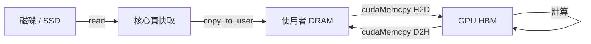
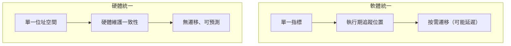

# 7.1　檔案讀寫與記憶體拷貝的雙軌制

> 本節導論：現代系統有兩套「資料流」——檔案系統的 read/write，與異質記憶體的 memcpy。這種雙軌制是異質計算效能的隱形殺手。本節解剖它。

## 7.1.1 兩套資料流的由來

在異質系統裡，資料要走兩條完全不同的路徑：

**路徑一：檔案系統的 read/write。**
資料存在磁碟或 SSD，透過 `read` 讀進使用者緩衝區，處理完透過 `write` 寫回。這條路的抽象是「位元組流」。

**路徑二：裝置記憶體的 memcpy。**
資料存在 CPU 的 DRAM，透過 `cudaMemcpy`（或類似 API）複製到 GPU 的 HBM，計算完複製回來。這條路的抽象是「位址空間之間的拷貝」。

這兩條路徑，各自有各自的 API、各自的記憶體層級、各自的效能特性。它們 **不共享同一個位址空間**，也不共享同一個資料抽象。

## 7.1.2 雙軌制的具體痛點

**（1）兩次拷貝。**
一個典型流程：磁碟 → 核心頁快取 → 使用者緩衝區 → GPU HBM。資料被拷貝了至少三次（磁碟到頁快取、頁快取到使用者、使用者到 HBM）。每一次拷貝都消耗頻寬與延遲。

**（2）資料格式的轉換。**
檔案裡是「序列化的位元組」（例如 JPEG、CSV、Protobuf），載入記憶體後要「反序列化」成張量（有形狀、有型別）。這個轉換是額外的 CPU 工作，且可能引入錯誤。

**（3）生命週期的割裂。**
檔案有「開啟、讀取、關閉」的生命週期；張量有「配置、使用、釋放」的生命週期。兩者不對齊，導致資源管理複雜、容易洩漏。

**（4）無法跨層最佳化。**
因為檔案與記憶體是兩套獨立的抽象，編譯器無法做「跨層最佳化」：例如「直接把檔案解碼到 GPU 記憶體」這種最佳化，需要跨越檔案系統、編譯器、驅動，很難實現。

## 7.1.3 「零拷貝」的局部解法

業界有一些「零拷貝（zero-copy）」的技術，嘗試減少拷貝：

* **mmap**：把檔案映射到記憶體，避免「頁快取到使用者緩衝區」的拷貝。但這只解決了「檔案到記憶體」的一半。
* **GPUDirect Storage**：讓 GPU 直接從 NVMe SSD 讀取資料（透過 DMA），繞過 CPU 記憶體。這是 NVIDIA 的技術，減少了「磁碟到 HBM」的中轉。
* **pinned memory**：把記憶體釘在實體記憶體，讓 GPU 可以直接透過 PCIe 存取（zero-copy），避免拷貝到 HBM。但頻寬受限。

這些技術都是 **「局部最佳化」**：它們減少某一環節的拷貝，但沒有消除「雙軌制」的根本結構。

## 7.1.4 問題的根源：位址空間的分裂

雙軌制的根源，是 **「記憶體分屬不同位址空間」**：

* CPU 有一個虛擬位址空間，映射到 DRAM。
* GPU 有一個虛擬位址空間，映射到 HBM。
* 兩者之間沒有共享的位址，所以資料要「複製」才能跨。

如果 CPU 與 GPU 共享同一個位址空間，那「拷貝」就不需要了——GPU 直接讀寫同一塊記憶體即可。這就是「統一記憶體（unified memory）」的目標。

## 7.1.5 統一記憶體的兩種實現

統一記憶體有兩種技術路線：

**（1）軟體統一記憶體（software-managed）。**
由執行期（runtime）管理：程式用一個指標，執行期在背後追蹤「這個資料現在在哪個裝置」，需要時自動遷移（migrate）。CUDA 的 Unified Memory（2014 年隨 CUDA 6 推出）是代表。缺點是「按需遷移」可能造成不可預測的延遲（page fault 驅動的遷移）。

**（2）硬體統一記憶體（hardware-coherent）。**
由硬體保證一致性：所有裝置共享同一個實體記憶體池，硬體維護快取一致性。CXL 是代表。優點是「無需軟體遷移、行為可預測」；缺點是需要硬體支援，目前仍在普及中。

## 7.1.6 雙軌制的終結：單一資料抽象

真正的解法，不只是「統一記憶體」，而是 **「統一的資料抽象」**：系統管理的不是「檔案」也不是「原始位址」，而是 **「帶生命週期與血緣的資料物件（張量）」**。

在這種抽象下：
* 資料物件有明確的形狀、型別、位置（可能跨多個記憶體層級）。
* 存取透過物件，而非裸位址或檔案路徑。
* 拷貝變成「遷移」（migration），由系統透明處理或硬體自動完成。
* 物件有血緣（lineage）：知道它從哪裡來、經過什麼轉換。

這就是第 7.3 節要談的「物件即位址」的儲存模型。

## 7.1.7 本節小結

* 雙軌制：檔案 read/write 與裝置 memcpy，兩套獨立的資料流。
* 四個痛點：兩次拷貝、格式轉換、生命週期割裂、無法跨層最佳化。
* 局部解法（mmap、GPUDirect Storage、pinned memory）只減少某一環節的拷貝，未消除結構。
* 根源是「位址空間分裂」。
* 統一記憶體兩種路線：軟體管理（CUDA UM，按需遷移）、硬體一致（CXL，可預測）。
* 終極解法是統一資料抽象：管理「帶生命週期的張量物件」，而非檔案或裸位址。

下一節，我們深入「跨越 HBM、DRAM、CXL 的單一位址空間」的技術細節。
