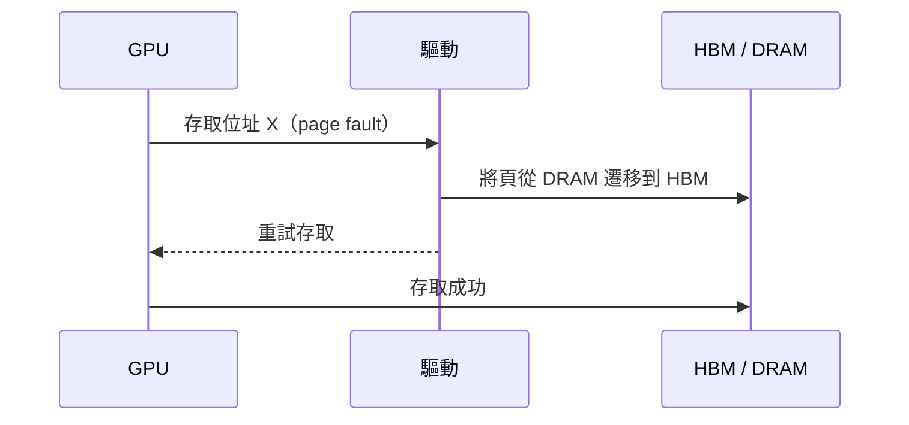
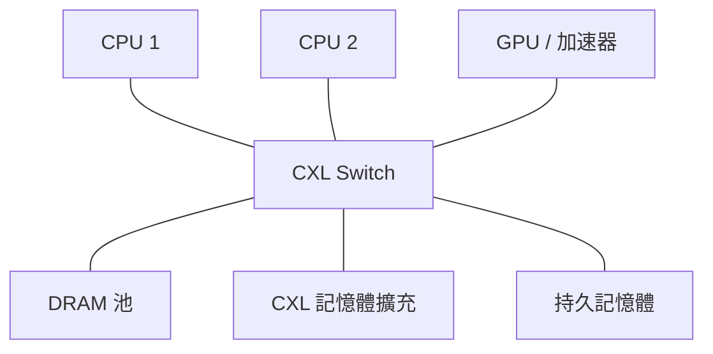

# 7.2　跨越 HBM、DRAM 與 CXL 的單一位址空間

> 本節導論：統一記憶體的核心，是把「分屬不同裝置」的記憶體，變成「一個位址空間下的不同層級」。本節拆解這背後的硬體與軟體機制。

## 7.2.1 記憶體層級的地景

現代異質系統的記憶體，是一個複雜的層級（hierarchy）：

| 層級 | 位置 | 容量 | 頻寬 | 延遲 |
| --- | --- | --- | --- | --- |
| 暫存器 | 晶片上 | 極小 | 極高 | 1 週期 |
| SRAM / 快取 | 晶片上 | 小–中 | 高 | 數週期 |
| HBM | GPU/NPU 旁 | 中（數十 GB） | 極高 | 中 |
| DRAM | CPU 旁 | 大（數百 GB–TB） | 中 | 高 |
| CXL 記憶體池 | 透過 CXL 互連 | 很大（TB 級） | 中 | 高於本地 DRAM |
| 非揮發儲存 | SSD/SCM | 極大 | 低 | 極高 |

傳統上，這些層級是「物理隔離」的：HBM 只給 GPU 用，DRAM 只給 CPU 用，彼此要透過 explicit 拷貝。統一位址空間的目標，是把它們 **「納入同一個位址空間，不同區段有不同特性」**。

## 7.2.2 統一位址空間的三個層次

「單一位址空間」不是一個二元的概念，它有三個層次：

**（1）統一位址（unified addressing）。**
所有記憶體都在同一個位址空間裡，程式用一個指標就能指到任何記憶體。這是 **定址（addressing）** 層次的統一。

**（2）統一尋址（unified access）。**
任何處理單元都能直接讀寫任何記憶體，而不需要 explicit 拷貝。這是 **存取（access）** 層次的統一。

**（3）統一一致性（coherence）。**
多個處理單元對同一塊記憶體的讀寫，有硬體保證的快取一致性。這是 **一致性（coherence）** 層次的統一。

這三個層次，技術難度遞增。CUDA 的 Unified Memory 做到了（1）與部分（2）（用 page fault 遷移）；CXL 做到了（1）（2）（3），但需要硬體支援。

## 7.2.3 HBM 與 DRAM 的統一：軟體遷移

GPU 的 HBM 與 CPU 的 DRAM 之間，最成熟的統一方案是 **軟體管理的統一記憶體（如 CUDA Unified Memory）**。

它的機制是：

* 程式用一般的指標（`cudaMallocManaged`）。
* 執行期（驅動）追蹤「這個頁現在在哪個記憶體」。
* 當 GPU 存取一個「在 CPU 記憶體」的頁，觸發 **頁面錯誤（page fault）**，驅動把該頁遷移到 HBM。
* 反之亦然。

這個方案的優點是「程式設計簡單」：不需要手動拷貝。缺點是「延遲不可預測」：page fault 與遷移會造成突發延遲，對延遲敏感的應用不友好。而且「遷移」本身仍是拷貝，只是被隱藏了。

## 7.2.4 CXL：硬體一致的統一記憶體

**CXL（Compute Express Link）** 提供了更根本的解法。它是建立在 PCIe 實體層上的互連協定，核心是 **CXL.mem** 子協定：它讓裝置可以透過記憶體語意（load/store）存取共享的記憶體池，並由硬體維護快取一致性。

CXL 的三個子協定：

* **CXL.io**：向後相容 PCIe 的 I/O 語意。
* **CXL.cache**：讓裝置能快取主機記憶體（裝置存取主機）。
* **CXL.mem**：讓主機能存取裝置記憶體池（主機存取裝置）。

CXL.mem 的關鍵特性是 **「記憶體池化」**：多個主機或裝置可以共享一個大的記憶體池，位址空間統一，硬體保證一致性。

對作業系統的意義：**記憶體不再是「屬於某個裝置」的，而是「一個可共享的池」**。這徹底打破了「分屬不同裝置、需要拷貝」的雙軌制。

## 7.2.5 CXL 的效能特性與取捨

CXL 不是萬靈丹，它有明確的效能特性：

* **延遲**：CXL 記憶體的延遲，高於本地 DRAM（因為要經過互連），但低於網路儲存。大約是「本地 DRAM 的數倍」。
* **頻寬**：受限於 PCIe 頻寬（PCIe 5.0 約 64 GB/s per lane-group，CXL 3.0 開始支援更高）。
* **一致性開銷**：維護快取一致性需要額外的協定開銷。

所以 CXL 的定位，不是「取代本地 DRAM」，而是「擴充記憶體容量、提供跨裝置共享」。最熱的資料放本地 HBM/DRAM，溫資料放 CXL 池，冷資料放儲存。

## 7.2.6 OS 的挑戰：把層級暴露給排程器

統一記憶體帶給 OS 的新挑戰是：**如何把「記憶體層級」的資訊，暴露給排程器與編譯器**。

在傳統模型裡，OS 只看到「一塊記憶體」，不知道它的特性。但在統一記憶體下，同一塊位址空間的不同區段，有不同的頻寬與延遲。如果排程器不知道這些，就無法做「把熱資料放 HBM、冷資料放 CXL」的決策。

所以新的 OS 需要 **「記憶體拓撲抽象（memory topology abstraction）」**：

* 描述每個記憶體區段的「位置、容量、頻寬、延遲」。
* 讓編譯器與排程器能「按資料的存取模式，選擇放哪個層級」。
* 這正是第 9 章「三大核心原語」之一「硬體拓撲抽象」的一部分。

## 7.2.7 一個具體的例子：跨層級的矩陣乘

設想一個矩陣乘 `C = A × B`，其中 `A` 很大（放 CXL 池）、`B` 中等（放 DRAM）、`C` 要放 GPU HBM。

在雙軌制下，流程是：`A` 從 CXL 拷貝到 CPU 記憶體、再拷貝到 HBM；`B` 從 DRAM 拷貝到 HBM；計算；`C` 拷貝回 DRAM。

在統一位址空間下，流程是：

* 編譯器知道 `A`、`B`、`C` 的位置與大小。
* 它把計算切成 tile，對每個 tile：
  * 從 CXL 池「串流」`A` 的 tile 到 HBM（硬體 DMA，無 CPU 介入）。
  * 從 DRAM 串流 `B` 的 tile 到 HBM。
  * 在 GPU 上計算 `C` 的 tile，直接寫回目標位置。
* 沒有「拷貝到使用者緩衝區」這一步，也沒有「拷貝回 CPU」這一步。

這個流程的效率提升，來自「消除中轉」與「重疊計算與搬運（double buffering）」。

## 7.2.8 本節小結

* 記憶體層級：暫存器、快取、HBM、DRAM、CXL 池、儲存，各有容量/頻寬/延遲。
* 統一位址空間三層次：統一定址、統一存取、統一一致性，難度遞增。
* HBM/DRAM 統一：軟體遷移（CUDA UM，延遲不可預測）。
* CXL：硬體一致、記憶體池化，打破「分屬不同裝置」。
* CXL 的取捨：延遲高於本地、頻寬受限、一致性開銷。
* OS 的挑戰：把記憶體層級暴露給排程器（記憶體拓撲抽象）。
* 跨層級矩陣乘的例子：消除中轉、重疊計算與搬運。

下一節，我們把「資料物件」講清楚：**張量的生命週期與血緣，如何成為新儲存模型的核心抽象**。
