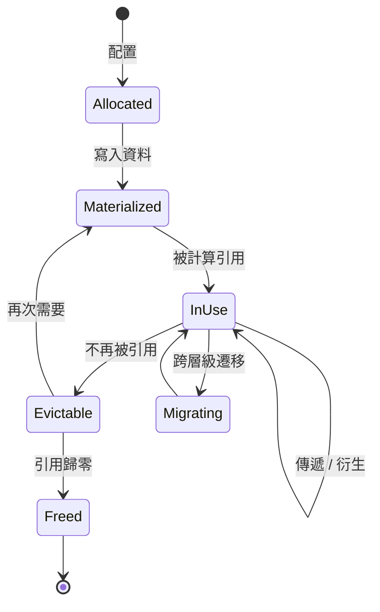

# 7.3　張量物件的生命週期與血緣

> 本節導論：如果新儲存模型管理的不是「檔案」而是「資料物件」，那這個物件需要什麼屬性？本節提出「物件即位址」的模型，以及生命週期與血緣的概念。

## 7.3.1 從「檔案」到「物件」

傳統儲存模型的核心是「檔案」：一個有名字（路徑）、有位元組內容、有持久性的東西。這套模型是為「人類組織資料」設計的（第 2.1 節）。

新儲存模型的核心是「物件（object）」——更精確地說，是 **資料物件（data object）**，例如張量。它與檔案的差別：

| 屬性 | 檔案 | 資料物件 |
| --- | --- | --- |
| 識別 | 路徑（字串） | 物件 ID（不可偽造） |
| 內容 | 位元組流 | 有型別、形狀的張量 |
| 位置 | 檔案系統樹 | 記憶體階層（可遷移） |
| 生命週期 | 持久（除非刪除） | 明確（建立→使用→釋放） |
| 血緣 | 無 | 有（從哪裡來、經過什麼轉換） |
| 存取 | open/read/write | 按物件存取 |

「物件即位址（object-as-address）」的意思是：**物件本身就是可被指涉的位址**，而不是「用路徑去查找的內容」。這讓物件可以被直接傳遞、組合、共享，而不需要經過命名空間。

## 7.3.2 物件的基本結構

一個資料物件，需要描述這些資訊：

```text
object Tensor {
  id:        ObjectId,          // 唯一識別
  shape:     [int],             // 形狀，例如 [1, 2048, 2048]
  dtype:     f16,               // 型別
  layout:    row_major,         // 佈局
  location:  MemoryHierarchy,   // 在哪個記憶體層級（可多個副本）
  refcount:  int,               // 引用計數
  lineage:   Lineage,           // 血緣
  lifetime:  Lifetime,          // 生命週期狀態
}
```

其中 `location` 可能有多個副本（例如同時存在 HBM 與 DRAM），由一致性機制管理；`lineage` 記錄「這個物件是由哪些物件、經過什麼運算產生的」。

## 7.3.3 生命週期：從建立到釋放

資料物件的生命週期，比檔案的「開啟-關閉」精細得多：



關鍵狀態：

* **Allocated**：記憶體已配置，但內容未定。
* **Materialized**：內容已寫入。
* **InUse**：被某個計算引用（refcount > 0）。
* **Evictable**：不再被引用，但可保留以供重用（快取）。
* **Freed**：記憶體歸還。

這個狀態機讓系統能「精確管理記憶體」：知道哪些記憶體正在用、哪些可以釋放、哪些可以換出。這比傳統的「檔案快取」更精細。

## 7.3.4 血緣（Lineage）：資料的「族譜」

**血緣（lineage）** 是資料物件模型最獨特的概念：它記錄「這個物件是怎麼來的」。

一個物件的血緣，是一棵 **衍生樹（derivation tree）**：

```text
input.csv → (parse) → raw_tensor → (normalize) → norm_tensor
                                         ↓
                                    (matmul w) → logits
                                         ↓
                                    (softmax) → probs
```

血緣的用途：

* **可追溯性（traceability）**：知道一個結果是怎麼算出來的。這對除錯、審計、合規至關重要。
* **增量計算（incremental computation）**：如果某個上游輸入沒變，下游結果可以重用（不用重算）。
* **記憶體回收的最佳化**：如果一個中間物件不再被任何「最終輸出」的血緣需要，就可以提早釋放。
* **平行化**：血緣樹的不同分支可以平行計算。

## 7.3.5 血緣與「無狀態」的張力

這裡有一個有趣的張力：**血緣是一種「狀態」，而第 4 章說「一次性軟體是無狀態的」**。怎麼調和？

答案是：血緣是 **「一次執行內」的狀態**，不是「跨執行」的持久狀態。

* 在單次執行內，血緣是重要的：它幫助最佳化、除錯、記憶體管理。
* 執行結束後，血緣可以選擇性保留（作為審計記錄）或丟棄（回歸無狀態）。

所以「無狀態」不是「完全沒有狀態」，而是「狀態不跨越執行邊界」。血緣是「執行內的可觀測性（observability）」，而非「跨執行的持久性」。

## 7.3.6 「物件即位址」的實際好處

把物件當成位址，帶來幾個實際好處：

**（1）零拷貝共享。**
兩個計算要共享同一個張量，只需要共享物件 ID，不需要拷貝。物件的位置由系統管理，存取透過物件。

**（2）可組合。**
物件可以像值一樣傳遞、組合。`f(g(x))` 就是「用 `x` 產生 `g` 的物件，再產生 `f` 的物件」。這與第 1.3 節「計算圖」的組合性一致。

**（3）可驗證。**
物件的形狀、型別、血緣都是明確的，驗證器可以檢查「這個運算的輸入輸出形狀是否匹配」。

**（4）可遷移。**
物件的位置（HBM/DRAM/CXL）是物件的屬性，不是它的本質。系統可以根據存取模式，把物件遷移到最適合的層級。

## 7.3.7 與第 2 章「消除隱性狀態」的呼應

這個物件模型，正是第 2.3 節「消除隱性狀態」的具體實現：

* 沒有「檔案路徑」這種隱性的命名空間依賴——物件有明確的 ID。
* 沒有「環境變數」這種隱性的設定——物件的屬性都明確宣告。
* 沒有「當前目錄」這種隱性的上下文——物件的存取不依賴 CWD。

換句話說，**「物件即位址」的儲存模型，是「顯性狀態」原則在儲存層的落地**。

## 7.3.8 實現的挑戰

這個模型有真實的實現挑戰：

* **物件 ID 的生成與管理**：需要一個全域的、不可偽造的 ID 空間。這本身需要一個「極小化的命名服務」，可能落在核心。
* **血緣的儲存成本**：血緣樹可能很大，需要壓縮或取樣。
* **與現有檔案系統的橋接**：現實世界還有大量檔案，需要有「檔案 → 物件」的橋接層。
* **跨裝置的一致性**：物件的多個副本（HBM/DRAM）需要一致性保證，這依賴硬體（CXL）。

## 7.3.9 本節小結

* 從「檔案」到「物件」：物件有 ID、形狀、型別、位置、生命週期、血緣。
* 「物件即位址」：物件本身是可指涉的位址，不需路徑查找。
* 生命週期狀態機：Allocated → Materialized → InUse → Evictable → Freed。
* 血緣：資料的族譜，用於可追溯、增量計算、記憶體回收、平行化。
* 血緣是「執行內狀態」，與「跨執行無狀態」不衝突。
* 好處：零拷貝共享、可組合、可驗證、可遷移。
* 與第 2 章呼應：物件模型是「顯性狀態」在儲存層的落地。
* 挑戰：ID 管理、血緣儲存、檔案橋接、跨裝置一致性。

第 7 章到此，我們建立了「統一記憶體 + 物件儲存」的原語。下一章，我們談第二個原語：**跨晶片的計算圖排程器**。
