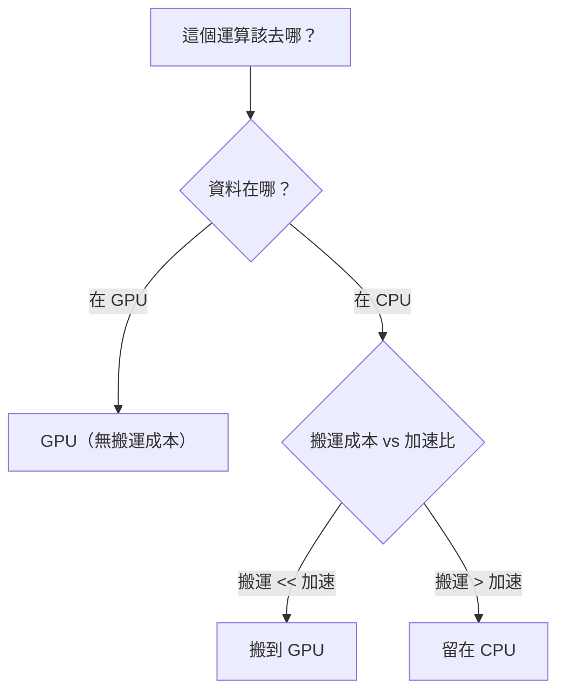
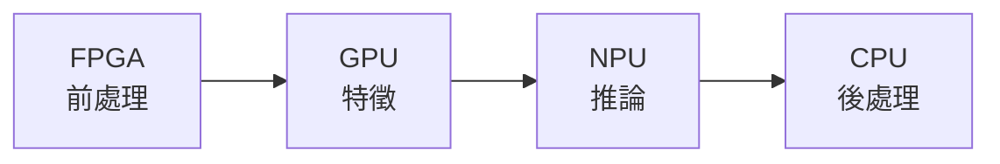

# 8.2　CPU 與 GPU 與 NPU 與 FPGA 的協同決策

> 本節導論：排程器要「把對的計算放到對的裝置」。但「對」的標準是什麼？本節建立一個「裝置適合性」的決策框架，並比較四類裝置的特性。

## 8.2.1 四類裝置的計算模型

要協同決策，先要理解四類裝置的「個性」：

**CPU：通用、低延遲、擅長控制流。**
CPU 是亂序執行（out-of-order）、有複雜的分支預測與快取。它擅長「控制密集」的工作：分支多、資料依賴複雜、需要低延遲的決策。它不擅長「大量同質並行」。

**GPU：SIMT、高吞吐、擅長資料並行。**
GPU 有數千個執行緒，以 warp 為單位同步執行。它擅長「資料並行」：同一個運算套用到大量資料（矩陣、向量、影像）。它的弱點是「分支發散」（warp 內分支不同會降低效率）與「低延遲任務」。

**NPU：脈動陣列、極高能效、擅長密集矩陣。**
NPU 的 PE 陣列專門做矩陣乘加，資料流動如心跳。它擅長「密集的矩陣運算」（神經網路的核心）。它的弱點是「通用性差」：只能做特定的運算，靈活性低。

**FPGA：空間資料流、可重構、擅長低延遲特殊運算。**
FPGA 可以被「接線」成任何電路。它擅長「固定模式、低延遲、特殊運算」：例如自訂的資料壓縮、加密、或需要極低延遲的訊號處理。它的弱點是「開發成本高」（要寫硬體）、「時脈低」。

## 8.2.2 裝置適合性的五個維度

排程器判斷「哪個裝置適合」，要綜合五個維度：

**（1）運算類型（compute type）。**
矩陣乘 → GPU/NPU；分支密集 → CPU；固定模式特殊運算 → FPGA。

**（2）運算強度（arithmetic intensity）。**
計算密集（每 byte 做很多運算）→ GPU/NPU；記憶體密集（每 byte 做很少運算）→ 頻寬是瓶頸，要看哪個裝置的記憶體頻寬高。

**（3）平行度（parallelism）。**
高度可平行（數千執行緒）→ GPU；低平行度（序列依賴）→ CPU。

**（4）延遲要求（latency）。**
低延遲（微秒級）→ CPU 或 FPGA（避免 GPU kernel launch 的毫秒級開銷）；高吞吐 → GPU/NPU。

**（5）能效（energy efficiency）。**
每瓦效能 → NPU（推論）通常最高；FPGA 次之；GPU 再次；CPU 最低。

## 8.2.3 一個決策表

把這些維度整理成一個粗略的決策表：

| 運算特性 | 首選 | 次選 | 說明 |
| --- | --- | --- | --- |
| 密集矩陣乘（大） | NPU/GPU | — | 脈動陣列或 tensor core |
| 密集矩陣乘（小、低延遲） | GPU | CPU | kernel launch 開銷要考慮 |
| 分支密集控制流 | CPU | — | GPU 分支發散代價高 |
| 元素級運算（大量） | GPU | NPU | 記憶體頻寬是瓶頸 |
| 固定模式特殊運算 | FPGA | CPU | 可重構電路的優勢 |
| 極低延遲串流處理 | FPGA | CPU | 硬體管線延遲極低 |
| 稀疏、不規則運算 | CPU | GPU | 難以向量化 |

這張表當然是簡化的（實際要考慮具體硬體參數），但它展示了「協同決策」的基本邏輯：**沒有「最好的裝置」，只有「最適合這個運算的裝置」**。

## 8.2.4 跨裝置的資料搬運成本

「適合性」不是唯一的考量，還有 **「資料在哪」**。把一個運算放到某個裝置，要考慮「把資料搬到那個裝置的成本」。

一個經典的權衡：一個運算在 GPU 上比 CPU 快 10 倍，但資料在 CPU 記憶體，搬到 GPU 要 5 毫秒，運算本身只要 1 毫秒。那「搬到 GPU 再算」總共 6 毫秒，不如「直接在 CPU 算」的 10 毫秒——但若資料本來就在 GPU，就是 1 毫秒，遠勝 CPU。

所以排程器要同時考慮：**運算時間 + 資料搬運時間**。

這也是為什麼「統一記憶體（第 7 章）」如此重要：它把「搬運」變成「存取」，讓排程器不用糾結「搬運成本」。

## 8.2.5 異質管線（heterogeneous pipeline）

更精緻的排程，不是「每個運算選一個裝置」，而是 **「讓多個裝置同時工作」**——形成一條異質管線。

例如，一個影像處理流程：

* **FPGA**：做低延遲的影像前處理（去噪、校正）。
* **GPU**：做大量的矩陣運算（特徵提取）。
* **NPU**：做神經網路推論（分類）。
* **CPU**：做控制邏輯與後處理。

這四個階段可以 **流水線化（pipeline）**：當 FPGA 在處理第 N 幀時，GPU 在處理第 N-1 幀，NPU 在處理第 N-2 幀。這讓總吞吐量由「最慢的階段」決定，而非「四者之和」。

排程器的工作，是「平衡管線」：如果 GPU 是瓶頸，就想辦法把部分工作移到 NPU；如果 FPGA 太慢，就要重構它的電路。

## 8.2.6 協同決策的三個挑戰

**（1）動態性。**
裝置的負載是動態變化的。排程器要「即時」感知負載，並調整決策。這需要低延遲的監測與快速的重新排程。

**（2）異質性的抽象。**
不同裝置的「能力」差異巨大，如何用一個統一的抽象來描述？這是第 1.3 節「能力描述」要解決的。

**（3）決策的解釋性。**
排程決策應該「可解釋」：為什麼這個子圖去了 GPU？這對除錯、調校、建立信任很重要。

## 8.2.7 本節小結

* 四類裝置：CPU（控制流）、GPU（資料並行）、NPU（密集矩陣）、FPGA（低延遲特殊運算）。
* 適合性五維度：運算類型、運算強度、平行度、延遲要求、能效。
* 決策表展示「沒有最好，只有最適合」。
* 跨裝置搬運成本是關鍵考量，統一記憶體能緩解。
* 異質管線：多裝置流水線化，吞吐由最慢階段決定。
* 挑戰：動態性、異質抽象、決策解釋性。

下一節，我們談「排程器與編譯器的閉環」：**為什麼排程決策不能只靠排程器，必須與編譯器協同**。
