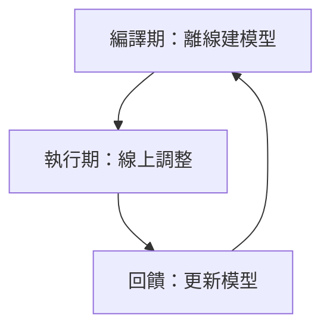

# 8.3　排程器與編譯器的閉環

> 本節導論：排程器要知道「哪個子圖適合哪個裝置」，這需要「成本模型」。而成本模型的來源，正是編譯器。排程器與編譯器必須形成一個閉環。

## 8.3.1 排程器需要什麼資訊

排程器做決策，需要回答「如果我把這個子圖放到這個裝置，要多久？」這個問題。這個「多久」，就是 **成本模型（cost model）**。

成本模型的輸入：
* **子圖的特性**：運算類型、規模、資料依賴、形狀。
* **裝置的特性**：算力、頻寬、延遲、快取大小。
* **資料的位置**：資料在哪個記憶體，搬運成本多少。

成本模型的輸出：
* **預估執行時間**。
* **預估記憶體用量**。
* **預估能效**。

沒有成本模型，排程器就只能「瞎猜」；有了成本模型，排程器才能「理性決策」。

## 8.3.2 成本模型從哪來：編譯器的角色

成本模型從哪來？有兩條路：

**（1）靜態分析（編譯器提供）。**
編譯器在降階時，可以分析每個子圖的「運算量、記憶體存取量」，並結合硬體的「峰值算力、頻寬」，估算執行時間。例如：

$$
T_{\text{compute}} = \frac{\text{FLOPs}}{\text{peak FLOPs} \times \text{efficiency}}, \qquad
T_{\text{memory}} = \frac{\text{Bytes}}{\text{bandwidth}}
$$

實際時間約為 $ \max(T_{\text{compute}}, T_{\text{memory}}) $ （若重疊良好），或兩者之和（若無重疊）。

**（2）實測（profiling）。**
在真實硬體上跑一段，量測實際時間。這比靜態分析準，但成本高（要真的跑），且不適合「預先排程」。

**實際系統通常結合兩者**：用靜態分析做「粗略估計」，用實測做「校正」。

## 8.3.3 編譯器依賴排程器：為什麼是「閉環」

有趣的是，編譯器也依賴排程器。因為：

* **降階策略取決於目標裝置**：如果排程器決定「這個子圖去 GPU」，編譯器就要用 GPU 的降階路徑（`gpu` 方言）；如果去 NPU，就要用 NPU 的降階路徑。
* **最佳化取決於資源**：如果 GPU 記憶體有限，編譯器要更積極地 tiling；如果記憶體充裕，可以少 tiling。

所以形成一個 **閉環（closed loop）**：

這個閉環的意思是：**排程器與編譯器不是「上下游」的單向關係，而是「互相回饋」的循環**。

## 8.3.4 閉環的三個層次

這個閉環可以發生在三個時間尺度：

**（1）編譯期閉環（offline）。**
在部署前，用「離線 profiling」建立成本模型，編譯器據此做降階與排程。這是最常見的。

**（2）執行期閉環（online）。**
在執行時，監測實際效能，動態調整排程。例如「發現 GPU 比預期慢，就把部分子圖移到 NPU」。

**（3）跨版本閉環（evolutionary）。**
每次執行後，把「實際成本」回饋到成本模型，讓下一次的排程更準。這是一種「持續學習」。

## 8.3.5 一個具體的例子：自動調優（auto-tuning）

這個閉環在實務上最著名的實現，是 **自動調優（auto-tuning）**：

* TVM、Ansor、Triton 等框架，會針對一個運算（如矩陣乘），生成多種「排程變體」（不同的 tiling、向量化、平行化策略）。
* 在目標硬體上 **實測** 每個變體的時間。
* 選出最快的變體，並把「這個運算在這種硬體上，用這種排程最快」記入成本模型。

這就是「排程器 + 編譯器 + profiling」的完整閉環。它的代價是「autotuning 的搜尋成本高」，但換來的是「針對具體硬體的最佳化」。

## 8.3.6 MLIR 的角色：讓閉環可組合

MLIR 的設計，讓這個閉環變得「可組合」：

* **轉換（transform）方言**：MLIR 有 `transform` 方言，可以把「排程策略」表達為 IR。這讓「排程決策」本身成為「可被編譯器處理的物件」。
* **Pass 的可組合性**：每個最佳化是獨立的 pass，可以根據排程決策「選擇性地套用」。
* **多層 IR**：不同層級做不同決策，高層做「粗排程」，低層做「細調校」。

這讓「排程器與編譯器的閉環」不再需要「客製化的整合」，而是「用統一的 IR 表達」。

## 8.3.7 閉環的挑戰：收斂與穩定性

閉環系統有一個經典的風險：**「震盪（oscillation）」**。

設想：排程器把工作移到 GPU，GPU 變慢，又移回 CPU，CPU 變慢，又移回 GPU……這種「來回橫跳」會讓系統不穩定。

對策：
* **遲滯（hysteresis）**：只有當「改善足夠大」時才切換，避免微小波動導致切換。
* **冷靜期（cooldown）**：切換後，等一段時間再評估，避免頻繁切換。
* **穩定的成本模型**：用「平滑（smoothing）」的歷史資料，避免被單次異常誤導。

## 8.3.8 本節小結

* 排程器需要成本模型：子圖特性 + 裝置特性 + 資料位置 → 預估時間/記憶體/能效。
* 成本模型兩來源：靜態分析（編譯器）與實測（profiling）。
* 編譯器也依賴排程器（降階策略取決於目標），形成閉環。
* 閉環三層次：編譯期（offline）、執行期（online）、跨版本（evolutionary）。
* 自動調優是閉環的具體實現：生成變體、實測、選最佳、記入模型。
* MLIR 讓閉環可組合：transform 方言、pass 可組合、多層 IR。
* 風險：震盪。對策：遲滯、冷靜期、平滑成本模型。

第 8 章到此，我們建立了「計算圖排程」的原語。下一章，我們談第三個原語，也是收斂的核心：**極小化可信核心（Micro-Verifier Kernel）**。
