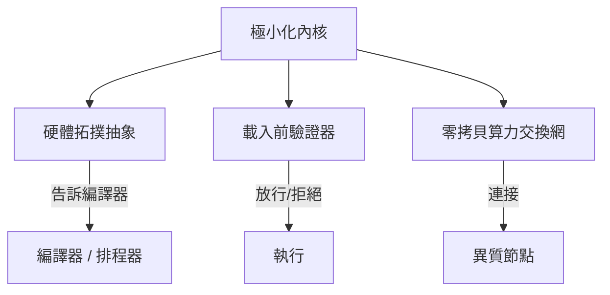

# 9.1　剝離臃腫之後的內核本質

> 本節導論：現代 OS 內核有數百萬行程式碼，大部分是在處理「歷史包袱」。如果把它們一層層剝掉，內核還剩下什麼不變的核心？本節做這個思想實驗。

## 9.1.1 內核為什麼臃腫

一個現代 Linux 內核，程式碼超過三千萬行。這些程式碼大致分佈在：

* **驅動程式**：最大宗，佔一半以上。每一種硬體都要一個驅動。
* **檔案系統**：數十種檔案系統（ext4、Btrfs、XFS、F2FS……）。
* **網路協定棧**：TCP/IP、IPv6、各種協定。
* **安全模組**：SELinux、AppArmor、seccomp。
* **虛擬化**：KVM、各種 virtio 裝置。
* **架構相關**：x86、ARM、RISC-V……每個架構一套。

這些程式碼的總量，遠超「維持系統運作」的必需。它們的存在，是為了「支援多樣的硬體、多樣的需求、多樣的相容性」。

## 9.1.2 臃腫的代價

臃腫不是「佔硬碟空間」這麼簡單，它有三個實質代價：

**（1）攻擊面（attack surface）。**
每一行程式碼都可能是漏洞。三千萬行程式碼，就算漏洞率是每千行一個，也有數萬個潛在漏洞。這是為什麼 Linux 每個月都要發布安全補丁。

**（2）驗證不可能。**
形式化驗證的極限，大約是「幾萬行」。三千萬行的內核，不可能被完整驗證。所以我們只能「信任」它，而不能「證明」它。

**（3）認知負擔。**
沒有人能理解整個內核。這讓「修改內核」變得極其危險——一個小改動可能引發不可預期的連鎖反應。

## 9.1.3 剝離的思想實驗：什麼是「不變的核心」

現在做思想實驗：如果我們把「歷史包袱」一層層剝掉，內核還剩下什麼？

**剝掉驅動**：如果硬體初始化可以由韌體（firmware）或「極小的硬體抽象層」處理，那大部分驅動可以消失。計算路徑由編譯器生成，不走驅動（第 1、3 章）。

**剝掉檔案系統**：如果資料管理用「物件模型」（第 7 章），而非「檔案樹」，那檔案系統的大部分功能（目錄、inode、日誌）可以消失。持久化可以用「簡單的區塊儲存」處理。

**剝掉網路協定棧**：如果「算力交換網（fabric）」用「零拷貝的記憶體共享」而非「TCP/IP 封包」，那協定棧可以大幅簡化（第 9.2.3 節）。

**剝掉 POSIX 抽象**：如果程式用「計算圖 IR」而非「行程 + 系統呼叫」，那行程管理、訊號、fd 表可以消失（第 4、5 章）。

剝完之後，內核剩下什麼？

## 9.1.4 剩下的三件事

剝完歷史包袱，內核只剩下三件 **「本質上必須由特權層做」** 的事：

**（1）硬體拓撲的發現與抽象。**
系統需要知道「有哪些硬體、它們如何連接、各有什麼能力」。這個資訊必須由「能碰硬體」的特權層提供。這是「硬體真相」的來源。

**（2）載入前驗證。**
計算圖 IR 進入執行前，必須被驗證「安全」。這個驗證必須由「可信的執行者」做。這是安全的最後防線。

**（3）跨計算圖的資源仲裁與交換。**
多個計算圖同時要同一張 GPU，需要仲裁。計算圖之間要交換資料，需要一個「零拷貝的交換網」。

這三件事，就是第 9.2 節要詳細談的「三大核心原語」。

## 9.1.5 為什麼這三件事「必須」在內核

有人會問：為什麼不能把這三件事也「上移」到使用者態？

**（1）硬體拓撲**：讀取硬體資訊（如 PCIe 配置空間、ACPI 表、裝置樹）需要特權指令。使用者態無法直接做。

**（2）驗證**：驗證器本身必須「不可被篡改」。如果驗證器在使用者態，惡意程式可以篡改它。所以驗證器必須在「隔離的、可信的」環境，也就是內核。

**（3）資源仲裁**：多個計算圖競爭資源，需要一個「中立的仲裁者」。這個仲裁者不能是「其中一個競爭者」。所以要在內核。

換句話說，這三件事的「必須在內核」，是因為它們都涉及 **「跨越信任邊界」**：硬體、安全、資源分配。這些是「不可委託給不受信任的程式」的職責。

## 9.1.6 「極薄」的量化

「極薄」到底多薄？可以做一個粗略估計：

* **硬體拓撲抽象**：幾百到幾千行（讀取配置、建立描述）。
* **載入前驗證器**：幾千到一萬行（抽象解釋引擎、不變式檢查）。
* **零拷貝交換網**：幾千行（記憶體映射、佇列管理、同步）。

總計：**約一萬到兩萬行**。這與 seL4（約一萬行）量級相當，是「可被形式化驗證」的範圍。

對比 Linux 的三千萬行，這是 **三個數量級的縮減**。

## 9.1.7 這不是「回到微內核」

有人會把這個想法類比為「微內核（microkernel）」。確實有相似之處（把非核心功能移出內核），但有一個關鍵差別：

* **傳統微內核**（如 Mach、QNX）：把檔案系統、驅動、網路棧移到「使用者態的伺服器行程」，但這些伺服器仍然是「傳統的程式」，用「訊息傳遞」與內核通訊。
* **極小化內核**：不只把功能移出，還把「計算路徑」整個交給「編譯器生成的 IR」，把「安全」交給「載入前驗證」，把「儲存」交給「物件模型」。內核不只是「小」，而是「只剩三件事」。

所以「極小化內核」比「微內核」更激進：它不只是「功能外移」，而是「抽象層的重新設計」。

## 9.1.8 本節小結

* 現代內核臃腫（三千萬行），代價是攻擊面大、無法驗證、認知負擔重。
* 剝離思想實驗：剝掉驅動、檔案系統、協定棧、POSIX，剩下三件事。
* 三件事：硬體拓撲抽象、載入前驗證、零拷貝算力交換網。
* 為什麼必須在內核：都涉及跨越信任邊界（硬體、安全、資源）。
* 量化：約一萬到兩萬行，可被形式化驗證，比 Linux 少三個數量級。
* 與微內核的差別：不只功能外移，而是抽象層重新設計（計算給編譯器、安全給驗證、儲存給物件）。

下一節，我們詳細談這三大核心原語的技術內涵。
