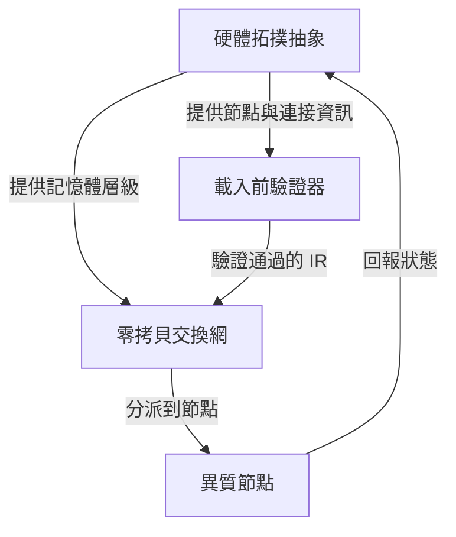

# 9.2　三大核心原語

> 本節導論：極小化內核只剩三件事——硬體拓撲抽象、載入前驗證器、零拷貝算力交換網。本節逐一拆解它們的技術設計。

## 9.2.1 原語一：硬體拓撲抽象

**問題**：編譯器與排程器需要知道「有哪些硬體、如何連接、各有什麼能力」。這些資訊散落在 BIOS/UEFI、ACPI 表、PCIe 配置空間、裝置樹（device tree）裡，格式各異。內核要把這些「原始資訊」轉成「統一的、可查詢的抽象」。

**設計**：一個 **拓撲圖（topology graph）**，用統一的資料結構描述：

```text
topology {
  nodes = [
    { id: 0, kind: cpu,  cores: 64,  isa: x86_64, cache: {...} },
    { id: 1, kind: gpu,  compute: [...], memory: {hbm: 80GiB}, link: {pcie: gen5} },
    { id: 2, kind: npu,  compute: [...], memory: {sram: 256MiB}, link: {...} },
    { id: 3, kind: fpga, lut: 1.3M, dsp: 9000, link: {...} },
  ]
  edges = [
    { from: 0, to: 1, kind: pcie, bw: "64GB/s", latency: "~1us" },
    { from: 0, to: 2, kind: onchip, bw: "1TB/s", latency: "~100ns" },
    { from: 1, to: 2, kind: nvlink, bw: "900GB/s", latency: "~500ns" },
  ]
}
```

這個拓撲圖的關鍵特性：

* **節點（node）**：每個算力單元是一個節點，帶能力描述（第 1.3 節）。
* **邊（edge）**：節點之間的連接，帶頻寬與延遲。
* **可查詢**：編譯器與排程器可以查詢「從 A 到 B 的搬運成本」。

**為什麼在內核**：讀取硬體配置需要特權指令（如 x86 的 `rdmsr`、存取 PCIe 配置空間）。且拓撲是「全域真相」，不該被個別程式篡改。

## 9.2.2 原語二：載入前驗證器（Verifier）

**問題**：計算圖 IR 進入執行前，必須被證明「安全」：記憶體不越界、迴圈有界、資源不超支、不呼叫非法操作。這個證明必須「快」（毫秒級）、「可靠」（不放過危險程式）、「可終止」（不無限分析）。

**設計**：一個 **抽象解釋引擎**，對 IR 做靜態分析（第 6.2 節）：

* **型別追蹤**：追蹤每個值的型別與形狀（`tensor<4x8xf32>`）。
* **範圍分析**：追蹤每個索引的範圍，確認在張量邊界內。
* **迴圈有界**：確認 `scf.for` 的上界是常數或有明確上界。
* **資源預算**：計算峰值記憶體用量，確認不超支。
* **呼叫檢查**：確認只呼叫允許的 intrinsic / helper。

```text
verify(graph) {
  for each op in graph.topo_order() {
    check_types(op)
    check_bounds(op, known_ranges)
    check_resources(op, budget)
    update_abstract_state(op)
  }
  assert all_loops_bounded(graph)
  assert memory_peak <= budget
}
```

**帶證明的變體（Proof-Carrying IR）**：更高階的設計，是讓 IR 攜帶「安全性證明」，驗證器只檢查證明有效性（第 6.3.4 節）。這比「從頭分析」快得多，但需要生成器能產出證明。

**為什麼在內核**：驗證器本身是「信任根」，必須不可篡改。且驗證結果決定「程式能不能跑」，這是一個安全決策，不能交給不受信任的程式。

## 9.2.3 原語三：零拷貝算力交換網（Fabric）

**問題**：計算圖之間、節點之間要交換資料。傳統方式（拷貝、封包）有成本。新方式要用「共享記憶體 + 零拷貝」交換。

**設計**：一個 **交換網（fabric）**，建立在統一記憶體之上：

* **共享記憶體池**：所有節點共享一個位址空間（第 7 章）。
* **物件傳遞**：節點之間傳遞「物件句柄（handle）」，而非「資料副本」。
* **零拷貝**：接收方直接存取同一塊記憶體，不拷貝。
* **同步機制**：用輕量的「就緒旗標（ready flag）」或「事件（event）」通知。


**與網路協定棧的對比**：

* 傳統 TCP/IP：把資料切成封包、加標頭、走協定棧、重組。這套是為「不可靠的網路」設計的。
* 交換網：資料直接在共享記憶體中，用「物件句柄 + 同步」交換。沒有封包、沒有協定棧、沒有重組。

**為什麼在內核**：共享記憶體的映射、跨節點的同步，涉及「資源分配與隔離」，需要一個「中立的仲裁者」。而且交換網是「跨計算圖」的基礎設施，不能由單一程式控制。

## 9.2.4 三者的協同

這三個原語不是孤立的，而是協同工作：



* **拓撲抽象**提供「有哪些資源」。
* **驗證器**確認「這個計算圖能用這些資源安全執行」。
* **交換網**負責「把資料在節點之間流動」。

一個計算圖的生命週期：

1. 進來，查拓撲（知道有哪些節點）。
2. 驗證（確認安全、資源足夠）。
3. 排程（決定子圖去哪）。
4. 執行（透過交換網傳資料）。
5. 完成（釋放資源）。

## 9.2.5 為什麼是「這三個」

讀者可能會問：為什麼剛好是這三個原語，而不是別的？

答案是：**這三個原語，剛好對應「三種不可委託給不受信任程式的職責」**：

* **拓撲抽象** → 「知道真相」的職責（誰能碰硬體）。
* **驗證** → 「判斷安全」的職責（誰能決定放行）。
* **交換網** → 「仲裁資源」的職責（誰能分配共享記憶體）。

其他一切——計算、記憶體配置、排程、儲存——都可以「上移」到編譯器、排程器、物件模型。只有這三件事，因為涉及「信任邊界」，必須留在內核。

這是一個 **「最小充分集（minimal sufficient set）」**：不能再少（少了就不安全），也不需要更多（多了就臃腫）。

## 9.2.6 與現有系統的對照

| 原語 | 現有系統的對應 | 差別 |
| --- | --- | --- |
| 拓撲抽象 | ACPI、device tree、sysfs | 統一、可查詢、帶能力與連接成本 |
| 驗證器 | eBPF Verifier、seccomp | 針對 IR、毫秒級、可帶證明 |
| 交換網 | RDMA、共享記憶體 IPC | 零拷貝、物件導向、跨異質節點 |

現有系統有「零件」，但沒有「整合」。極小化內核的價值，是把這些零件「整合成三個乾淨的原語」。

## 9.2.7 本節小結

* 原語一（拓撲抽象）：統一的拓撲圖，描述節點、連接、能力、成本。
* 原語二（驗證器）：抽象解釋引擎，毫秒級證明安全，可帶證明。
* 原語三（交換網）：共享記憶體 + 物件句柄 + 零拷貝 + 輕量同步。
* 三者協同：拓撲提供資源、驗證確認安全、交換網流動資料。
* 為什麼是這三個：對應「知道真相、判斷安全、仲裁資源」三種不可委託的職責，是最小充分集。
* 與現有系統對照：有零件，但極小化內核把它整合成三個原語。

下一節，我們談「可形式化驗證的微內核設計」：**如何讓這一萬多行，真的被數學證明是對的**。
