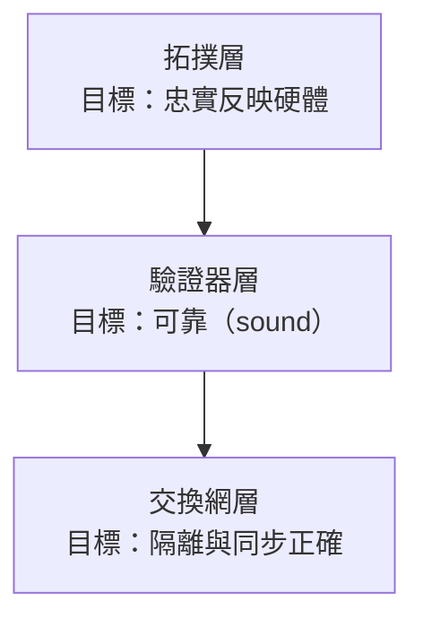

# 9.3　可形式化驗證的微內核設計

> 本節導論：極小化內核只有一萬多行，但「小」不等於「對」。要讓它可信，必須「可被形式化驗證」。本節談怎麼設計一個「可驗證」的內核。

## 9.3.1 「可驗證」是一個設計約束

形式化驗證不是「寫完程式再補證明」，而是 **「從設計的第一天就把可驗證性當成約束」**。這意味著：

* **簡單（simplicity）**：越簡單的程式，越容易證明。所以要用最少的機制、最少的狀態。
* **分層（layering）**：把系統分成「可獨立驗證的層」，每層有明確的介面與不變式。
* **明確（explicitness）**：所有狀態都要「顯性」，不能有隱性的假設。
* **無動態（minimal dynamism）**：避免動態配置、反射、eval 這類「難以靜態推理」的機制。

這些約束，與第 2 章「消除隱性狀態」、第 4 章「無狀態」、第 5 章「IR 作為介面」的方向完全一致。**可驗證性不是額外的要求，它是「好的系統設計」的自然結果**。

## 9.3.2 seL4 的啟示：可驗證微內核長什麼樣

seL4 是「可驗證微內核」的標竿。它的設計選擇值得學習：

* **極小的核心**：只提供「執行緒、位址空間、IPC、能力（capability）」四種機制。其他一切（驅動、檔案系統）在使用者態。
* **能力為基礎的安全（capability-based security）**：每個資源存取都需要「能力（capability）」——一個不可偽造的權杖。這比「權限檢查」更精確、更可驗證。
* **事件驅動的核心**：核心只在使用者請求或中斷時執行，沒有背景的「守護執行緒」。
* **明確的記憶體管理**：記憶體由使用者態的「記憶體管理器」分配，核心只負責「映射」。

seL4 的功能正確性證明，證明了「C 實作」與「抽象規格」一致。這花了數年、數十人年，但它證明了「一個真正的微內核可以被完整驗證」。

## 9.3.3 極小化內核的驗證策略

極小化內核（三個原語）的驗證，可以分層進行：

**（1）拓撲抽象層。**
驗證目標：**「拓撲圖是硬體真相的忠實反映」**。這較難（涉及硬體），但可以「信任韌體」來簡化——假設韌體提供的資訊是正確的，只驗證「解析邏輯」正確。

**（2）驗證器層。**
驗證目標：**「驗證器是可靠的（sound）」**——它不會把危險程式判為安全。這是「驗證器的驗證（verifier verification）」，是整個系統的信任根。可用 Coq/Isabelle 形式化。

**（3）交換網層。**
驗證目標：**「記憶體隔離與同步正確」**——生產者與消費者的資料不會互相干擾，同步不會死鎖。這可以用模型檢查（model checking）或分離邏輯（separation logic）驗證。

## 9.3.4 驗證器的驗證：最關鍵的一環

整個系統的信任，最終落在「驗證器」上。如果驗證器有 bug，它可能「誤放」危險程式，那整個安全模型就崩潰了。

所以 **「驗證器本身必須被形式化驗證」**。這是「信任根收斂」的終極體現（第 6.3.7 節）：

* 驗證器要證明：**「如果 verify(P) = accept，則 P 滿足安全性質 S」**。
* 這是一個「驗證器的可靠性定理（soundness theorem）」。
* 一旦證明，我們就可以「信任」驗證器——不需要信任「每個被驗證的程式」。

這就是為什麼極小化內核值得被形式化驗證：**它是「一次驗證、多次使用」的槓桿**。驗證器被證明一次，就能安全地驗證無數個 AI 生成的程式。

## 9.3.5 從「功能正確」到「安全性質」

形式化驗證有兩種層次：

**（1）功能正確性（functional correctness）。**
證明「程式做了它該做的事」。seL4 證明的是這個。

**（2）安全性質（security properties）。**
證明「程式不會做它不該做的事」。對驗證器而言，這更重要。

對極小化內核，我們需要的是「安全性質」的證明：
* 驗證器：不會誤放危險程式。
* 交換網：不會讓一個計算圖讀到另一個的資料。
* 拓撲層：不會回報錯誤的硬體資訊。

「安全性質」通常比「功能正確性」容易證明，因為它只需要證明「某些壞事不會發生」，不需要證明「所有好事都會發生」。

## 9.3.6 驗證的成本與現實路徑

必須誠實：完整形式化驗證的成本極高。一個現實的路徑是 **「漸進式驗證」**：

**階段一：隔離驗證（isolate & verify）。**
先把「驗證器」獨立出來，用形式化方法驗證它。其他部分（拓撲、交換網）先用測試與靜態分析。

**階段二：介面驗證（interface verification）。**
驗證「原語之間的介面」正確：拓撲層提供的資訊，驗證器正確使用；驗證器放行的程式，交換網正確隔離。

**階段三：整合驗證（integration verification）。**
把三者整合，證明「整個系統」滿足端到端的安全性質。

這個漸進路徑，讓「可驗證性」不是「全有或全無」，而是「逐步累積」。

## 9.3.7 可驗證性與效能的張力

「可驗證」與「高效能」有時衝突：

* 可驗證的設計偏好「簡單、靜態、顯性」；高效能的設計偏好「複雜、動態、快取」。
* 例如，「能力為基礎的安全」每次存取都要檢查能力，比「裸指標」慢。

但這個張力，在「驗證器」這個場景反而較小：驗證器是「載入前」執行的，它的效能不影響「執行時」的效能。執行時的高效能，靠的是「編譯器生成的最佳化程式碼」，而非「驗證器」。

所以「可驗證的內核 + 高效能的編譯器」是一個好的分工：**內核求「可證明正確」，編譯器求「極致效能」**。

## 9.3.8 本節小結

* 「可驗證」是設計約束：簡單、分層、明確、無動態。
* seL4 的啟示：極小核心、能力安全、事件驅動、明確記憶體管理。
* 驗證策略分層：拓撲層（忠實反映硬體）、驗證器層（可靠）、交換網層（隔離同步）。
* 驗證器的驗證是最關鍵：證明「accept 則安全」，是信任根收斂的體現。
* 從「功能正確」到「安全性質」，安全性質較易證明。
* 現實路徑：漸進式驗證（隔離→介面→整合）。
* 可驗證與效能的張力：內核求可證明正確，編譯器求極致效能。

第 9 章到此，我們完成了第三部「新原語」的論證。第四部轉向「路線」：第 10 章談演化派——如何在 Linux 內部長出新器官。
