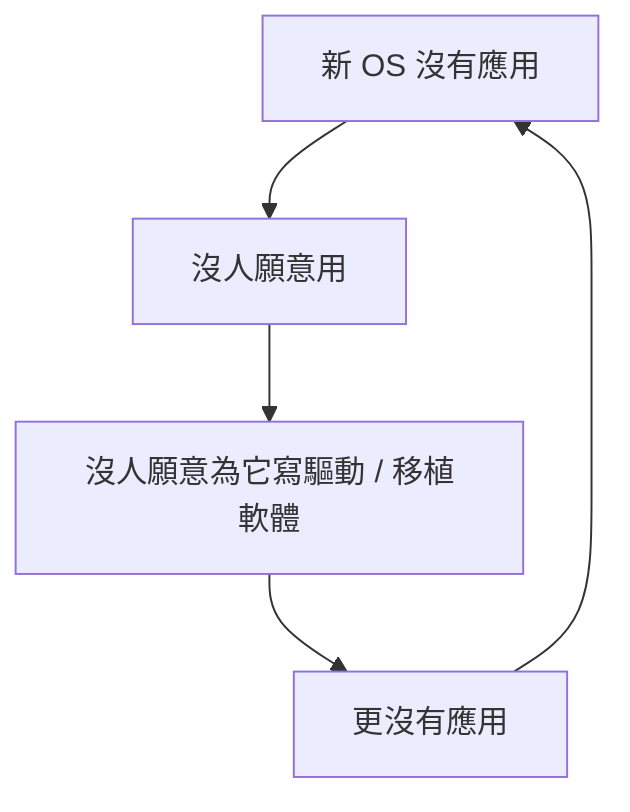

# 10.1　為什麼離不開 Linux 生態

> 本節導論：既然舊抽象層問題重重，為什麼不直接重寫一個新 OS？因為 Linux 有一道巨大而現實的護城河——生態。本節解剖這道護城河的四道牆。

## 10.1.1 護城河一：硬體驅動

Linux 支援的硬體種類，是任何新 OS 難以企及的：

* 從資料中心的大型主機、GPU、DPU，到嵌入式裝置、手機、路由器。
* 數萬種驅動程式，涵蓋每一種晶片、每一種介面。
* 廠商願意為 Linux 寫驅動（因為市佔率高），但不太願意為新 OS 寫。

這形成一個 **「雞生蛋、蛋生雞」** 的正回饋：Linux 市佔高 → 廠商寫驅動 → Linux 支援更多硬體 → 市佔更高。

一個新 OS 要支援同樣的硬體，得重寫數萬個驅動，這是幾十年、數萬人年的工程。歷史上，BeOS、Plan 9、Haiku 等新 OS 都死在這裡。

## 10.1.2 護城河二：網路協定棧

Linux 的網路協定棧（TCP/IP、IPv6、QUIC、各種 offload）經過數十年的調校，效能與相容性都是標竿。它支援：

* 各種網路硬體（從 1G 到 400G、從 Ethernet 到 InfiniBand）。
* 各種協定擴充（TCP BBR 擁塞控制、TLS offload、XDP）。
* 與雲端基礎設施的深度整合（Kubernetes、容器網路）。

重寫一個網路棧不難（有很多教學專案），但要「重寫一個在生產環境可靠、效能達標的網路棧」極難。這是新 OS 的第二道牆。

## 10.1.3 護城河三：雲原生與容器生態

Linux 是雲端的事實標準。整個雲原生生態——Docker、Kubernetes、containerd、eBPF 工具、可觀測性工具——都建立在 Linux 的核心特性上（namespace、cgroup、seccomp、eBPF）。

一個新 OS 即使技術上更先進，也要面對「整個雲原生工具鏈不相容」的問題。企業不會為了「技術先進」而放棄整個生態。

## 10.1.4 護城河四：人才與知識

Linux 有全球最大的作業系統開發者社群、最多的文件、最多的 Stack Overflow 答案、最多的大學課程。一個新 OS 要培養同樣的人才池，需要數十年。

這道牆最隱形，也最難跨越：**技術可以追趕，人才與知識的慣性極難改變**。

## 10.1.5 冷啟動魔咒

把四道牆合起來，就是「新 OS 的冷啟動魔咒」：

歷史上，無數技術上更優秀的 OS 死在這個循環裡：

* **Plan 9**（貝爾實驗室，1990s）：設計優雅（以檔案為萬物介面），但沒有應用生態。
* **BeOS**（1990s）：多媒體效能優秀，但驅動與應用不足。
* **Haiku**（BeOS 開源後繼）：至今仍是小眾。
* **Fuchsia**（Google，2016–）：技術先進（微內核 Zircon），但生態仍在早期。

**技術優秀不是充分條件，生態才是**。

## 10.1.6 所以：演化派的務實選擇

面對這道護城河，演化派的選擇是：**不重寫，而是在 Linux 內部「長出新器官」**。

具體策略是：

* **保留**：Linux 的驅動、網路棧、雲原生生態（這些是不可替代的護城河）。
* **架空**：把「計算路徑」從傳統 POSIX 路徑，轉移到「繞過內核」的新路徑（eBPF、io_uring、VFIO、Unikernel）。
* **漸進**：不要求「一次革命」，而是「逐步讓舊路徑變成純粹的初始化與控制面」。

這個策略的精髓是 **「體內寄生」**：新機制在舊系統內部生長，逐步取代舊機制的功能，而不需要「殺死宿主」。

## 10.1.7 為什麼這條路可行

演化派之所以可行，是因為 Linux 提供了「讓新機制生長的空間」：

* **可擴充的內核**：eBPF 讓使用者可以在內核裡跑「經過驗證的程式」，不需修改內核。
* **可繞過的路徑**：io_uring、VFIO、DPDK 讓使用者可以「繞過」傳統的系統呼叫與驅動。
* **可裁剪的核心**：Unikernel 讓 OS 與應用編譯成一體，去掉不需要的部分。

這些機制，讓「新 OS 的思想」可以在「舊 OS 的殼」裡實現。這是演化派的核心洞見。

## 10.1.8 本節小結

* 四道護城河：硬體驅動、網路協定棧、雲原生生態、人才與知識。
* 冷啟動魔咒：沒有應用 → 沒人用 → 沒人移植 → 更沒應用。
* 歷史教訓：Plan 9、BeOS、Haiku、Fuchsia 技術優秀但生態難。
* 演化派策略：保留護城河、架空計算路徑、漸進演化。
* 「體內寄生」：新機制在舊系統內生長，逐步取代舊機制。
* 可行性：Linux 提供可擴充（eBPF）、可繞過（io_uring/VFIO）、可裁剪（Unikernel）的空間。

下一節，我們逐一拆解「體內寄生」的四個具體技術：eBPF、io_uring、VFIO、Unikernel。
