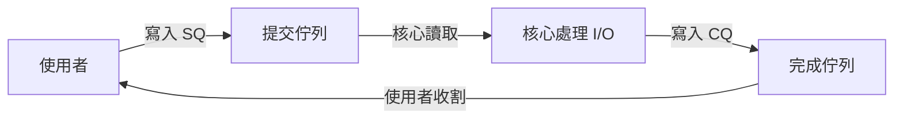
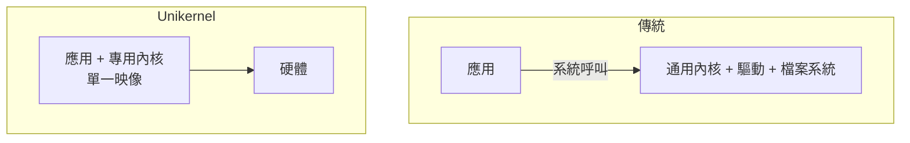
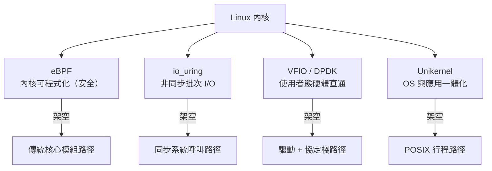

# 10.2　體內寄生：eBPF 與 io_uring 與 VFIO 與 Unikernel

> 本節導論：演化派的四把刀，各自攻陷一個舊抽象層的弱點。本節拆解它們的機制，以及它們如何「架空」傳統 POSIX 路徑。

## 10.2.1 eBPF：內核可程式化驗證

**攻陷的弱點**：核心態程式設計的門檻太高——要寫核心模組、要重編譯核心、一個 bug 就毀掉系統。

**機制**：eBPF 允許使用者載入「經過驗證的程式」到核心執行（第 6.2 節）。它的關鍵是 **驗證器**：確保程式安全後才放行。

**架空的舊路徑**：
* 傳統：為了「在核心裡做某事」（如封包過濾、系統呼叫追蹤），要寫核心模組。
* eBPF：用 eBPF 程式，掛在 hook 點（如 XDP、kprobe、tracepoint）上執行。

**範圍**：網路（XDP 做高速封包處理）、安全（seccomp-like 過濾）、觀測（tracing）、甚至排程（sched_ext，Linux 6.12 引入，允許用 eBPF 寫排程器）。

eBPF 的意義：它讓「內核可程式化」變成「安全的、可驗證的」，打破了「核心態程式設計高不可攀」的狀態。它是「載入前驗證」哲學在 Linux 內部的第一次大規模落地。

## 10.2.2 io_uring：零系統呼叫非同步 I/O

**攻陷的弱點**：傳統 I/O 是「同步 + 系統呼叫密集」——每個 `read`/`write` 都是一次系統呼叫，高頻 I/O 時成本累積。

**機制**：io_uring 是 Jens Axboe 於 2019 年（Linux 5.1）引入的非同步 I/O 框架。核心是兩個 **環形緩衝區（ring buffer）**，由使用者與核心共享：

* **提交佇列（SQ, submission queue）**：使用者把 I/O 請求放進去。
* **完成佇列（CQ, completion queue）**：核心把完成的結果放進去。

使用者透過「批次提交」與「批次收割」與核心互動。在理想情況下，**一次系統呼叫可以提交/收割多個 I/O**，甚至可以用「輪詢模式（SQPOLL）」完全避免系統呼叫。

**架空的舊路徑**：傳統 `read`/`write` 或 `epoll` 的「同步逐次」路徑，被「非同步批次」的 ring buffer 路徑取代。

io_uring 的意義：它把「系統呼叫的邊界跨越成本」用「共享記憶體的 ring buffer + 批次」攤平，是「零系統呼叫」哲學的具體實踐。

## 10.2.3 VFIO / Kernel-bypass：使用者態硬體直通

**攻陷的弱點**：傳統驅動把硬體藏在核心態，使用者只能透過系統呼叫間接操作，成本高。

**機制**：

* **VFIO（Virtual Function I/O）**：Linux 的核心框架，允許把裝置「直通」給使用者態程式（或虛擬機）。使用者態可以直接存取裝置的 MMIO 暫存器與 DMA，不需要系統呼叫。
* **UIO**：更輕量的使用者態 I/O 框架。
* **DPDK（Data Plane Development Kit）**：Intel 主導的框架，讓使用者態程式「完全接管」網路卡，繞過核心協定棧。

這類技術的統稱是 **「核心旁路（kernel bypass）」**：把裝置的控制權從核心「借」給使用者態，讓使用者直接操作硬體。

**架空的舊路徑**：傳統「系統呼叫 → 驅動 → 裝置」的路徑，被「使用者態直接操作裝置」的路徑取代。核心退化成「只負責初始化與權限授予」。

## 10.2.4 Unikernel：OS 與應用一體化

**攻陷的弱點**：傳統 OS 是一個「通用的、多工的、為多種應用服務」的龐然大物，單一應用跑在上面，要背負大量不需要的抽象（多行程、檔案系統、通用驅動）。

**機制**：Unikernel 把「OS 與應用」編譯成 **一個單一的、專用的映像**。它只包含「這個應用需要的」程式碼：

* 沒有行程隔離（因為只有一個應用）。
* 沒有通用檔案系統（用專用的儲存抽象）。
* 沒有系統呼叫邊界（因為 OS 與應用在同一特權層）。

代表專案：MirageOS（2013）、IncludeOS、Unikraft。

**架空的舊路徑**：整個 POSIX 的「行程 + 系統呼叫 + 通用抽象」路徑，被「應用與內核一體化」取代。

Unikernel 的意義：它是「極薄執行底座」的最直接體現——把 OS 削到「只剩這個應用需要的部分」，系統呼叫邊界消失。

## 10.2.5 四把刀的協同：一張圖

四把刀各自攻陷一個舊路徑：

* **eBPF** 架空「核心模組」。
* **io_uring** 架空「同步系統呼叫」。
* **VFIO/DPDK** 架空「驅動 + 協定棧」。
* **Unikernel** 架空「POSIX 行程」。

合起來，傳統 POSIX 路徑被「架空」成 **「純粹的資源初始化與控制面」**：核心只負責「開機、初始化硬體、授予權限」，然後把「計算與 I/O」全部交給繞過核心的新路徑。

## 10.2.6 「架空」而非「取代」

需要強調：這四把刀不是「取代」Linux，而是「架空」它。Linux 仍然在：

* 驅動硬體（初始化、電源管理、熱插拔）。
* 提供生態（容器、Kubernetes、工具鏈）。
* 提供安全基礎（能力、namespace、cgroup）。

被架空的，只是「計算與 I/O 的資料路徑」。這正是「體內寄生」的精髓：**宿主還在，寄生者接管了宿主的關鍵功能**。

## 10.2.7 本節小結

* eBPF：內核可程式化驗證，架空「核心模組」路徑。
* io_uring：非同步批次 I/O，架空「同步系統呼叫」路徑。
* VFIO/DPDK：使用者態硬體直通，架空「驅動 + 協定棧」路徑。
* Unikernel：OS 與應用一體化，架空「POSIX 行程」路徑。
* 四把刀協同：傳統 POSIX 路徑被架空成「資源初始化與控制面」。
* 「架空」而非「取代」：Linux 仍在（驅動、生態、安全），只是資料路徑被接管。

下一節，我們誠實面對這個策略的極限：**當「每件事都要繞過傳統內核才能變快」時，這顆巨型內核還剩下多少存在的必要**。
