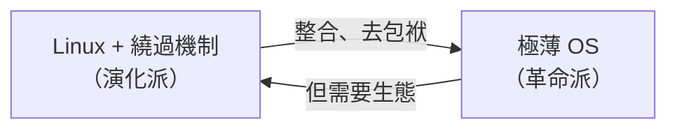

# 10.3　漸進演化的天花板

> 本節導論：演化派很務實，但務實不等於沒有極限。本節誠實檢視「體內寄生」策略的內在矛盾與天花板。

## 10.3.1 天花板一：繞過得越多，內核越像遺跡

「體內寄生」的邏輯是：**每當傳統路徑太慢，就繞過它**。

* 系統呼叫太慢 → io_uring 繞過。
* 驅動太慢 → VFIO 繞過。
* 協定棧太慢 → DPDK 繞過。
* 行程太慢 → Unikernel 繞過。

但這個邏輯有一個內在矛盾：**繞過得越多，被繞過的內核就越像一個「只負責開機的遺跡」**。如果計算、I/O、網路、儲存全部繞過核心，那核心還剩下什麼？

答案是「資源初始化與控制面」。但「資源初始化」是一次性的（開機時做），「控制面」是低頻的。這意味著 **核心在系統的穩定狀態下，幾乎不參與任何事**。

一個「幾乎不參與任何事」的核心，還有存在的必要嗎？這不是修辭問題，而是工程問題：如果核心只剩「開機 + 授權」，那它是不是可以更小、更簡單、甚至被替換？

## 10.3.2 天花板二：繞過路徑的碎片化

每次「繞過」都是「一個獨立的、特化的機制」：

* io_uring 有自己的 ring buffer。
* VFIO 有自己的裝置直通。
* DPDK 有自己的輪詢模式。
* eBPF 有自己的驗證器。

這些機制 **彼此之間不統一**：它們各自解決一個問題，但沒有「共同的抽象」。這導致：

* **碎片化**：使用者要學多套 API、多套模型。
* **重複**：每個機制都重新發明「環形緩衝區」「非同步」「輪詢」。
* **難以組合**：io_uring 的非同步，與 VFIO 的直通，如何組合？需要客製化整合。

這正是第 1 章批評驅動模型時的同一種問題：**「每個裝置重新發明自己的命令語言」**。繞過機制也在重新發明自己的介面。

## 10.3.3 天花板三：內核的安全邊界仍在

演化派無法擺脫的一件事是：**安全的最終防線，仍由內核負責**。

即使計算、I/O 都繞過核心，核心仍然是：

* 「授予權限」的仲裁者（誰能存取哪個裝置）。
* 「隔離」的執行者（namespace、cgroup、能力）。
* 「驗證」的信任根（eBPF 驗證器在核心）。

這意味著：**內核的程式碼仍然是「必須被信任」的**。而 Linux 內核有三千萬行，其中大部分（驅動、檔案系統）是「不需要被信任、但仍在核心態」的程式碼。

這就是矛盾：**你想繞過內核的「計算路徑」，但你繞不過內核的「信任邊界」**。而這個信任邊界，因為三千萬行的臃腫，仍然是巨大的攻擊面。

## 10.3.4 天花板四：演化速度與歷史包袱

Linux 的演化速度，受制於「向後相容」的承諾。任何改變，都要考慮「會不會破壞現有程式」。

* 一個系統呼叫的語意不能改（因為有程式依賴它）。
* 一個 ABI 不能改（因為有二進位相容性）。
* 一個行為不能改（因為有應用依賴它）。

這種「向後相容」的承諾，是 Linux 成功的基礎，也是它無法「重新設計抽象層」的根本原因。演化派只能在「相容的框架內」加東西，不能「重新設計」。

所以演化派的天花板是：**它永遠無法擺脫 1970 年代的抽象層，只能在上面疊加新機制**。

## 10.3.5 一個思想實驗：把繞過機制「整合成新 OS」

設想把演化派的所有繞過機制，整合起來，去掉 Linux 的歷史包袱，會得到什麼？

* 計算：計算圖 IR + 編譯器降階（不是系統呼叫）。
* I/O：非同步 ring buffer（不是同步 read/write）。
* 硬體：使用者態直通（不是核心驅動）。
* 隔離：載入前驗證（不是行程隔離）。

這不就是本書第 3 部描述的「極小化內核 + 三大原語」嗎？

換句話說：**演化派的終點，就是革命派的起點**。當你把所有繞過機制整合、去掉歷史包袱，你得到的就是一個「新的、極薄的 OS」。

這個觀察很重要：演化與革命不是對立，而是「同一條路的兩個階段」。演化派把「繞過機制」種進 Linux，革命派把「繞過機制」抽出來組成新 OS。

## 10.3.6 演化派的價值：不是白費

即使有天花板，演化派仍然有巨大價值：

* **它是現實的最佳解**：在「不能放棄生態」的約束下，它最大化地提升了效能與靈活性。
* **它是新 OS 的「試驗場」**：eBPF、io_uring、VFIO 這些機制，驗證了「載入前驗證」「非同步批次」「使用者態直通」的可行性，為新 OS 提供了「已被驗證的零件」。
* **它是「漸進遷移」的路徑**：企業可以先採用演化派，逐步把工作負載遷移到新機制，最終可能過渡到新 OS。

所以演化派不是「錯誤的路」，而是「現實的路」。它的天花板，正是革命派的動力。

## 10.3.7 本節小結

* 天花板一：繞過得越多，內核越像遺跡（只剩開機與授權）。
* 天花板二：繞過機制碎片化（各自發明介面，難以組合）。
* 天花板三：安全邊界仍在內核（三千萬行的信任邊界）。
* 天花板四：向後相容的承諾，讓它無法重新設計抽象層。
* 思想實驗：整合繞過機制、去包袱，就得到極薄 OS——演化派的終點就是革命派的起點。
* 演化派的價值：現實最佳解、新 OS 的試驗場、漸進遷移路徑。

第 10 章到此，我們完成了「演化派」的分析。下一章，我們轉向「革命派」：**如果今天重新發明作業系統，它會長什麼樣**。
