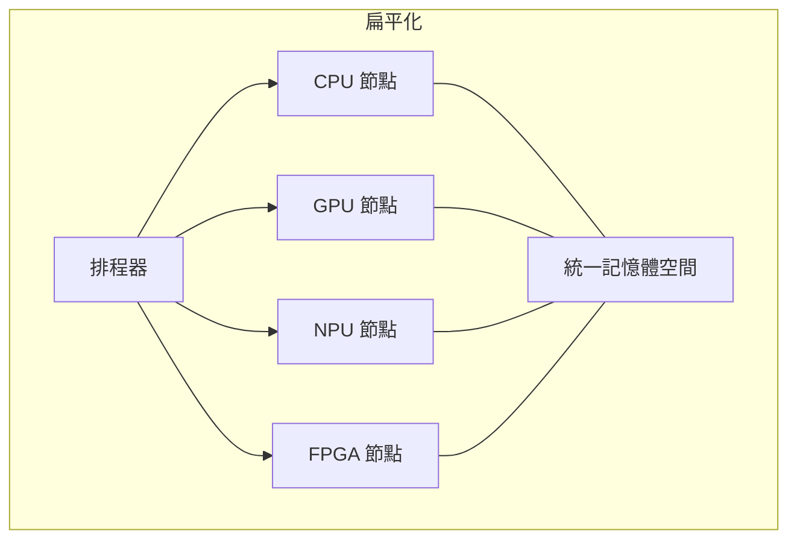
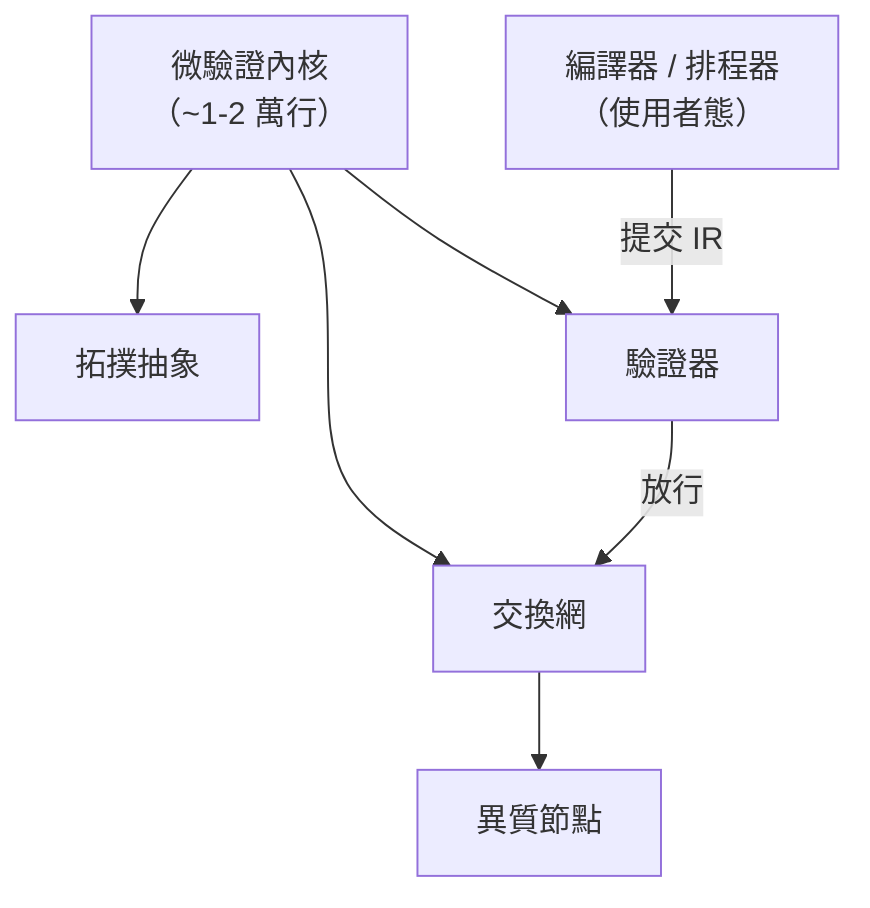
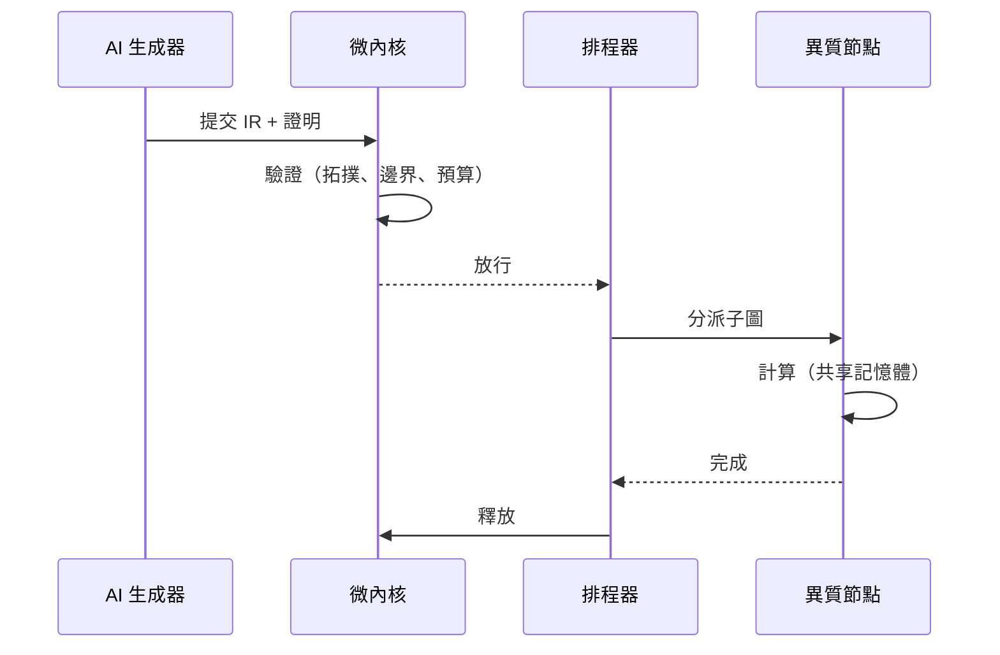

# 11.2　原生設計藍圖：IR 執行介面與扁平化記憶體

> 本節導論：把前面九章的結論，組裝成一個「乾淨重新設計」的 OS 藍圖。本節描述它的三個核心設計。

## 11.2.1 設計一：原生 IR 執行介面

**核心主張**：系統唯一接受的「執行檔」，是 **經過驗證的計算圖 IR**（或帶證明的 IR）。

這意味著：

* 沒有 ELF、沒有動態連結、沒有「機器碼執行檔」。
* 程式的「單位」是計算圖，而非「行程」。
* 系統啟動一個程式，不是「fork + exec + 載入映像」，而是「驗證 IR + 排程子圖 + 執行」。

```text
// 系統接受的「執行檔」就是一份 IR
module {
  func.func @main(%input: tensor<?x?xf32>) -> tensor<?x?xf32> {
    %w = tensor.constant dense<...> : tensor<?x?xf32>
    %0 = linalg.matmul ins(%input, %w : ...) outs(...) -> tensor<?x?xf32>
    %1 = linalg.relu ins(%0 : ...) outs(...) -> tensor<?x?xf32>
    return %1 : tensor<?x?xf32>
  }
}
```

**為什麼是 IR**（第 5 章）：
* 保留高階語意（可降階到多種硬體）。
* 可驗證（結構化、SSA、明確型別）。
* 可組合（可重寫、可融合）。
* 可攜帶證明（Proof-Carrying IR）。

**與傳統執行檔的差別**：

| 面向 | 傳統 ELF | 原生 IR |
| --- | --- | --- |
| 內容 | 機器碼 | 計算圖 |
| 綁定 | 特定架構 | 與目標無關（降階時綁定） |
| 驗證 | 無（只能執行時隔離） | 載入前驗證 |
| 隔離 | 行程 + 頁表 | 驗證 + 輕量沙箱 |
| 啟動 | fork/exec/動態連結 | 驗證 + 排程 |

## 11.2.2 設計二：硬體與記憶體扁平化

**核心主張**：CPU、GPU、NPU、FPGA 作為 **對等算力節點**，直接掛載在 **統一記憶體空間** 上，沒有 Host/Device 之分。

這意味著：

* **沒有「主機」與「裝置」的區分**：所有節點都是「對等的算力節點」，都能被排程器直接調度。
* **單一位址空間**：所有節點的記憶體，在同一個位址空間裡（第 7 章）。沒有 `memcpy`。
* **物件即位址**：資料是「帶生命週期的張量物件」，不是「檔案」或「裸位址」。



**為什麼扁平化**（第 1、7 章）：
* 消除「雙軌制」的拷貝稅。
* 讓排程器能「跨節點」自由調度。
* 讓「物件」可以在節點之間流動，無需轉換。

## 11.2.3 設計三：極致確定性與微驗證內核

**核心主張**：OS 的核心，是 **幾千行、可形式化驗證的微內核**，專門負責「算力拓撲調度」與「硬體安全邊界」。

它只做三件事（第 9 章）：

* **硬體拓撲抽象**：告訴排程器「有哪些節點、如何連接、成本多少」。
* **載入前驗證器**：確認進入執行的 IR 安全。
* **零拷貝算力交換網**：讓節點之間共享資料。



**為什麼是微內核**（第 9 章）：
* 小到可被形式化驗證（信任根收斂）。
* 只保留「不可委託給不受信任程式」的職責。
* 其餘一切（計算、排程、儲存）上移到使用者態的編譯器與排程器。

## 11.2.4 三個設計如何協同

把三個設計串起來，就是新 OS 的完整生命週期：

1. **AI 生成 IR**：根據意圖，生成計算圖 IR（可能附帶證明）。
2. **微內核驗證**：驗證器確認 IR 安全、資源足夠。
3. **排程器調度**：排程器根據拓撲，把子圖分派到異質節點。
4. **交換網傳輸**：節點之間透過共享記憶體交換張量。
5. **執行與回收**：節點執行，完成後釋放物件。



注意：這個生命週期裡，**沒有「行程」、沒有「系統呼叫」、沒有「檔案」、沒有「拷貝」**。這是與傳統 OS 最根本的差別。

## 11.2.5 與傳統 OS 的完整對照

| 面向 | 傳統 Linux | AI 原生異質 OS |
| --- | --- | --- |
| 執行單位 | 行程 / 執行緒 | 計算子圖 |
| 執行檔 | ELF 機器碼 | 計算圖 IR |
| 介面 | 系統呼叫（C ABI） | IR 提交 |
| 記憶體 | 分屬各裝置，memcpy | 統一空間，物件 |
| 排程 | 時間片 | 計算圖排程 |
| 隔離 | 行程 + 頁表 | 載入前驗證 |
| 儲存 | 檔案系統樹 | 物件 + 血緣 |
| 內核 | 三千萬行 | 一到兩萬行 |
| 信任根 | 整個內核 | 微內核 + 驗證器 + 編譯器 |

## 11.2.6 藍圖的誠實評估

這個藍圖很美，但必須誠實面對：

* **它不是「明天就能用」**：需要硬體（CXL 普及）、工具鏈（IR 生態成熟）、生態（應用可用）。
* **它有「雞生蛋」問題**：沒有應用，沒人用；沒人用，沒有應用（第 11.3 節處理）。
* **它可能「過度設計」**：對於「不需要 AI、不需要異質算力」的場景，這個 OS 是殺雞用牛刀。

所以這個藍圖的定位，不是「取代所有 OS」，而是 **「為 AI 與異質算力密集的場景，提供一個原生設計的選項」**。雲端的 AI 工廠、邊緣的異質裝置，是它最適合的舞台（第 12 章）。

## 11.2.7 本節小結

* 設計一（IR 執行介面）：系統唯一接受的是驗證過的計算圖 IR，無 ELF/動態連結/行程。
* 設計二（扁平化）：CPU/GPU/NPU/FPGA 是對等節點，統一記憶體，物件即位址。
* 設計三（微驗證內核）：幾千行、可形式化驗證，只做拓撲、驗證、交換網。
* 三者協同：生成 IR → 驗證 → 排程 → 交換 → 執行 → 回收，全程無行程/系統呼叫/檔案/拷貝。
* 與傳統 OS 對照：九個面向的根本差異。
* 誠實評估：需硬體/工具鏈/生態成熟，非「明天可用」，定位是「AI 密集場景的原生選項」。

下一節，我們面對革命派最大的障礙：**AI 寫 Code 如何打破新 OS 的冷啟動魔咒**。
