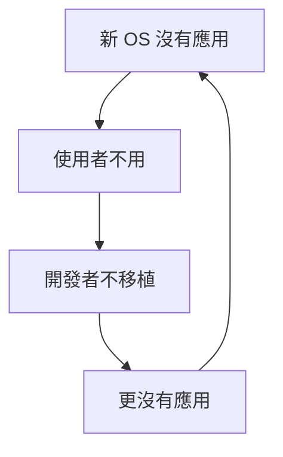
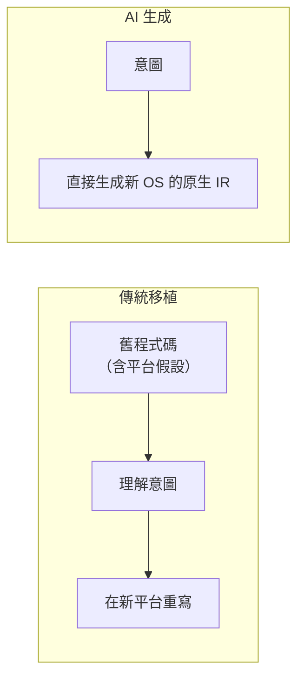

# 11.3　AI 寫 Code 打破冷啟動魔咒

> 本節導論：新 OS 的歷史宿命是「沒有應用，所以沒人用」。但 AI 即時生成程式的能力，可能第一次真正打破這個循環。本節論證為什麼、以及需要什麼條件。

## 11.3.1 冷啟動魔咒的回顧

第 10.1.5 節描述了冷啟動魔咒：

這個魔咒的根源是：**「應用程式的生產成本很高」**。開發者要為新 OS 重寫或移植應用，成本高、風險大、回報不確定。所以他們選擇「不移植」。

歷史上，Plan 9、BeOS、Haiku、Fuchsia 都卡在這裡：技術上可以做，但「沒有應用」讓它們無法普及。

## 11.3.2 魔咒的隱含前提

冷啟動魔咒有一個隱含前提：**「應用是稀缺的、需要人寫的、移植成本高的」**。

如果這個前提改變，魔咒就鬆動了。而 AI 寫 Code 恰好改變了這個前提：

* **應用不再稀缺**：AI 可以即時生成。
* **不需要「移植」**：AI 可以「針對新 OS 直接生成」，而不是「從舊 OS 移植」。
* **成本趨近於零**：生成的成本遠低於移植的成本。

換句話說，**AI 不是「解決了魔咒」，而是「讓魔咒成立的前提消失了」**。

## 11.3.3 為什麼「直接生成」比「移植」容易

傳統移植的困難在於：**「理解舊程式的意圖，並在新平台上重新實現」**。這是困難的，因為：

* 舊程式碼充滿了「平台特定的假設」（POSIX 系統呼叫、檔案路徑、環境變數）。
* 移植者要理解「這段程式碼到底想做什麼」，才能在新平台上實現。
* 移植可能引入 bug。

而 AI 生成不需要「理解舊程式碼」——它直接從 **「意圖」** 生成「新平台的實現」：

* 意圖是「把這批資料算統計」，不是「呼叫 `read` 再 `fopen`」。
* AI 直接生成「新 OS 的計算圖 IR」，跳過「舊程式的平台假設」。
* 生成的是「原生」的，不是「移植」的。

這就是關鍵洞察：**「移植」是「從實作到實作」；「生成」是「從意圖到實作」**。前者要跨越「舊平台的複雜性」，後者直接從「乾淨的意圖」出發。

## 11.3.4 打破魔咒的具體機制

AI 生成打破冷啟動魔咒，可以分三個層次：

**（1）應用層：舊應用「重新生成」。**
對於「想要用某個功能」的使用者，AI 可以根據「這個功能是什麼」的意圖，生成「新 OS 的原生實現」。不需要「移植舊應用」，只需要「描述舊應用的功能」。

**（2）中介層：舊應用「轉譯」。**
對於複雜的舊應用，AI 可以「分析其行為」，生成「行為等價的新 OS 實現」。這比「手動移植」快得多。

**（3）生態層：新應用「原生生成」。**
對於「新需求」，AI 直接生成「新 OS 的原生應用」，完全不需要「舊 OS 的參照」。

這三個層次，讓新 OS 從「沒有應用」變成「應用可以即時生成」。這是魔咒從未遇過的突破口。

## 11.3.5 但這需要什麼條件

誠實地說，「AI 打破魔咒」不是自動發生的，它需要幾個條件：

**（1）IR 標準化。**
AI 要能生成「新 OS 的原生 IR」，前提是「有一個穩定的、AI 能可靠生成的 IR 標準」。如果 IR 生態碎片化（第 3.2.7 節），AI 就無所適從。

**（2）驗證的可靠性。**
AI 生成的程式必須「可被驗證安全」。如果驗證器不可靠，生成的程式就不能被信任，魔咒仍然存在（只是從「沒有應用」變成「不敢用應用」）。

**（3）意圖描述的清晰。**
AI 生成依賴「清楚的意圖」。如果使用者說「我要一個文書處理器」，AI 生成的東西可能不符合期待。意圖的「規格化」是關鍵。

**（4）信任的建立。**
使用者要「相信」AI 生成的程式是對的、安全的。這需要長期的可靠性累積，與透明的驗證機制。

## 11.3.6 與歷史上的「跨平台」類比

這個轉變，可以類比歷史上的「跨平台」演化：

* **第一階段（1990s）**：為每個平台寫不同的程式（Windows 版、Mac 版）。成本高。
* **第二階段（2000s–2010s）**：用跨平台框架（Qt、Electron、Flutter），寫一次、多平台跑。成本中。
* **第三階段（2020s–）**：用 AI 生成，針對每個平台直接生成原生實現。成本低。

差別在於：前兩階段仍然需要「人類寫程式」，第三階段「生成」取代了「寫」。這讓「跨平台」從「工程問題」變成「生成問題」。

## 11.3.7 一個更具體的場景

設想一個企業要遷移到「AI 原生異質 OS」。它的舊系統是一堆 Python 腳本，做資料處理。

**傳統遷移**：重寫每個腳本，處理 POSIX 依賴、檔案路徑、環境變數……數月工程。

**AI 生成遷移**：
1. 用 AI 分析每個腳本的「意圖」（輸入什麼、做什麼轉換、輸出什麼）。
2. AI 生成「新 OS 的計算圖 IR」。
3. 微內核驗證 IR 的安全性。
4. 企業在新 OS 上執行。

這個過程，可能從「數月」縮短到「數天」。而且生成的 IR 是「原生」的，能充分利用新 OS 的統一記憶體與異質排程。

## 11.3.8 魔咒真的被打破了嗎

需要保持清醒：**「AI 打破魔咒」是一個「可能性」，不是「保證」**。

* 如果 AI 生成的程式「不可靠」，那使用者仍然不敢用。
* 如果 IR 生態「不統一」，那生成的成本仍然高。
* 如果「舊應用太複雜」，AI 可能無法正確理解其意圖。

所以更精確的說法是：**AI 第一次讓「打破冷啟動魔咒」在技術上成為可能**。但要真正打破，還需要「標準、驗證、信任」三者的成熟。

這是革命派與演化派都必須面對的現實：**技術可能性 ≠ 生態現實**。但至少，AI 讓「不可能」變成了「可能」，這本身就是一個範式轉移。

## 11.3.9 本節小結

* 冷啟動魔咒：沒應用 → 沒人用 → 沒人移植 → 更沒應用。
* 魔咒的隱含前提：應用稀缺、需人寫、移植成本高。
* AI 改變前提：應用可即時生成、不需移植、成本趨零。
* 「直接生成」比「移植」容易：從意圖到實作，而非從實作到實作。
* 三個層次：舊應用重新生成、舊應用轉譯、新應用原生生成。
* 需要條件：IR 標準化、驗證可靠性、意圖清晰、信任建立。
* 歷史類比：跨平台從「各寫一份」到「框架」到「AI 生成」。
* 清醒：AI 讓「打破魔咒」成為技術可能，但要真正打破，還需標準、驗證、信任成熟。

第 11 章到此，我們完成了「革命派」的藍圖。下一章，也是終章：**演化與革命的交匯點，以及作業系統的終極蛻變**。
