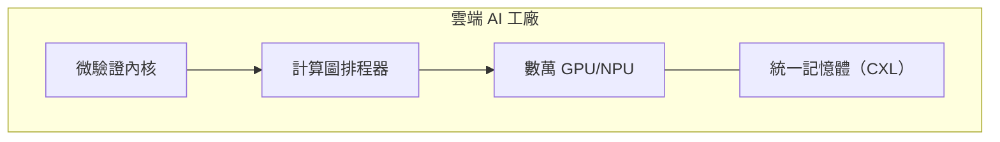
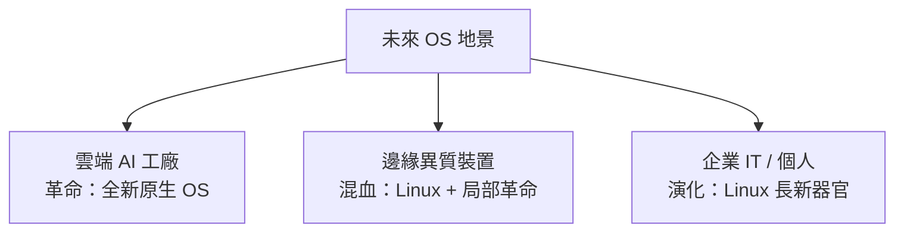

# 12.1　雲端 AI 工廠與邊緣異質裝置的分岔

> 本節導論：新 OS 不會「同時、全部」取代舊 OS。它會從「最痛的地方」開始。本節分析兩個最可能的起點：雲端 AI 工廠與邊緣異質裝置。

## 12.1.1 為什麼會有「分岔」

不同場景對 OS 的需求差異巨大，這決定了「演化」與「革命」會在不同場景以不同速度發生：

| 場景 | 對「相容性」的需求 | 對「極致效能」的需求 | 適合路線 |
| --- | --- | --- | --- |
| 一般企業 IT | 極高（舊應用多） | 中 | 演化（Linux） |
| 雲端 AI 工廠 | 低（自研、容器化） | 極高 | 革命（新 OS） |
| 邊緣異質裝置 | 中（部分相容） | 高 | 演化 + 局部革命 |
| 個人電腦 | 極高（生態龐大） | 中 | 演化（Linux/Windows/macOS） |

分岔的邏輯是：**「包袱越輕、痛點越尖，越可能革命」**。

## 12.1.2 雲端 AI 工廠：革命的溫床

雲端 AI 工廠（AI factory）是「大規模訓練與推論的資料中心」，它有三個特徵，讓它成為革命的溫床：

**（1）包袱輕。**
AI 工廠的工作負載，大多是「自研的、容器化的、以 Python + 框架寫的」。它們依賴的不是「POSIX 的細節」，而是「框架的 API」（PyTorch、JAX）。這意味著「換掉底層 OS」的相容性成本，比「換掉企業 IT 的 OS」低得多。

**（2）痛點尖。**
AI 工廠的痛點極其尖銳：每一毫秒的延遲、每一瓦的功耗、每一次拷貝的頻寬，都直接影響成本。傳統 OS 的抽象稅（第 2 章）在這裡被放大到極致。

**（3）規模大。**
一個 AI 工廠可能有數萬張 GPU。在這個規模下，「客製化 OS」的研發成本可以被攤平。Google 的 TPU + 自研軟體棧，就是這個邏輯的體現。

所以雲端 AI 工廠，最可能率先擁抱「全新原生 OS」。不是因為「技術浪漫」，而是因為「經濟帳算得過來」。

## 12.1.3 邊緣異質裝置：混血的路線

邊緣裝置（手機、自駕車、工業控制器、智慧攝影機）的處境不同：

* **包袱中等**：有一定量的既有應用（Android 生態），但也有「新場景」（AI 推論、即時控制）。
* **痛點多樣**：功耗、延遲、即時性、安全性，各有不同要求。
* **規模分散**：不像 AI 工廠那樣集中，客製化成本難攤平。

所以邊緣裝置更可能走「混血路線」：

* **底層**：保留 Linux（驅動、生態）。
* **局部革命**：在「即時控制」「AI 推論」這些痛點上，用「Unikernel」「專用加速器直通」「eBPF」等機制，繞過傳統路徑。

換句話說，邊緣裝置是「演化為主、局部革命為輔」。它的革命是「模組化」的，而不是「整體重寫」。

## 12.1.4 一般企業 IT：演化的鐵盤

一般企業 IT（ERP、資料庫、Web 服務）最不可能革命：

* **包袱極重**：大量遺留系統、舊應用、合規要求。
* **痛點不尖**：效能不是主要矛盾，「穩定、相容、可維護」才是。
* **風險厭惡**：企業不會為了「技術先進」而承擔「系統不穩」的風險。

所以企業 IT 會長期停留在「演化版 Linux」上，透過 eBPF、io_uring 等機制漸進提升，但不會「重寫 OS」。

## 12.1.5 三條路線的並存

把三個場景放在一起，未來的圖景是 **「三條路線並存」**：

這不是「誰取代誰」，而是「不同場景，不同選擇」。就像今天「Linux 統治伺服器、Windows 統治桌面、RTOS 統治嵌入式」一樣，未來的 OS 也會「分場景而治」。

## 12.1.6 一個關鍵變數：AI 生成的成熟度

三條路線的速度，取決於一個關鍵變數：**AI 生成程式的成熟度**。

* 如果 AI 能可靠地「生成新 OS 的原生應用」（第 11.3 節），那革命的門檻大幅降低，更多場景會轉向革命。
* 如果 AI 生成仍不可靠，那「相容性」仍是王道，演化仍是主流。

所以「AI 生成」是整個地景的「加速器」或「剎車」。這也是為什麼本書把「AI 寫 Code」與「異質算力」並列為兩股力量：它們互相放大。

## 12.1.7 本節小結

* 新 OS 從「最痛、包袱最輕」的地方開始。
* 雲端 AI 工廠：包袱輕、痛點尖、規模大 → 革命的溫床。
* 邊緣異質裝置：包袱中等、痛點多樣、規模分散 → 混血（演化 + 局部革命）。
* 企業 IT / 個人：包袱極重、痛點不尖、風險厭惡 → 演化鐵盤。
* 未來圖景：三條路線並存，分場景而治。
* 關鍵變數：AI 生成的成熟度（加速器或剎車）。

下一節，我們談一個更本體論的問題：**作業系統「蛻變」成什麼**。
