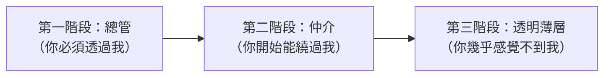

# 12.2　作業系統的蛻變

> 本節導論：作業系統沒有消失，它在「蛻變」。從「管理機器的總管」，變成「連接意圖、驗證與算力的透明薄層」。本節描述這場蛻變的三個階段。

## 12.2.1 蛻變的隱喻

「蛻變（metamorphosis）」這個詞很精準。它不是「死亡」，也不是「突變」，而是「同一個本體，改變形態」。

毛毛蟲變成蝴蝶：還是同一個生命，但形態、功能、與世界的關係都變了。作業系統也是：它還需要存在，但它的形態（從巨型內核到極薄底座）、功能（從管理機器到翻譯意圖）、與世界的關係（從「你必須透過我」到「你幾乎感覺不到我」）都變了。

## 12.2.2 第一階段：「總管」（1969–2000s）

在第一階段，OS 是 **「管理機器的總管」**：

* 它管理 CPU、記憶體、I/O。
* 它提供抽象（行程、檔案、系統呼叫）。
* 程式「必須透過它」才能使用硬體。

這個階段的隱喻是「官僚」：你想做任何事，都要填表（系統呼叫）、經過審批（權限檢查）、被分配資源（排程）。它有權力，也有負擔。

這個階段，OS 的價值在「管理」——因為硬體複雜、多使用者、需要隔離。

## 12.2.3 第二階段：「仲介」（2000s–2020s）

在第二階段，OS 變成 **「程式與硬體之間的仲介」**，但它的權力開始被「繞過機制」侵蝕：

*  virtualization、container 讓「多個 OS 實例」共享硬體。
*  eBPF、io_uring、DPDK 讓「關鍵路徑」繞過核心。
*  GPU 的興起，讓「計算」不再只發生在 CPU。

這個階段的隱喻是「中間商」：它仍然在交易中，但「買賣雙方」開始能直接接觸（kernel bypass），它的抽成（抽象稅）被壓縮。

這個階段，OS 的價值在「整合」——因為生態複雜、需要相容、需要管理。

## 12.2.4 第三階段：「透明薄層」（2020s–）

在第三階段（正在發生），OS 變成 **「連接意圖、驗證與物理算力的透明薄層」**：

* 輸入是「意圖」（自然語言、高階 API），不是「程式碼」。
* 中間是「驗證」（載入前證明），不是「權限檢查」。
* 輸出是「異質算力的執行」，不是「CPU 指令」。

這個階段的隱喻是「翻譯」：它不「管理」，而是「翻譯」。就像一個好的翻譯，你幾乎感覺不到它的存在，但沒有它，你無法與另一個世界溝通。

## 12.2.5 「透明」的含義

「透明」不是「不存在」，而是 **「不阻礙」**。一個透明的 OS：

* **不增加延遲**：計算路徑由編譯器生成，不經過 OS。
* **不增加複雜度**：介面是 IR，語意清晰。
* **不增加風險**：安全由驗證保證，不需昂貴隔離。
* **不增加認知負擔**：使用者描述意圖，OS 處理細節。

這與傳統 OS 的「不透明」（你必須理解它的抽象、它的系統呼叫、它的限制）形成對比。

## 12.2.6 「薄」的含義

「薄」不是「功能少」，而是 **「只保留不變的、必須由特權層保證的東西」**（第 0.3.6 節）。

一個薄的 OS：

* 不做「計算」（交給編譯器）。
* 不做「排程細節」（交給計算圖排程器）。
* 不做「儲存」（交給物件模型）。
* 只做「拓撲、驗證、交換」（三大原語）。

「薄」是「把不該它做的事交出去」的結果，不是「偷懶」。

## 12.2.7 蛻變不是「進化論式的必然」

需要警惕一種「目的論」的誤讀：好像 OS「必然」會蛻變成透明薄層。

歷史不是必然的。如果：
* CXL 沒有普及（統一記憶體不成立），
* IR 生態碎片化（無法統一介面），
* AI 生成不可靠（無法打破冷啟動），

那 OS 可能「停在第二階段」，甚至「退回第一階段」（如果安全事件讓人們更依賴隔離）。

所以「蛻變」是 **「一個方向、一個可能性」**，不是「歷史的必然」。它的實現，取決於技術、經濟、社會的多重條件。本書描述的，是「如果這些條件成立，OS 會長成什麼樣」。

## 12.2.8 三個階段的價值不會消失

蛻變不是「新的取代舊的」，而是「新的吸收舊的」。

* 第一階段的「管理」能力（資源分配、隔離）不會消失，它被「內化」到極小化內核的三大原語裡。
* 第二階段的「整合」能力（生態、相容）不會消失，它被「外化」到「演化版 Linux」與「生成式橋接」裡。
* 第三階段的「翻譯」能力（意圖到執行）是新的，它建立在前面兩個階段的基礎上。

所以「蛻變」是「累積」，不是「取代」。這也是為什麼本書既談「演化派」也談「革命派」——它們是同一場蛻變的兩個面向。

## 12.2.9 本節小結

* 蛻變：同一個本體，改變形態、功能、與世界的關係。
* 三階段：總管（你必須透過我）→ 仲介（你開始能繞過我）→ 透明薄層（你幾乎感覺不到我）。
* 「透明」是不阻礙：不增延遲、複雜度、風險、認知負擔。
* 「薄」是只保留不變的、必須特權層保證的東西，不是功能少。
* 蛻變不是歷史必然，取決於技術、經濟、社會條件。
* 三階段是累積，不是取代。

下一節，也是全書的終章：**結語——透明薄層的未來**。
