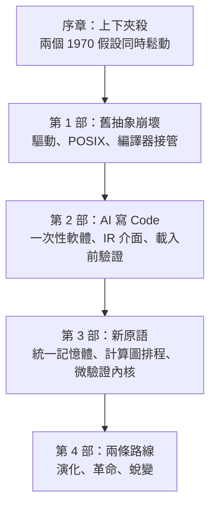

# 12.3　結語：透明薄層的未來

> 全書導論：從「上下夾殺」到「透明薄層」，這趟旅程走完了。本節回顧全書脈絡，並對未來提出幾個值得深思的問題。

## 12.3.1 全書脈絡回顧

十二個章節，其實是一條完整的論證鏈：

每一章都在拆掉上一章還默認存在的東西：

* 第 1 章拆掉「驅動模型」。
* 第 2 章拆掉「POSIX 包袱」。
* 第 3 章拆掉「OS 執行期職責」。
* 第 4 章拆掉「長期軟體」。
* 第 5 章拆掉「高階語言作為介面」。
* 第 6 章拆掉「權限硬隔離」。
* 第 7 章拆掉「檔案與記憶體雙軌」。
* 第 8 章拆掉「時間片排程」。
* 第 9 章拆掉「臃腫內核」。
* 第 10–12 章重新組裝成「極薄底座 + 兩條路線」。

## 12.3.2 核心命題的回顧

開篇的核心命題是：

> 下一代作業系統不是「對 AI 友好的 Linux」，而是融合編譯器、形式驗證與異質算力調度的極薄執行底座。

走完全書，這個命題的三個支柱都得到了具體的技術支撐：

* **編譯器**（第 3、5 章）：MLIR 多層 IR 把記憶體規劃、排程、降階前移到編譯期；IR 成為新的系統介面（ABI）。
* **形式驗證**（第 6、9 章）：eBPF Verifier、CompCert、seL4 提供「載入前證明」的基礎；信任根收斂到微內核 + 驗證器 + 編譯器。
* **異質算力調度**（第 7、8 章）：統一記憶體消除拷貝；計算圖排程器取代時間片排程。

## 12.3.3 三個「不變」的核心

在一片「拆掉」之中，有三件事是「不變」的核心，值得記住：

**（1）對「顯性」的堅持。**
從第 2 章「消除隱性狀態」，到第 5 章「IR 作為顯性介面」，到第 7 章「物件即位址」，貫穿始終的是「顯性優於隱性」。這是「可驗證性」的基礎，也是「可推理」的基礎。

**（2）對「證明」的追求。**
從第 6 章「載入前驗證」，到第 9 章「可形式化驗證的微內核」，貫穿始終的是「證明優於信任」。這是「安全」的基礎，也是「信任根收斂」的基礎。

**（3）對「統一」的渴望。**
從第 1 章「一等算力節點」，到第 5 章「統一 IR」，到第 7 章「統一記憶體」，貫穿始終的是「統一優於分裂」。這是「效能」的基礎，也是「可組合」的基礎。

## 12.3.4 三個值得深思的問題

書到結尾，不該給「標準答案」，而該留下「好問題」。三個值得深思的問題：

**問題一：如果 OS 變成「透明薄層」，那「控制權」在哪裡？**

當 OS 從「總管」變成「翻譯」，誰來決定「哪些意圖可以被執行」？是使用者？是平台？是模型提供者？「透明」可能意味著「不可見的控制」。這是技術問題，也是治理問題。

**問題二：如果 AI 生成「一切程式」，那「理解」還重要嗎？**

當沒人「讀」程式碼，只「驗證」程式碼，那「理解程式的意圖」這件事，會不會被「驗證程式的性質」取代？如果會，那人類對系統的「掌控感」從何而來？

**問題三：如果「形式驗證」成為安全的基礎，那「驗證器」本身的信任從何而來？**

驗證器是信任根，但信任根也需要被信任。這個「信任的遞迴」在哪裡停止？是硬體？是數學？是社會共識？

這三個問題，沒有標準答案。但它們提醒我們：**技術的蛻變，從來不是「純技術」的**。它牽動權力、理解、信任。

## 12.3.5 一個開放式的結尾

本書沒有一句「這就是未來 OS 的樣子」的斷言。因為未來不是被「預測」的，而是被「建造」的。

* 演化派會繼續在 Linux 裡長出新器官，把舊路徑架空。
* 革命派會在 AI 工廠裡建造全新的原生 OS，驗證「另一個世界」的可能性。
* 兩者會在某個交匯點相遇——也許是「整合繞過機制的新 OS」，也許是「重構抽象層的新 Linux」。

但不論哪條路，方向是清楚的：

> **作業系統並沒有消失，它只是從「管理機器的總管」，蛻變為「連接人類意圖、形式驗證與物理算力的透明薄層」。**

## 12.3.6 給讀者的話

如果你讀到這裡，你可能已經發現：這本書談的不只是「作業系統」，而是 **「當計算的形態改變時，我們如何重新設計它的地基」**。

異質算力改變了「計算在哪裡發生」；AI 寫 Code 改變了「程式從哪裡來」。這兩個改變，動搖了半世紀的地基。而重新設計地基的工作，才剛剛開始。

這是一場還在進行的革命。它不會在一本書裡完成，也不會在一年內完成。但它值得被認真對待——因為它是「AI 時代」最底層、也最容易被忽略的戰場。

## 12.3.7 全書小結

* 全書脈絡：上下夾殺 → 舊抽象崩壞 → AI 寫 Code → 新原語 → 兩條路線。
* 核心命題三支柱：編譯器、形式驗證、異質算力調度。
* 三個不變的核心：顯性、證明、統一。
* 三個值得深思的問題：控制權、理解、信任的遞迴。
* 開放式結尾：未來被建造，不被預測。
* 終極洞見：作業系統從「總管」蛻變為「透明薄層」。

全書完。
