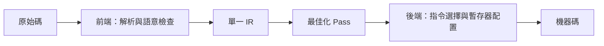
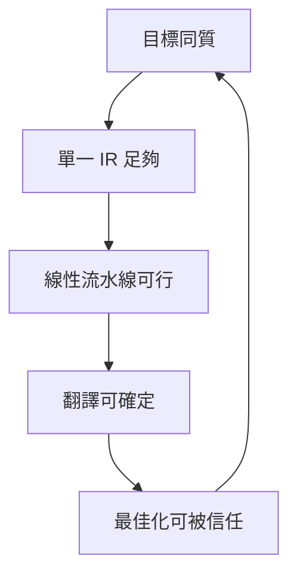

# 0.1　七十年線性神話的建立

> 本節導論：現代編譯器的架構不是自然律，而是一連串歷史條件的產物。要理解它為何在 AI 時代鬆動，必須先看清那條「前端 → 單一 IR → 機器碼」的線性流水線，是在什麼假設下被發明、又靠什麼假設維持了七十年。

## 0.1.1 一個被視為理所當然的架構

幾乎每一本編譯器教科書，都會畫出同一張圖：左邊是原始碼，經過 **前端（front end）** 做詞法、語法、語意分析，轉成一份 **中間表示（IR）**；中間經過一趟又一趟的 **最佳化（optimization）**；右邊由 **後端（back end）** 產生目標機器碼。

這張圖的核心特徵是 **線性（linear）**：資料單向流動，每一階段只依賴前一階段的產物。它簡潔、可組合、易於教學，也因此統治了編譯器工程將近七十年。

但「理所當然」往往意味著「假設被遺忘」。這條線性神話至少建立在三個隱含假設之上，而它們並非永恆。

## 0.1.2 假設一：目標是同質的單一處理器

1957 年，IBM 的 FORTRAN 編譯器問世，這是第一個真正意義上的高階語言編譯器。它的目標非常單純：**一台機器的機器碼**。1950–1970 年代的主流電腦，CPU 就是唯一的運算單元，程式的執行模型是「一條指令流、一個指令計數器」。

這個假設塑造了整個後端設計：指令選擇、暫存器配置、指令排程，全都圍繞「單一純量核心」展開。即使後來出現向量指令（如 1970 年代的 Cray 超級電腦），也只是在同一條指令流上加寬，並未改變「單一目標」的本質。

## 0.1.3 假設二：語意可以在一份 IR 裡完整表達

第二個假設是：**存在一份「夠好」的 IR，能同時承載高階語意與低階細節**。經典的分工是：前端把高階語言「降」成 IR，後端再從 IR「降」成機器碼。

這假設在單一語言、單一目標的年代大致成立。但它的破口在於：**高階語意與低階細節，往往需要不同的抽象層次**。高階的矩陣乘法知道「這是個二維縮併」，低階的機器碼只知道「一連串載入、乘加、寫回」。把前者過早壓成後者，就會丟失最佳化所需的結構資訊（這個問題我們在第 6 章會完整展開）。

## 0.1.4 假設三：翻譯是確定性的

第三個、也是最深層的假設：**編譯是一個確定性函數**。同一份輸入、同一個編譯器版本，永遠產出語義等價的輸出。這條「黃金律」是編譯器可信度的基石——正因為輸出可預測、可重現、可驗證，我們才敢把最佳化交給它自動進行。

這個假設支撐了往後數十年的最佳化理論：資料流分析、SSA 形式、多面體模型、圖著色暫存器配置……全都預設「最佳化是對程式的保義（semantics-preserving）改寫」。

## 0.1.5 三個假設如何互相加固

值得注意的是，這三個假設並非獨立，而是互相加固的：

* 因為 **目標同質**，所以不需要多種抽象層次，單一 IR 就夠。
* 因為 **單一 IR 夠用**，所以翻譯可以線性化、可確定。
* 因為 **翻譯確定**，最佳化才能被形式化、被信任。

這是一個自我強化的循環。要打破它，必須有外力同時衝擊多個環節——而 AI 與異質算力，正是這樣的外力。

## 0.1.6 神話的邊界

這條線性神話並非「錯」，而是「有適用範圍」。它在「同質 CPU + 人類手寫程式 + 單一語言」的世界裡近乎完美。問題是，今天的世界同時在三條邊界上越界：

* **硬體邊界**：目標不再是單一 CPU，而是 CPU、GPU、NPU、TPU、FPGA 的異質組合。
* **來源邊界**：程式不再只由人類手寫，也由 LLM 生成。
* **抽象邊界**：高階數學語意與低階電路拓撲之間，跨度遠超單一 IR 能承載的範圍。

下一節，我們就看這三條邊界如何「雙向重塑」編譯器。
