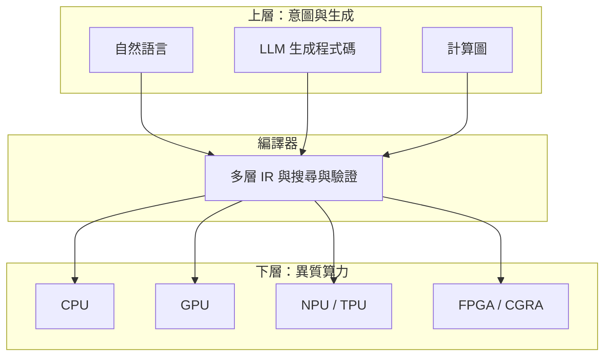

# 0.2　雙向重塑：底下百花齊放，上面意圖驅動

> 本節導論：編譯器正面臨「上下夾殺」。底層是異質算力的百花齊放，上層是自然語言與 AI 生成邏輯的興起。這兩股力量方向相反，卻同時把傳統的線性流水線推向極限。

## 0.2.1 底層的爆炸：從一顆 CPU 到一座異質晶片城

過去，編譯器的目標很單純：一顆 CPU、一套指令集。今天，一顆系統單晶片（SoC）裡可能同時包含：

* **CPU**：通用純量與向量運算，負責控制流與不規則計算。
* **GPU**：SIMT 大規模平行，負責高吞吐的資料平行工作。
* **NPU / TPU**：專用矩陣與張量引擎，負責深度學習的稠密運算。
* **FPGA / CGRA**：可重構邏輯，負責超低延遲或特殊資料流。

這些單元的 **程式模型完全不同**：CPU 是「指令流」，GPU 是「執行緒陣列」，NPU 是「張量分塊與靜態排程」，FPGA 是「電路拓撲」。同一份高階計算，必須被翻譯成四種截然不同的語言。

更麻煩的是，這些單元之間還有 **記憶體層級** 的差異：HBM、DRAM、CXL、片上 SRAM、暫存器檔案。編譯器不只要翻譯計算，還要翻譯「資料在哪裡、怎麼搬」。

## 0.2.2 上層的顛覆：從手寫程式到意圖與生成

與此同時，程式的來源也在改變：

* **自然語言成為輸入**：使用者說「把這批圖片分類」，而不是寫 for 迴圈。
* **LLM 生成程式碼與算子**：模型直接產出高階 IR、Kernel 草稿，甚至電路描述。
* **計算圖成為一等公民**：PyTorch、JAX 的計算圖，本身就是編譯器的輸入。

這意味著編譯器的 **前端** 不再只是「解析某個語言的語法」，而是要「理解意圖、接受機率性生成的輸入、並在龐大的候選中挑選與驗證」。

## 0.2.3 雙向擠壓下的三個斷裂

上下兩股力量同時施壓，造成三個結構性斷裂：

**（1）抽象跨度的斷裂。**
上層是「高維張量的語意」，下層是「電晶體層級的時序與佈局」。這個跨度遠超過單一 IR 能平滑承載的範圍。中間必須插入 **多層抽象**，否則不是丟失高階資訊，就是無法生成低階電路。

**（2）確定性的斷裂。**
上層的 LLM 生成是 **機率性** 的：同一個提示可能產出不同的程式。下層的硬體驗證卻要求 **確定性** 的正確性保證。編譯器必須在「機率性的輸入」與「確定性的輸出」之間，架起驗證的橋樑。

**（3）目標單一性的斷裂。**
過去「一份程式 → 一個目標」。現在「一份計算 → 一組異質目標的協同」。編譯器必須決定「哪段計算去哪裡、資料怎麼在單元間流動」，這已經不是翻譯，而是 **排程與分割**。

## 0.2.4 為什麼是「雙向」而非「單向」

這裡有個容易誤解的點：不是「上層變複雜，所以編譯器變複雜」的單向因果，而是 **雙向塑造**：

* 上層的 AI 工作負載 **驅動** 了下層硬體的異質化（因為單一晶片無法同時滿足吞吐、延遲、能效）。
* 下層硬體的異質化 **反過來驅動** 上層編譯器必須具備多目標能力。
* 而多目標能力又讓上層更敢用高階、意圖式的表達（因為編譯器能自動搞定降階）。

這個循環，正是本書要拆解的對象。它解釋了為什麼編譯器不再是「語言翻譯機」，而必須升級成「網狀轉化系統」。

## 0.2.5 一個歷史類比：從組合語言到高階語言

1957 年 FORTRAN 誕生時，最大的爭議是：「自動產生的機器碼，能比人類手寫的組合語言快嗎？」當時的答案是「幾乎不能」，但高階語言最終勝出，因為它讓程式設計師的生產力提升了幾個數量級，而編譯器的最佳化逐步追上了手寫水準。

今天的異質編譯器，面對的是同一種爭議的升級版：「自動排程與降階，能比人類專家手調的 Kernel 好嗎？」Triton、TVM、MLIR 的經驗顯示，答案正在從「不能」翻轉為「能，而且更好」——因為搜尋空間太大，人類調不動，機器可以。
