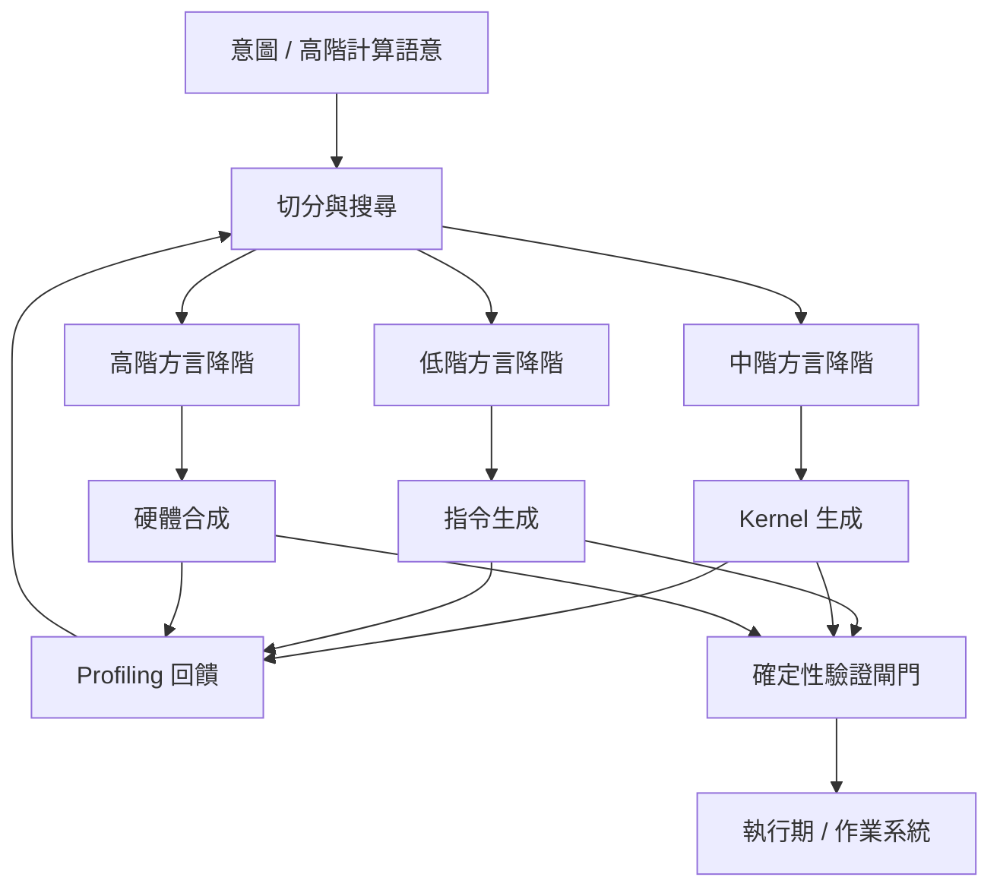

# 0.3　網狀轉化系統與全書命題

> 本節導論：如果前兩節描述的是「為什麼舊架構會鬆動」，本節要回答「新架構長什麼樣」。答案不是更長的流水線，而是一張可以回饋、可以分叉、可以驗證的 **網狀（mesh）** 轉化系統。

## 0.3.1 線性流水線的三個致命限制

把 0.1 節的線性模型攤開，會發現它有三個在異質時代致命的限制：

* **不可回饋**：資料單向流動，後端發現的事實（例如「這個 tile 太大，快取放不下」）無法即時回饋給高階決策。
* **不可分叉**：一份 IR 只能往一個目標降階；要做異質協同，得複製整條流水線。
* **不可搜尋**：最佳化是一連串固定順序的 pass，缺乏「在候選空間裡搜尋全域最優」的能力。

這三點，正好對應 0.2 節的三個斷裂。

## 0.3.2 網狀系統的四個特徵

一個為異質與 AI 設計的編譯器，應該具備四個特徵：

**（1）多層抽象並存（multi-level）。**
不是「一份 IR」，而是「一族 IR」，各自在自己的抽象層次上表達最自然的事。高階的張量語意、中階的迴圈與記憶體、低階的向量與指令、硬體層的電路——每層都保留該層最重要的結構。

**（2）可分叉與可匯流（fork-join）。**
同一份高階計算可以被切塊，分送到不同的降階路徑，最後在統一的記憶體與執行介面上匯流。這就是「網狀」的核心：不是單線，而是分支再聚合。

**（3）搜尋與回饋（search & feedback）。**
編譯過程不只是「套用規則」，而是「在候選空間裡搜尋」——tiling 大小、排程順序、Kernel 變體——並用 profiling 的實測結果回饋，形成閉環。

**（4）確定性守門（deterministic gatekeeping）。**
在機率性生成的下游，必須有一道確定性的驗證閘門：形式驗證、差分測試、全域不變式檢查。過了這道門，才允許降階與執行。

## 0.3.3 與作業系統的分工

本書的姊妹作《AI 時代的異質作業系統》處理的是 **執行期**：安全驗證、統一記憶體、跨晶片調度。本書處理的是 **執行前**：降階、搜尋、守門。

兩者的交接點有兩個：

* **高階 IR 介面**：編譯器把「已驗證、已降階」的 IR 交給執行期載入與調度。
* **驗證器**：編譯期的形式驗證與執行期的載入前驗證，是同一套不變式的兩道防線。

換句話說，**編譯器是「執行期職責前移」的產物**：把能靜態決定的都靜態決定，只把真正動態的留給作業系統。

## 0.3.4 全書核心命題

綜合以上，我們可以把本書的核心命題濃縮成一句：

> **現代異質編譯器，是一個融合多層抽象降階、機率性搜尋、形式化守門與軟硬體協同的網狀轉化系統。**

這句話裡有四個關鍵詞，對應全書四部：

| 關鍵詞 | 含義 | 對應章節 |
|---|---|---|
| 多層抽象降階 | MLIR 的方言與漸進式降階 | 第 6–8 章 |
| 機率性搜尋 | LLM 生成與 profiling 回饋 | 第 1、9 章 |
| 形式化守門 | CompCert、翻譯驗證、差分測試 | 第 2 章 |
| 軟硬體協同 | HLS、共設計、網狀管線 | 第 5、8、10 章 |

## 0.3.5 全書路線圖

* **第 1 部**：確定性如何鬆動，驗證為何升值。
* **第 2 部**：四種算力形態的物理現實。
* **第 3 部**：MLIR 與網狀編譯管線。
* **第 4 部**：LLM 賦能與終極形態。

下一章，我們從第一部開始：先看那條「確定性黃金律」究竟是什麼，以及 LLM 如何讓它鬆動。
