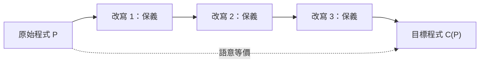

# 1.1　傳統編譯器的黃金律

> 本節導論：在談「鬆動」之前，必須先精確定義「被鬆動的東西」。傳統編譯器的黃金律，是「保義（semantics-preserving）」——輸出與輸入在所有可觀察行為上等價。這條律令看似簡單，卻支撐了整個最佳化理論大廈。

## 1.1.1 什麼是「保義」

編譯器本質上是一個函數 $ C $，把來源程式 $ P $ 映射為目標程式 $ C(P) $。黃金律要求：

$$
\forall P,\ \forall \text{輸入 } x:\quad \llbracket P \rrbracket(x) = \llbracket C(P) \rrbracket(x)
$$

其中 $ \llbracket \cdot \rrbracket $ 是語意函數。換句話說，**編譯前後，程式對所有輸入的可觀察行為必須一致**。

「可觀察行為」是關鍵詞。編譯器允許改變「不可觀察」的部分：暫存器配置、指令順序（在不影響資料依賴時）、記憶體布局。但不能改變「可觀察」的部分：輸出值、副作用順序、例外行為。

## 1.1.2 確定性的兩層含義

黃金律其實包含兩層不同的「確定性」：

**（1）語意確定性（semantic determinism）**：輸出必須與輸入語意等價。這是黃金律的本體。

**（2）過程確定性（procedural determinism）**：同一份輸入、同一個編譯器，應該產出 **同一份輸出**。這不是邏輯上的必然，而是工程上的承諾——它讓編譯結果可重現、可除錯、可快取。

第二層常被忽略，但它極其重要。正因為編譯是「可重現的確定性函數」，我們才能：

* 用雜湊值快取編譯結果（如 ccache）。
* 重現 bug（同一輸入必得同一輸出）。
* 建立「編譯器的回歸測試」（同一輸入的輸出可逐位元比對）。

## 1.1.3 為什麼最佳化必須保義

最佳化的本質是「改寫」。資料流分析告訴你「這個變數在這裡已是死碼」，於是你刪掉它；多面體模型告訴你「這兩個迴圈可以交換」，於是你交換它們。每一次改寫，都是一次「對語意的小手術」。

黃金律是這些手術的安全網：**只要每次改寫都保義，那麼任意多次改寫的組合也保義**。這讓最佳化可以模組化——每個 pass 只需對自己負責，不必擔心和其他 pass 的互動。

## 1.1.4 黃金律的工程代價

保義不是免費的。它帶來三種工程成本：

* **分析成本**：要證明「這個改寫保義」，需要做資料流分析、別名分析、依賴分析。分析越精確，最佳化越激進，但編譯越慢。
* **保守性成本**：當分析無法證明保義時，編譯器必須保守地「不做」。這限制了最佳化的上限。
* **驗證成本**：即使編譯器「相信」自己保義，仍需測試與形式驗證來確認。這是第 2 章的主題。

換句話說，黃金律不是一句口號，而是一整套「分析—改寫—驗證」的工程體系。

## 1.1.5 靜態單賦值（SSA）為何是黃金律的語言

現代編譯器幾乎都以 **SSA（Static Single Assignment）** 形式為基礎。SSA 要求「每個變數只被賦值一次」，這讓資料流分析變得極為簡潔：每個使用（use）都唯一對應一個定義（def）。

SSA 與黃金律的關係在於：**SSA 讓「保義」變得可局部驗證**。在 SSA 下，一個改寫是否保義，往往可以化約為「這個節點的所有使用是否仍指向語意等價的定義」。這就是為什麼 LLVM IR、MLIR 都建立在 SSA 之上。

但 SSA 也埋下了一個伏筆：它把程式壓成「純量、平坦、無結構」的形式，這對高階最佳化是災難（第 6 章詳述）。

## 1.1.6 黃金律的歷史地位

黃金律的地位，類似牛頓力學在古典物理的地位：在它的適用範圍內，精確而優雅。它支撐了：

* 1970 年代的資料流分析。
* 1980–90 年代的 SSA 與最佳化編譯器。
* 2000 年代 LLVM 的可組合 pass 架構。
* 2010 年代的多面體模型與自動平行化。

但它也有「適用範圍」——就像牛頓力學在接近光速時失效，黃金律在遇到「機率性生成」時，也開始鬆動。

下一節，我們就看 LLM 如何把「確定性函數」變成「機率性取樣」。
