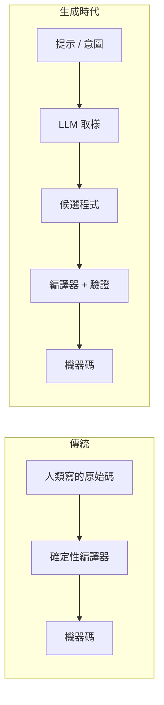
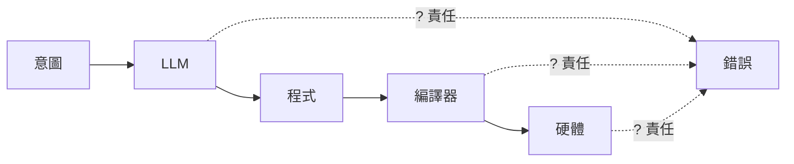

# 1.2　當 LLM 介入生成：機率性翻譯的代價

> 本節導論：LLM 不再只是「輔助寫程式」，它開始直接生成算子、Kernel 甚至 IR。這讓編譯的輸入端從「確定性的原始碼」變成「機率性的取樣」。本節拆解這個轉變帶來的三種代價：模型漂移、非確定性、責任歸屬。

## 1.2.1 從「編譯確定性程式」到「編譯機率性輸出」

傳統編譯器的輸入，是人類寫定的、語法合法的原始碼。LLM 介入後，情況變成：

* **生成程式碼**：使用者給提示，LLM 產出 Python、C++ 或 Triton 程式。
* **生成算子**：在計算圖層，LLM 直接產出「融合後的算子」或「最佳化後的計算定義」。
* **生成 IR**：更激進地，LLM 直接產出 MLIR 片段或排程決策。

這些輸出的共同點是：**它們是取樣（sampling）的結果，而非確定性計算的結果**。同一個提示，換一個隨機種子，就得到不同的程式。

注意右邊多了一個「候選」的概念：生成不再是單一輸出，而是 **一個候選集合**。編譯器的角色，從「翻譯一個程式」變成「在候選集合中挑選、修正、驗證」。

## 1.2.2 代價一：模型漂移（Model Drift）

LLM 的行為不是靜態的。同一個模型，在不同時間、不同版本、不同上下文下，行為可能改變。這造成「模型漂移」：

* **版本漂移**：模型更新後，同一提示的輸出改變。
* **上下文漂移**：提示前後的內容、對話歷史，會影響輸出。
* **取樣漂移**：溫度（temperature）等參數，讓輸出本身帶隨機性。

對編譯器而言，這意味著「輸入不可重現」。傳統編譯器可以說「同一份原始碼，永遠產出同一份機器碼」；但當原始碼本身是 LLM 產出的，「同一份輸入」這個前提就消失了。

## 1.2.3 代價二：非確定性（Nondeterminism）

即使固定模型與提示，LLM 的輸出仍可能非確定，原因包括：

* **取樣隨機性**：解碼時的隨機採樣。
* **平行計算的非決定性**：GPU 上的浮點累加順序不同，導致微小差異。
* **服務端負載與批次**：推論服務的批次大小、量化版本，都可能影響輸出。

這對編譯器的最佳化帶來麻煩。傳統最佳化假設「程式是固定的物件，可以分析、改寫、快取」。當程式每次生成都略有不同，快取失效，回歸測試難以穩定，bug 難以重現。

## 1.2.4 代價三：責任歸屬（Attribution）

最棘手的是責任問題。假設 LLM 生成的 Kernel 有一個數值 bug，導致模型輸出錯誤。責任在誰？

* **提示者**：提示寫得不夠清楚？
* **模型**：訓練資料或對齊有問題？
* **編譯器**：最佳化改變了語意？
* **硬體**：浮點行為與預期不符？

在傳統編譯器裡，這條鏈是清楚的：程式設計師寫錯，或編譯器有 bug。但在「意圖 → LLM → 程式 → 編譯器 → 硬體」的長鏈中，責任被稀釋、被分散。

這正是為什麼 **驗證** 在生成時代變得不可或缺：當責任難以追溯，唯一能建立信任的方式，是「在每個環節留下可驗證的證據」。

## 1.2.5 一個關鍵洞察：候選而非單一

面對上述代價，一個重要的思維轉變是：**不要把 LLM 的輸出當成「程式」，而要當成「候選」**。

這個轉變的意涵是：

* 生成多個候選，而非一個。
* 對候選做驗證與測試，而非直接採用。
* 用編譯器的成本模型與 profiling，從候選中挑選最優。

換句話說，LLM 不是取代編譯器，而是 **把編譯器的輸入從「一個程式」變成「一個搜尋空間」**。編譯器的工作，從「翻譯」擴展為「搜尋 + 驗證」。

## 1.2.6 本節小結

* LLM 讓編譯的輸入從確定性原始碼變成機率性取樣。
* 三種代價：模型漂移、非確定性、責任歸屬。
* 應對之道：把輸出視為候選集合，用搜尋與驗證來篩選。
* 這引出下一節的核心悖論：機率性生成越強，確定性驗證就越值錢。
