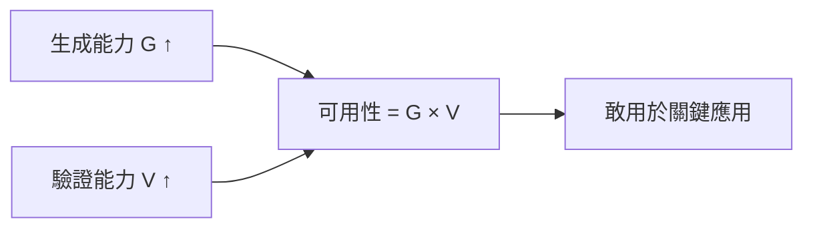

# 1.3　機率越強驗證越貴

> 本節導論：這是本書第一部最反直覺、也最重要的命題——**機率性生成越強大，確定性驗證就越值錢**。本節說明這個悖論的邏輯結構，以及它如何重塑編譯器的價值分配。

## 1.3.1 悖論的表面與裡層

表面上看，生成能力越強，我們越不需要驗證：LLM 都能寫對了，何必再花力氣證明？

但裡層的邏輯恰好相反。原因有三：

**（1）生成越強，越敢用在關鍵處。**
當 LLM 只能寫玩具程式，錯了也無所謂。當它能生成生產環境的 Kernel、甚至硬體描述，錯了就是資料損毀、模型失效、安全事故。**能力越強，錯誤的後果越嚴重**。

**（2）生成越強，越難人工審查。**
人類專家能審查一百行手寫程式，卻難以審查 LLM 一次生成的十萬行、或一個複雜的 GPU Kernel。**生成規模超過人類審查能力時，驗證必須自動化**。

**（3）生成是機率的，錯誤是系統性的。**
LLM 的錯誤不是隨機雜訊，而是有模式的：它可能系統性地在邊界條件、數值精度、記憶體對齊上出錯。**這類錯誤不會因為「多試幾次」而消失，只會因為「針對性驗證」而被抓出**。

## 1.3.2 驗證的三種價值

在生成時代，驗證的價值可以分成三層：

* **正確性價值**：確保生成的程式真的做對的事。這是底線。
* **信任價值**：讓人類敢用生成的程式。沒有驗證，生成的能力無法轉化為生產力。
* **搜尋價值**：驗證訊號本身就是搜尋的指南——哪個候選通過驗證、哪個失敗，回饋給生成器，讓下一輪更好。

第三層常被忽略，但它把「驗證」從「事後檢查」變成「搜尋的一部分」。驗證不再是最後一道關卡，而是 **生成迴圈裡的適應度函數（fitness function）**。

## 1.3.3 一個不等式

我們可以用一個簡單的不等式來刻畫這個悖論。設：

* $ G $：生成能力（能產出正確候選的機率）。
* $ V $：驗證能力（能抓出錯誤候選的機率）。
* $ C $：錯誤的後果成本。

那麼「可用的生成系統」需要滿足：

$$
G \cdot V > 1 - \frac{1}{C}
$$

當 $ C $ 很大（關鍵應用），右式趨近 1，於是 $ G $ 與 $ V $ 必須 **同時** 很高。換句話說，**生成能力的提升，不能取代驗證能力；兩者是乘法關係，不是替代關係**。

## 1.3.4 驗證成本的轉移

有趣的是，驗證的「成本」也在轉移。傳統驗證靠人工與測試，成本隨程式規模線性成長。但現代驗證工具（形式驗證、差分測試、符號執行）的成本，在某種程度上是「一次性」的：

* 建立驗證框架的成本高，但可重複使用。
* 形式化的不變式一旦寫好，可套用到所有候選。
* 差分測試的「參考實作」一旦有，可自動比對無限多候選。

這意味著，**驗證的邊際成本在下降，而生成帶來的風險在上升**。兩條曲線交叉，正好解釋了為什麼「驗證越值錢」。

## 1.3.5 對編譯器架構的意涵

這個悖論直接影響編譯器的架構設計：

* **驗證必須內建，而非外掛**：驗證不能是「編譯完再測」，而必須是編譯流程的一部分（如 MLIR 的 verifier、翻譯驗證 pass）。
* **驗證必須可組合**：每個降階步驟都要能獨立驗證，才能定位錯誤。
* **驗證必須夠快**：如果驗證比生成還慢，整個迴圈就無法運轉。

這三點，正是第 2 章要展開的主題。

## 1.3.6 歷史的迴響：從型別系統到驗證器

這個悖論在歷史上其實有先例。1970 年代強型別語言的興起，某種程度上也是同樣的邏輯：程式越複雜，型別檢查的價值越高。型別系統就是一種「編譯期的驗證」，它讓人敢用更高階的抽象。

今天的驗證器（verifier），是型別系統的延伸：它檢查的不只是型別，還有 SSA 支配關係、記憶體安全、數值範圍、甚至形式化的語意不變式。

## 1.3.7 本節小結

* 悖論：生成越強，驗證越值錢。
* 三個原因：後果更嚴重、規模超人類審查、錯誤有系統性。
* 驗證的三層價值：正確性、信任、搜尋。
* 不等式 $ G \cdot V $ 說明生成與驗證是乘法關係。
* 對架構的意涵：驗證要內建、可組合、夠快。

下一章，我們具體看這些驗證工具：從 CompCert 的機器證明，到差分測試與模糊測試，再到全域不變式的硬邊界。
