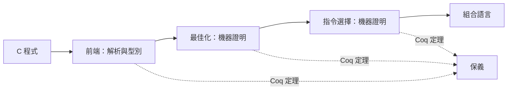
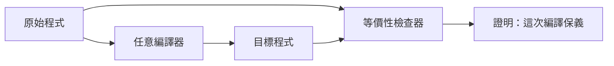

# 2.1　從 CompCert 到翻譯驗證

> 本節導論：驗證編譯器的正確性，有兩條哲學路線。一條是「證明編譯器本身正確」（CompCert），另一條是「證明每一次編譯都正確」（翻譯驗證）。兩者互補，構成了神經編譯時代的第一道守門防線。

## 2.1.1 問題的起點：我們為何不相信編譯器

編譯器是極其複雜的軟體，動輒數百萬行。即使經過大量測試，仍可能潛藏 bug——而這些 bug 可能讓最佳化悄悄改變語意，造成難以察覺的錯誤。歷史上不乏這類案例：錯誤的別名分析、錯誤的迴圈變換、錯誤的浮點最佳化。

問題是：**如何證明編譯器沒有這類 bug？**

## 2.1.2 CompCert：編譯器本身的機器證明

CompCert 是 Xavier Leroy 自 2005 年起主導的專案，目標是「用機器證明編譯器正確」。它的做法是：

* 用 **Coq** 證明助理，形式化 C 語言的語意。
* 形式化編譯器的每一個階段（解析、最佳化、指令選擇、暫存器配置）。
* 對每個階段，證明「若來源程式語意為 $ \sigma $，則目標程式語意也是 $ \sigma $」。

最終得到一個定理：

$$
\forall P,\quad \text{WellTyped}(P) \Rightarrow \llbracket P \rrbracket = \llbracket \text{CompCert}(P) \rrbracket
$$

這是一個極強的保證：**只要 C 程式合法，CompCert 產出的組合語言就保義**。

## 2.1.3 CompCert 的代價與邊界

CompCert 的成就毋庸置疑：它是第一個在真實世界可用的、經機器證明的 C 編譯器。但它也有明顯的代價：

* **規模限制**：證明極其耗時，CompCert 只覆蓋 C 語言的一個子集，最佳化也相對保守。
* **維護成本**：每加一個最佳化，都要重新證明，成本高昂。
* **不適用於快速演化的目標**：GPU、NPU 的後端變化太快，來不及形式化。

換句話說，CompCert 是「證明編譯器本身正確」的典範，但它無法覆蓋異質編譯器那種「目標百花齊放、最佳化快速演化」的現實。

## 2.1.4 翻譯驗證：換一個方向

**翻譯驗證（Translation Validation）** 由 Pnueli 等人在 1998 年提出，思路是：不去證明「編譯器永遠正確」，而是「針對這一次編譯，驗證輸入與輸出的等價性」。

$$
\text{For each compile run:} \quad \llbracket P \rrbracket \equiv \llbracket C(P) \rrbracket
$$

它的關鍵優勢是：**驗證的是「結果」，而非「過程」**。因此：

* 不需要對編譯器本身做形式化。
* 可以驗證任意最佳化、任意後端，只要有一個等價性檢查器。
* 隨著編譯器演化，驗證器不必重寫。

## 2.1.5 兩條路線的互補

CompCert 與翻譯驗證，並非取代關係，而是互補：

| 面向 | CompCert | 翻譯驗證 |
|---|---|---|
| 證明對象 | 編譯器本身 | 每一次編譯結果 |
| 成本 | 一次性極高 | 每次編譯都要付 |
| 適用 | 穩定、範圍明確的語言 | 快速演化、多目標 |
| 弱點 | 無法覆蓋異質後端 | 依賴等價性檢查器的能力 |

實務上，現代編譯器常結合兩者：核心的、穩定的部分用形式化保證，快速演化的部分用翻譯驗證兜底。

## 2.1.6 為何異質編譯器更需要翻譯驗證

異質編譯器的特點是「目標多、變化快」：

* GPU 後端每年更新（新的 Warp 排程、新的 Tensor Core 指令）。
* NPU 廠商的 ISA 各不相同，且不公開。
* FPGA 的 HLS 工具鏈持續演化。

在這種環境下，對編譯器本身做完整形式化幾乎不可能。翻譯驗證提供了另一條路：**無論後端怎麼變，只要有一個針對「這次編譯」的等價性檢查，就能守住正確性**。

而 LLM 生成的候選，更是翻譯驗證的天然用武之地：每個候選都要被獨立驗證，而不是信任生成過程。

## 2.1.7 本節小結

* CompCert 證明「編譯器本身正確」，代價高、覆蓋窄。
* 翻譯驗證證明「每次編譯正確」，靈活、適合異質與快速演化。
* 兩者互補：穩定的用形式化，演化的用翻譯驗證。
* 在 LLM 生成時代，翻譯驗證成為篩選候選的核心工具。

下一節，我們看另一類驗證手段：差分測試與 LLM 驅動的模糊測試。
