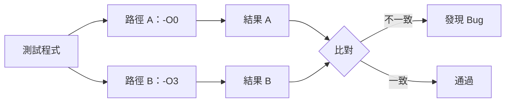
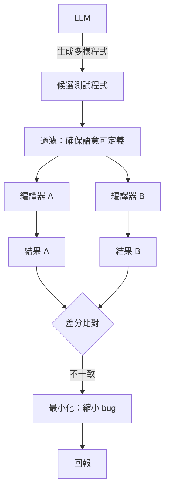

# 2.2　差分測試與 LLM 驅動的模糊測試

> 本節導論：形式驗證證明「應該正確」，測試則逼近「實際正確」。在編譯器驗證中，差分測試（Differential Testing）與模糊測試（Fuzzing）是最務實的兩把利器，而 LLM 的加入，正讓它們的語法多樣性提升到前所未有的層次。

## 2.2.1 差分測試的核心思想

差分測試（又稱差分模糊測試，differential fuzzing）的想法極簡：

> 如果兩個東西「應該等價」，那就用大量輸入去測，看它們是否真的等價。

在編譯器驗證中，常見的等價關係包括：

* **最佳化前 vs 最佳化後**：同一程式的 `-O0` 與 `-O2` 版本，輸出應該一致。
* **不同編譯器**：GCC 與 Clang 編譯同一程式，行為應該一致。
* **不同後端**：同一份 IR 降階到 CPU 與 GPU，數值結果應該一致（在容差內）。
* **解釋器 vs 編譯器**：參考解釋器的結果，應與編譯後執行一致。

## 2.2.2 為何差分測試特別適合編譯器

編譯器天然具備「多個應該等價的實作」，這讓差分測試如魚得水：

* **最佳化本身就是差分**：每個 pass 都宣稱保義，正好可以用「有無此 pass」來差分。
* **異質後端是差分**：同一份計算的不同實作，應該給出相同結果。
* **LLM 生成是差分**：生成的候選與參考實作，應該一致。

更重要的是，差分測試 **不需要寫規格（specification）**。傳統測試要人工寫「預期輸出」，差分測試只要「兩邊比對」，大幅降低門檻。

## 2.2.3 模糊測試：用輸入去逼出 Bug

差分測試需要「大量輸入」。模糊測試（fuzzing）就是自動產生這些輸入的技術：從隨機位元組，到結構化的程式，再到針對語意的變異。

編譯器的模糊測試，通常不是「餵隨機位元組給編譯器」，而是 **產生合法或近乎合法的程式**，讓編譯器去編譯，再比對結果。這需要 **語法感知的生成器（grammar-aware generator）**。

經典工具如 **Csmith**（隨機生成 C 程式）、**YARPGen**（隨機生成有明確未定義行為邊界的程式），都是這個思路。它們產生的程式「語法合法、語意可定義」，專門用來逼出編譯器的深層 bug。

## 2.2.4 LLM 帶來的語法多樣性

傳統模糊測試的弱點是「語法單調」：生成器往往只覆蓋語言的某個子集，產生的程式長得很像。LLM 改變了這一點：

* **語法多樣性**：LLM 能生成各式各樣的慣用法、邊界寫法、罕見語法組合。
* **語意多樣性**：LLM 能生成有真實意義的程式（排序、矩陣運算、字串處理），而非純隨機。
* **跨語言**：同一演算法可用 C、Rust、Triton 等多種語言表達，擴大差分維度。

這正是「邊界毒藥程式」的來源：LLM 能寫出人類專家才想得到的刁鑽邊界案例，逼出編譯器在極端情況下的 bug。

## 2.2.5 差分測試的限制

差分測試不是萬靈丹。它有幾個關鍵限制：

* **共同錯誤（common-mode failure）**：如果兩個實作有同一個 bug，差分測試抓不到。例如兩個後端都用了同一個錯誤的別名分析。
* **未定義行為（UB）**：程式若有未定義行為，兩個實作可以合法地不同，差分測試會誤報。所以需要「UB 自由的程式生成器」。
* **浮點與非確定性**：浮點運算的微小差異、平行執行的非確定性，會造成假陽性。需要容差與確定性控制。
* **覆蓋率**：差分測試只能測「生成器能生成的程式」。生成器覆蓋不到的地方，仍是盲區。

## 2.2.6 把 LLM 放進迴圈：生成—驗證—最小化

實務上，LLM 驅動的差分測試是一個迴圈：

1. **生成**：LLM 依提示產生多樣程式。
2. **過濾**：用靜態分析確保無 UB、語法合法。
3. **差分執行**：在多個編譯器或最佳化等級上跑，比對結果。
4. **最小化**：發現不一致時，自動縮小到最小重現案例（delta debugging）。
5. **回饋**：把發現的 bug 模式回饋給生成器，讓下一輪更針對性。

這個迴圈把「LLM 的多樣性」與「差分測試的自動化」結合，形成一個高效的 bug 探測器。

## 2.2.7 與形式驗證的互補

差分測試與形式驗證（2.1 節）是互補的：

* 形式驗證證明「所有輸入都正確」，但成本高、覆蓋窄。
* 差分測試只能證明「這些輸入正確」，但成本低、覆蓋廣（尤其搭配 LLM 的多樣性）。

在實務中，兩者常分層使用：形式驗證守核心不變式，差分測試掃大面積的邊界。

## 2.2.8 本節小結

* 差分測試：用「應該等價的兩個實作」比對，不需寫規格。
* 模糊測試：自動產生大量輸入，逼出深層 bug。
* LLM 提升語法多樣性，能生成「邊界毒藥程式」。
* 限制：共同錯誤、UB、浮點非確定性、覆蓋率。
* 迴圈：生成—過濾—差分—最小化—回饋。

下一節，我們看更根本的一層：那些「無論怎麼測都不該被違反」的全域不變式。
