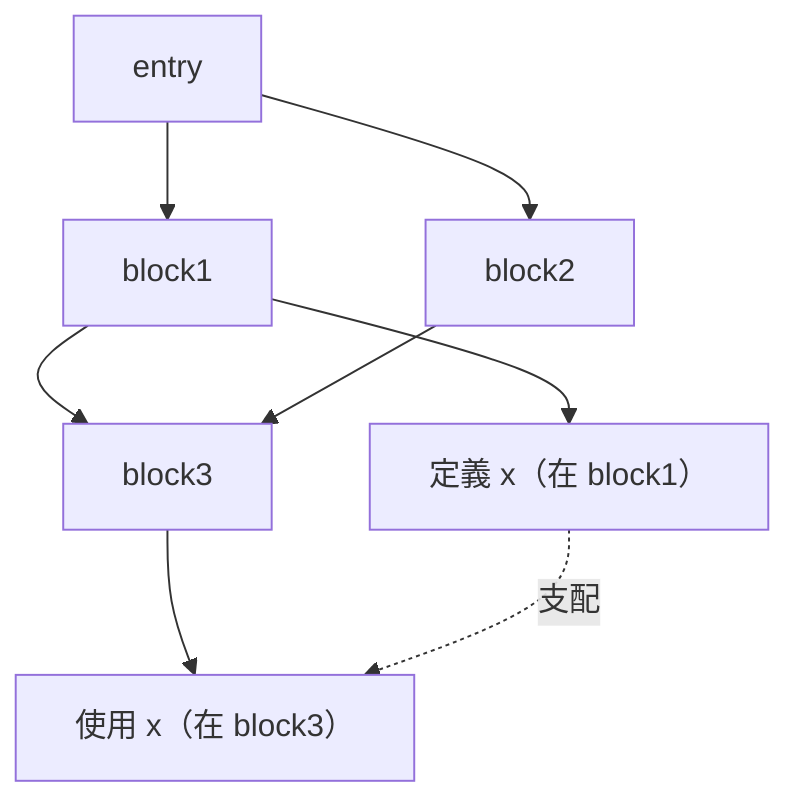
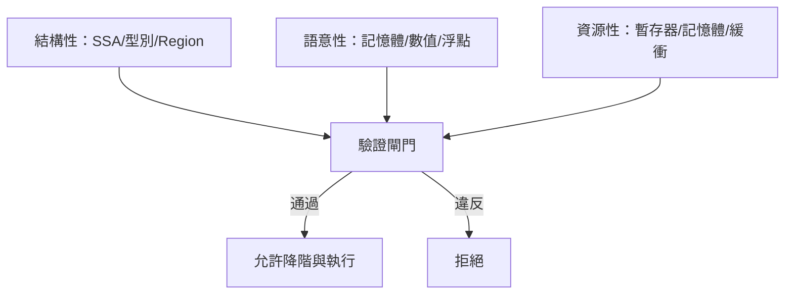

# 2.3　全域不變式的硬邊界

> 本節導論：無論生成多強、最佳化多激進，有些東西是「不管怎樣都不能違反」的。這些全域不變式（global invariants）構成了編譯器的最終防線，也是人類與形式化工具必須握有最終簽名權的地方。

## 2.3.1 什麼是全域不變式

全域不變式，是指「在編譯的任何階段、任何最佳化之後，都必須成立」的性質。它們不同於個別 pass 的局部條件，而是整個 IR 必須持續滿足的「結構契約」。

在 MLIR 與 LLVM 的世界裡，典型的不變式包括：

* **SSA 支配關係（dominance）**：每個使用（use）必須被其定義（def）所支配。
* **型別一致性**：運算元與結果的型別必須符合操作定義。
* **暫存器配置的合法性**：同一時刻，一個實體暫存器不能被兩個值佔用。
* **異常表完備性**：每個可能拋出例外的指令，都必須有對應的例外處理條目。

## 2.3.2 SSA 支配關係：最根本的不變式

SSA 支配關係是現代 IR 的基石。它的定義是：在控制流圖中，節點 $ d $ 支配節點 $ u $，若且唯若「從入口到 $ u $ 的每一條路徑都經過 $ d $」。

在 SSA 下，每個值只有一個定義點，因此「這個使用是否合法」可以化約為「其定義是否支配其使用」。

為什麼它是不變式？因為一旦違反，程式的語意就崩潰：你使用了一個「可能還沒被定義」的值。任何最佳化、任何降階，都必須維持這個性質。MLIR 的 verifier 每次 pass 後都會檢查它。

## 2.3.3 為什麼這些不變式「不能被機率化」

關鍵洞察是：**這些不變式是二元的（binary），不是機率的**。

LLM 可以「大概寫對」一個 Kernel，但支配關係不能「大概成立」——一個使用要嘛被支配，要嘛不被支配，沒有中間地帶。這正是為什麼驗證不能被生成取代：

* 生成是連續的、機率的（信心分數、取樣）。
* 不變式是離散的、確定的（成立或不成立）。

兩者之間，需要一個 **確定性的轉換器**：把「機率性的候選」轉成「通過不變式檢查的物件」。這個轉換器，就是編譯器的 verifier 與形式化工具。

## 2.3.4 三類硬邊界

我們可以把硬邊界分成三類：

**（1）結構性不變式。**
如 SSA 支配、型別一致、區域（Region）的巢狀合法性。這些是 IR 的「語法」，任何操作都必須維持。

**（2）語意性不變式。**
如記憶體安全（不得越界存取）、數值範圍（不得超出型別可表示範圍）、浮點語意（不得改變舍入模式）。這些是 IR 的「語意契約」。

**（3）資源性不變式。**
如暫存器數量上限、共享記憶體容量、片上緩衝大小。這些是「物理限制」，降階時必須遵守。

## 2.3.5 人類與形式化工具的最終簽名權

這裡有一個重要的治理問題：**誰有權說「這個候選可以放行」？**

在生成時代，答案是：**人類與形式化工具必須握有最終簽名權**。原因有三：

* **責任**：只有人類能承擔法律與倫理責任。機器可以建議，但不能負責。
* **完備性**：形式化工具能窮盡證明某些不變式，LLM 不能保證「窮盡」。
* **可審計性**：形式化的證明是可審計的（可重複檢查），LLM 的「信心」不是。

這不是對 AI 的不信任，而是對「確定性」的堅持。正如 1.3 節的不等式：生成能力與驗證能力是乘法關係，缺一不可。

## 2.3.6 一個具體例子：例外表完備性

以例外表為例。在 LLVM IR 中，每個可能拋出例外的呼叫，都必須有對應的 `invoke` 與 `landingpad`。如果一個最佳化把 `invoke` 改成 `call`（假設不拋例外），卻沒有更新例外表，程式在例外發生時就會走入未定義行為。

這類 bug 極難用測試抓到（需要精確觸發例外），但用「例外表完備性」這個不變式，可以在編譯期就靜態檢查。這就是硬邊界的價值：**它把「難以測試的錯誤」變成「可靜態驗證的錯誤」**。

## 2.3.7 不變式與 MLIR 的設計哲學

MLIR 把不變式內建到架構裡：

* 每個 Operation 有 `verify()` 方法，檢查自身的不變式。
* PassManager 在每個 pass 後可選擇性地跑 verifier。
* Dialect 可以定義自己的不變式（如 `linalg` 的 indexing 合法性）。

這種「不變式即架構」的設計，讓驗證不是外掛，而是 IR 的一部分。這正是第 7 章會展開的主題。

## 2.3.8 本節小結

* 全域不變式是「任何階段都必須成立」的結構契約。
* 典型例子：SSA 支配、型別一致、暫存器配置、例外表完備。
* 不變式是二元的，不能被機率化，因此不能被生成取代。
* 三類硬邊界：結構性、語意性、資源性。
* 人類與形式化工具必須握有最終簽名權。

至此，第一部結束。我們確立了「定義鬆動」與「驗證升值」的張力。下一部，我們進入物理世界：看四種算力形態如何逼出不同的編譯策略。
