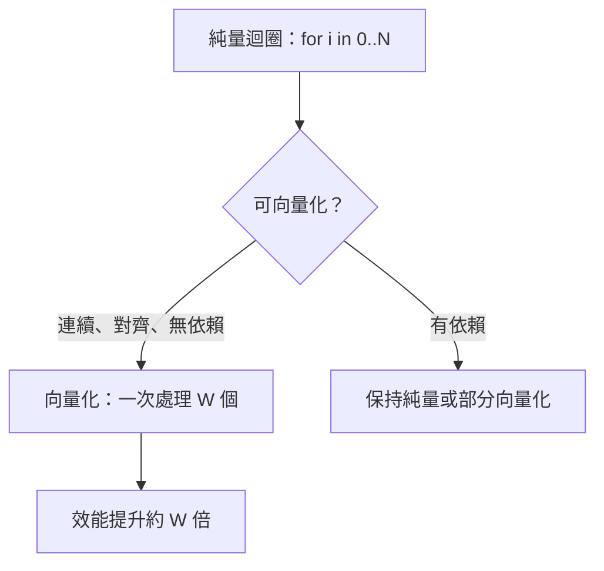

# 3.1　CPU 後端的微架構博弈

> 本節導論：CPU 後端看似「成熟穩定」，其實是最精密的微架構博弈場。亂序執行、SIMD 向量化、快取階層與指令排程，每一項都是編譯器與硬體之間的相互猜測。本節拆解這場博弈的規則。

## 3.1.1 後端到底在做什麼

CPU 後端的工作，可以濃縮成四個問題：

* **選哪些指令？**（指令選擇，instruction selection）
* **值放在哪裡？**（暫存器配置，register allocation）
* **指令排成什麼順序？**（指令排程，instruction scheduling）
* **如何利用平行？**（向量化與軟體管線）

這四個問題互相牽制：選了向量指令就改變暫存器壓力，改變排程就影響暫存器生命週期。後端因此不是「依序解四個問題」，而是「在約束下聯合求解」。

## 3.1.2 亂序執行：硬體替編譯器做的排程

現代高效能 CPU 是 **亂序執行（out-of-order, OoO）** 的：硬體會在執行時，動態重排指令順序，以填補延遲。這帶來了有趣的張力：

* 編譯器的指令排程，是「靜態」的，基於對延遲的估計。
* 硬體的亂序，是「動態」的，基於實際的資料依賴與資源可用性。

結果是：**編譯器的排程越精確，硬體越能發揮；但硬體越聰明，編譯器排程的邊際效益越低**。這就是為什麼在 OoO 核心上，過度激進的指令排程反而可能有害（增加暫存器壓力，卻被硬體重排抵消）。

## 3.1.3 SIMD 向量化：把純量變成資料平行

**SIMD（Single Instruction Multiple Data）** 是 CPU 上最直接的資料平行。以 x86 的 AVX-512 為例，一條指令可以同時處理 16 個 32 位元浮點數。

向量化的核心挑戰是 **資料布局**。要向量化一個迴圈，必須確保：

* **連續性**：要一起運算的資料，在記憶體中連續（或可用 gather/scatter 收集）。
* **對齊**：向量載入通常要求位址對齊，否則效能大跌或出錯。
* **無依賴**：迴圈迭代之間沒有資料依賴（或有可重排的依賴）。

## 3.1.4 快取階層：tiling 的物理根源

CPU 的記憶體階層（L1 → L2 → L3 → DRAM）速度差異巨大。L1 存取約 1–4 週期，DRAM 約 200–300 週期。這意味著：**如果工作集（working set）放不進快取，效能會被記憶體頻寬綁死**。

這就是 **tiling（分塊）** 的物理根源。以矩陣乘法 $ C = A \times B $ 為例，若直接三重迴圈，每次乘加都可能從 DRAM 讀資料；但若把矩陣切成符合快取的 tile，讓一個 tile 的計算在快取內完成，就能大幅減少記憶體流量。

分塊的效益可以用「算術強度（arithmetic intensity）」刻畫：

$$
\text{AI} = \frac{\text{FLOPs}}{\text{Bytes moved}}
$$

分塊越大，重複使用的資料越多，算術強度越高，越不容易被頻寬綁死。但 tile 不能大於快取，這就是「在快取容量約束下最大化算術強度」的最佳化問題。

## 3.1.5 指令排程與延遲隱藏

CPU 的指令有延遲（latency）與吞吐（throughput）的區別。例如載入指令延遲長，但可以管線化；乘法延遲中等；加法延遲短。

指令排程的目標，是 **在延遲期間插入無依賴的指令**，隱藏延遲。這需要編譯器知道：

* 每條指令的延遲與吞吐。
* 資料依賴圖（dependency graph）。
* 可用的執行單元數量。

但這裡有個根本矛盾：**編譯器不知道實際的微架構細節**（管線深度、執行單元數量、分支預測器行為）。所以現代後端往往依賴「機器模型（machine model）」來估計，而這個模型永遠是近似。

## 3.1.6 編譯器與微架構的共生

總結來說，CPU 後端是一場「編譯器猜硬體、硬體補編譯器」的博弈：

* 編譯器做靜態最佳化，硬體做動態補救。
* 編譯器假設延遲，硬體實際隱藏延遲。
* 編譯器做向量化與分塊，硬體提供快取與 SIMD 單元。

這場博弈的關鍵啟示是：**後端最佳化不是「越激進越好」，而是「與微架構匹配越好」**。這也解釋了為什麼「為特定 CPU 調校」的編譯器，往往比「通用最佳化」的編譯器快——因為它更懂那顆晶片的脾氣。

## 3.1.7 本節小結

* 後端四問：指令選擇、暫存器配置、指令排程、平行化。
* 亂序執行讓硬體替編譯器做動態排程，降低靜態排程的邊際效益。
* SIMD 向量化需要連續、對齊、無依賴。
* 快取階層是 tiling 的物理根源，算術強度是關鍵指標。
* 指令排程的本質是延遲隱藏，但編譯器對微架構只有近似模型。

下一節，我們轉向 GPU：一個把「執行緒」推到極致、卻又要求「同進同出」的矛盾機器。
