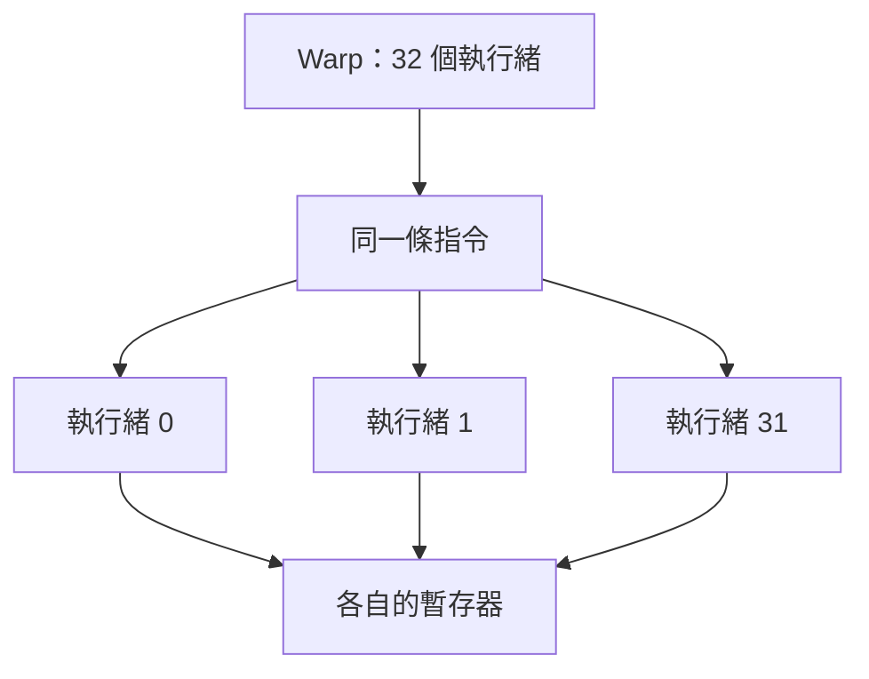
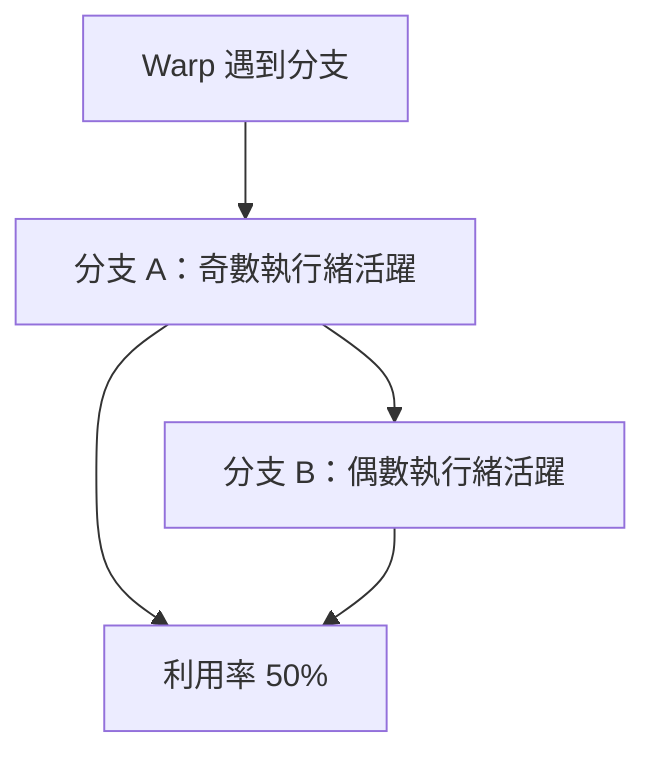
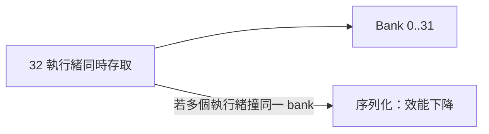

# 3.2　GPU 的 SIMT 模型與 Warp 執行

> 本節導論：GPU 不是「很多個 CPU 核心」，而是一種完全不同的執行模型：SIMT（Single Instruction, Multiple Threads）。理解 Warp 的「同進同出」、Shared Memory 的爭用、暫存器壓力與分歧控制流，是寫出高效 GPU 編譯器的前提。

## 3.2.1 從 SIMD 到 SIMT

CPU 的 SIMD 是「一條指令處理多個資料」，但資料必須打包在向量暫存器裡。GPU 的 SIMT 則是「多個執行緒，共用一條指令流」：

* 每個執行緒有自己的暫存器與程式計數器（概念上）。
* 但硬體以 **Warp（NVIDIA，32 執行緒）** 或 **Wavefront（AMD，64 執行緒）** 為單位，一次執行同一條指令。

這意味著：**同一 Warp 內的所有執行緒，必須執行相同的指令**。這就是 SIMT 的核心，也是所有 GPU 編譯難題的根源。

## 3.2.2 分歧控制流：SIMT 的最大麻煩

如果一個 Warp 內的執行緒要走不同的分支（例如 `if (tid % 2) ... else ...`），會發生什麼？

硬體的做法是 **序列化（serialization）**：先執行 `if` 分支（只讓符合條件的執行緒活躍），再執行 `else` 分支（讓另一批活躍）。這叫 **分歧（divergence）**。

代價是：**兩條分支的執行時間相加**，而非取其一。若分歧嚴重，Warp 的利用率會大幅下降。

編譯器的責任，是 **減少分歧** 或 **把分歧的代價藏起來**。常見手法包括：predication（把短分支改成條件執行）、分支合併、以及在排程時把同分歧的執行緒放在同一 Warp。

## 3.2.3 Shared Memory 與 Bank Conflict

GPU 的共享記憶體（Shared Memory）是片上高速緩衝，供同一執行緒區塊（block）內的執行緒共享。它的頻寬極高，但有一個陷阱：**Bank Conflict**。

Shared Memory 被切成多個 bank（通常 32 個）。若同一 Warp 的執行緒，同時存取「同一個 bank 的不同位址」，就會發生衝突，存取被序列化。

這對矩陣運算尤其致命：若資料布局不對，轉置（transpose）會造成嚴重 bank conflict。編譯器必須做 **布局重排（layout transformation）**，例如 padding、swizzling，來避免衝突。

## 3.2.4 Register Pressure：暫存器的定量分配

GPU 的暫存器是「每個執行緒」分配的。每個執行緒能用的暫存器數量有限（例如 255 個），而一個 SM 的暫存器總量固定。這造成一個權衡：

* 每個執行緒用越多暫存器，能並行的執行緒越少（occupancy 越低）。
* 每個執行緒用越少暫存器，可能要做更多 spill（溢出到 local memory），效能下降。

$$
\text{Occupancy} \approx \frac{\text{每個 SM 可用暫存器}}{\text{每執行緒暫存器} \times \text{每 block 執行緒}}
$$

這是一個典型的「資源約束下的最佳化」：編譯器要盡量降低暫存器壓力，同時保持足夠的並行度。

## 3.2.5 Occupancy 與延遲隱藏的取捨

高 occupancy（同時駐留更多 Warp）的好處是：當一個 Warp 在等記憶體時，硬體可以切換到另一個 Warp，隱藏延遲。這叫 **延遲隱藏（latency hiding）**。

但高 occupancy 不總是更好：

* 若一個 Kernel 是「計算密集」且暫存器需求高，降低 occupancy 換取更多暫存器，可能更快。
* 若一個 Kernel 是「記憶體密集」，則需要高 occupancy 來隱藏延遲。

所以編譯器（或 autotuner）必須根據 Kernel 的特性，在「暫存器 vs occupancy」之間找到平衡點。

## 3.2.6 GPU 執行模型的編譯意涵

總結 GPU 的執行模型，對編譯器有四個意涵：

* **分歧是敵人**：要盡量減少分支分歧，或把分歧轉成 predication。
* **記憶體布局是關鍵**：Shared Memory 的 bank conflict、global memory 的 coalescing，都取決於布局。
* **暫存器是稀缺資源**：要在 occupancy 與 register pressure 之間取捨。
* **延遲靠並行隱藏**：要足夠多的 Warp 來填補記憶體延遲。

這些意涵，讓 GPU 編譯器與 CPU 編譯器有本質差異：CPU 編譯器關心「單執行緒的指令排程」，GPU 編譯器關心「整個 Warp/block 的資源與排程」。

## 3.2.7 本節小結

* SIMT：多執行緒共用一條指令流，以 Warp（32）或 Wavefront（64）為單位。
* 分歧造成序列化，是效能殺手。
* Shared Memory 有 bank conflict，需要布局重排。
* Register pressure 與 occupancy 是核心取捨。
* 延遲隱藏靠足夠的 Warp 並行。

下一節，我們看 Triton 如何把「調度粒度」從執行緒提升到張量分塊，從根本上改變程式設計與編譯的介面。
