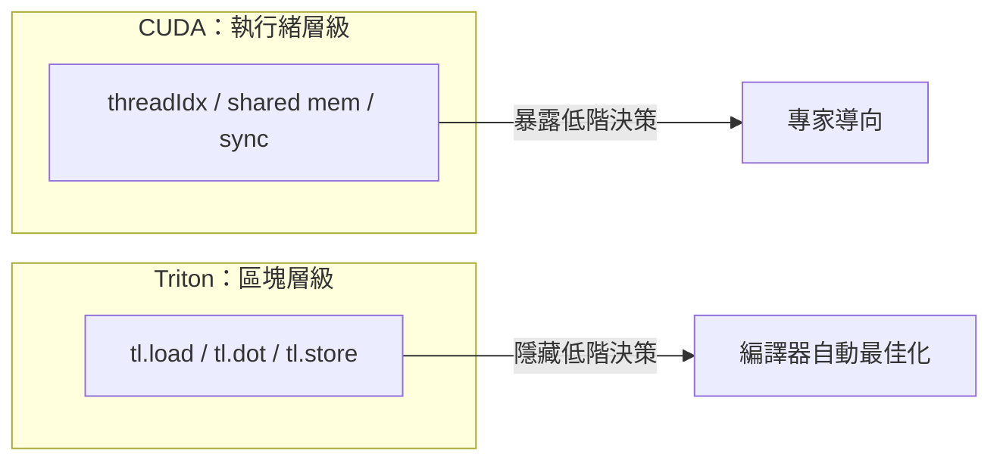
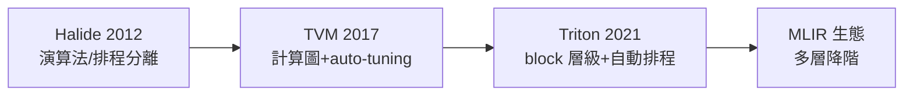

# 3.3　Triton 的啟示：從執行緒到張量分塊

> 本節導論：如果 GPU 的難點在於「執行緒層級的資源與排程」，那麼 Triton 的核心洞見是：**把調度粒度從單一執行緒提升到張量分塊（Tile）**。這一步，讓編譯器重新獲得了自動最佳化的空間，也重新定義了「程式設計師該管什麼」。

## 3.3.1 傳統 CUDA 的困境

在傳統 CUDA 中，程式設計師要手動管理：

* **執行緒索引**：`threadIdx.x`、`blockIdx.x`、grid/block 大小。
* **Shared Memory**：手動宣告、手動載入、手動同步（`__syncthreads()`）。
* **記憶體布局**：手動避免 bank conflict。
* **暫存器壓力**：手動控制變數生命週期。

```cuda
// 傳統 CUDA 的矩陣乘法片段
__shared__ float As[TILE][TILE];
__shared__ float Bs[TILE][TILE];
int tx = threadIdx.x, ty = threadIdx.y;
// ... 手動載入、同步、計算 ...
```

這種寫法讓專家能榨出極致效能，但也讓「非專家」幾乎無法寫出高效的 Kernel。更糟的是，它把「執行緒層級的決策」暴露給使用者，而這些決策本應是編譯器的工作。

## 3.3.2 Triton 的核心抽象：Block 作為一等公民

Triton（Philippe Tillet 等人於 2021 年在 OpenAI 提出）改變了這一點。它的語言模型是：

* **程式以「張量區塊（block）」為單位**，而非單一執行緒。
* 每個 block 是一個「虛擬的張量運算」，例如 `tl.load`、`tl.dot`、`tl.store`。
* 程式設計師不寫執行緒索引，而寫「區塊層級的資料流」。

```python
# Triton 的矩陣乘法片段
@triton.jit
def matmul_kernel(a_ptr, b_ptr, c_ptr, M, N, K, BLOCK: tl.constexpr):
    pid = tl.program_id(0)
    # 以 block 為單位載入
    a = tl.load(a_ptr + ...)   # 形狀 [BLOCK, BLOCK]
    b = tl.load(b_ptr + ...)
    c = tl.dot(a, b)
    tl.store(c_ptr + ..., c)
```

這裡的關鍵是：**程式設計師只描述「要做什麼區塊運算」，不描述「哪個執行緒做哪個元素」**。



## 3.3.3 為什麼「提高粒度」能釋放最佳化空間

這是一個深刻的編譯原理洞見。當程式設計師把「每個執行緒做什麼」寫死，編譯器就被鎖死在一個特定的映射上，無法重新安排。但當程式設計師只說「這是一個 block 的矩陣乘」，編譯器就有自由去：

* **決定 block 大小**（tile size）。
* **決定資料如何載入**（coalesced load）。
* **決定是否用 Tensor Core**。
* **決定暫存器與 Shared Memory 的分配**。

換句話說，**提高抽象粒度，等於把「低階排程的自由度」還給編譯器**。

## 3.3.4 與 Halide、TVM 的譜系

Triton 不是憑空出現的。它的思想脈絡可以追溯到：

* **Halide（2012）**：把「演算法（algorithm）」與「排程（schedule）」分離，讓使用者描述「做什麼」與「怎麼排」，編譯器負責降階。
* **TVM（2017）**：用計算圖與 tensor expression，加上 auto-tuning（Ansor），在排程空間中搜尋。
* **Triton（2021）**：把「排程」進一步自動化，讓使用者只寫 block 層級的運算，編譯器負責 tile 大小、佈局、同步。

這條譜系的共同主題是：**把「怎麼做」從使用者手中拿回來，交給編譯器與搜尋**。



## 3.3.5 Tile 作為「語意單位」的威力

Triton 的另一個洞見是：**tile 是一個好的「語意單位」**。它夠大，能保留矩陣運算的結構（讓 `tl.dot` 能被映射到 Tensor Core）；又夠小，能放進暫存器與 Shared Memory（讓排程可實現）。

這與 6.1 節要談的「LLVM IR 過早拆解」形成鮮明對比：LLVM IR 把矩陣乘法拆成純量迴圈，丟失了「這是矩陣乘」的語意；Triton 的 block 則保留了這個語意，直到降階的最後一刻。

## 3.3.6 Triton 的限制與邊界

Triton 不是萬能。它的限制包括：

* **不適合不規則計算**：tile 模型假設資料是規則的、可切塊的。稀疏、圖、指標追逐等不規則計算，仍需要更靈活的模型。
* **控制流受限**：Triton 的 block 內控制流較受限，複雜的分支仍難以表達。
* **依賴特定硬體**：Triton 的效能優勢，很大程度來自它對 NVIDIA GPU 的深度最佳化；移植到其他硬體需要重新設計。

## 3.3.7 對編譯器設計的普遍啟示

Triton 的啟示，超越了 GPU：

* **抽象粒度決定最佳化空間**：太高階失去硬體細節，太低階鎖死排程。tile 是一個好的中間點。
* **分離「做什麼」與「怎麼做」**：這是 Halide 以來的一貫主題。
* **把搜尋交給機器**：tile 大小、佈局、排程的組合爆炸，人類調不動，機器可以。

這些啟示，正是第 8 章「網狀編譯管線」與第 9 章「AI 賦能編譯器」的伏筆。

## 3.3.8 本節小結

* CUDA 暴露執行緒層級決策，門檻高。
* Triton 把粒度提升到 block/tile，隱藏低階決策。
* 提高粒度 = 把排程自由度還給編譯器。
* 譜系：Halide → TVM → Triton → MLIR。
* 限制：不規則計算、控制流、硬體依賴。

下一章，我們從 GPU 的「大量平行」，轉向 NPU/TPU 的「靜態排程與張量引擎」。
