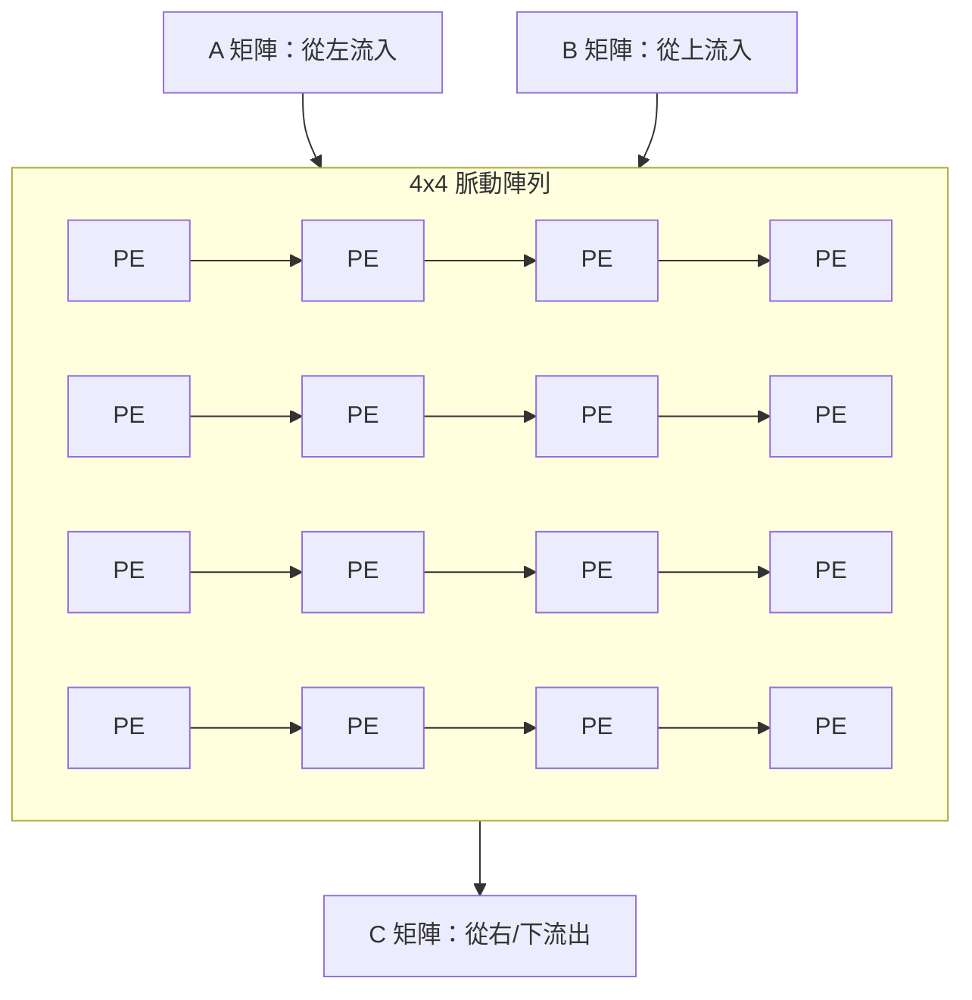
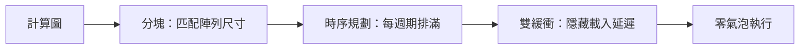

# 4.1　脈動陣列與專用矩陣單元

> 本節導論：如果 GPU 是「用大量執行緒掩蓋延遲」，那麼 TPU/NPU 就是「用資料流消除延遲」。脈動陣列（Systolic Array）是這種哲學的極致體現：資料像心跳一樣在陣列中流動，每個週期都有乘法在發生。本節拆解它的硬體邏輯與對編譯器的苛刻要求。

## 4.1.1 從 CPU/GPU 到專用張量引擎

CPU 與 GPU 都是「通用」的：它們要能執行任意程式，因此有複雜的控制邏輯、快取、分支預測。但深度學習的計算極度規律：主要是矩陣乘法與卷積。

專用張量引擎（TPU、NPU）的核心洞見是：**如果計算這麼規律，為什麼不把控制邏輯換成更多的乘法器？**

- CPU：少量 ALU，大量控制與快取。
- GPU：大量 ALU，中等控制，共享記憶體。
- TPU/NPU：**大量乘加單元（MAC），極少控制，資料流驅動**。

## 4.1.2 脈動陣列的結構

**脈動陣列（systolic array）** 的概念由 H. T. Kung 與 Charles Leiserson 在 1978–1979 年提出。它的結構是：

* 一個二維的乘加單元（PE）陣列。
* 資料從邊緣「脈動」式地流入，每個 PE 在每個週期做一次乘加。
* 結果從另一側流出。

以 $ 4 \times 4 $ 的陣列計算矩陣乘法為例：

關鍵是：**資料在陣列中「路過」時就被重複使用**。一個從左流入的元素，會依序經過一整列，與該列每個 PE 的 B 元素相乘並累加。這叫 **資料重用（data reuse）**，也是脈動陣列效率的來源：不需要頻繁地從記憶體讀取，資料在晶片上流動時就被榨乾所有價值。

## 4.1.3 為什麼脈動陣列需要「靜態排程」

脈動陣列的效率，來自「每個週期都排滿乘法」。但這要求：

* **資料必須在正確的時刻到達正確的 PE**。
* **不能有氣泡（bubble）**：若某個 PE 等待資料，整個陣列的利用率就下降。
* **權重（weights）必須預先載入或及時流動**。

這意味著：**編譯器必須在編譯時，就把「哪個資料在什麼週期去哪裡」算得清清楚楚**。這與 CPU/GPU 的「動態排程」形成鮮明對比：

| 面向 | CPU/GPU | TPU/NPU |
|---|---|---|
| 排程 | 動態（硬體排程） | 靜態（編譯器排程） |
| 資料流 | 快取驅動 | 編譯器規劃 |
| 容錯 | 硬體重排 | 無，必須精確 |

這就是為什麼 NPU 編譯器「高度依賴靜態規劃」：**硬體幾乎不幫你重排，錯了就是氣泡或錯誤結果**。

## 4.1.4 張量引擎的資料流

除了脈動陣列，現代 TPU/NPU 還常用 **資料流架構（dataflow architecture）**：

* **權重固定（weight stationary）**：權重留在 PE 內，輸入資料流過。
* **輸出固定（output stationary）**：部分和留在 PE 內，累加後才寫出。
* **輸入固定（input stationary）**：輸入留在 PE 內，權重流過。

每種策略適合不同的運算形狀。編譯器要根據運算的特性（矩陣大小、通道數、卷積核大小），選擇最合適的資料流。

## 4.1.5 對編譯器的三個苛刻要求

總結來說，脈動陣列對編譯器提出三個苛刻要求：

**（1）精確的時序規劃。**
每個資料元素何時到達、何時被使用、何時離開，都必須精確計算。這需要編譯器對硬體的延遲、緩衝深度有完整模型。

**（2）完美的分塊。**
tile 大小必須匹配陣列維度。太小，陣列利用率低；太大，放不進緩衝。這是一個「在硬體約束下最大化利用率」的最佳化問題。

**（3）零氣泡的排程。**
編譯器要安排資料的預取（prefetch）與雙緩衝（double buffering），讓計算單元永遠有資料可用。

## 4.1.6 一個歷史註腳：Google TPU

Google 的 TPU（Tensor Processing Unit）是脈動陣列最著名的商業實作。TPU v1（2015 年部署、2016 年公開）的核心是一個 $ 256 \times 256 $ 的脈動陣列，專門加速推論的矩陣運算。它的編譯器（基於 XLA）必須把計算圖靜態編譯成精確的時序排程。

TPU 的成功，證明了「專用 + 靜態排程」在特定工作負載上的巨大優勢；但它也暴露了「通用性不足」的代價——這也是為什麼後來的 TPU 版本持續增加彈性。

## 4.1.7 本節小結

* TPU/NPU 用大量 MAC 取代控制邏輯，以資料流驅動。
* 脈動陣列靠「資料在陣列中流動時被重用」來榨取效率。
* 靜態排程是必要條件：編譯器必須精確規劃時序、分塊、雙緩衝。
* 三個苛刻要求：精確時序、完美分塊、零氣泡。

下一節，我們把這些要求具體化為「靜態規劃的四把利器」：融合、分塊、布局、雙緩衝。
