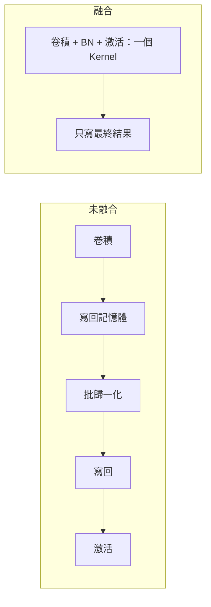
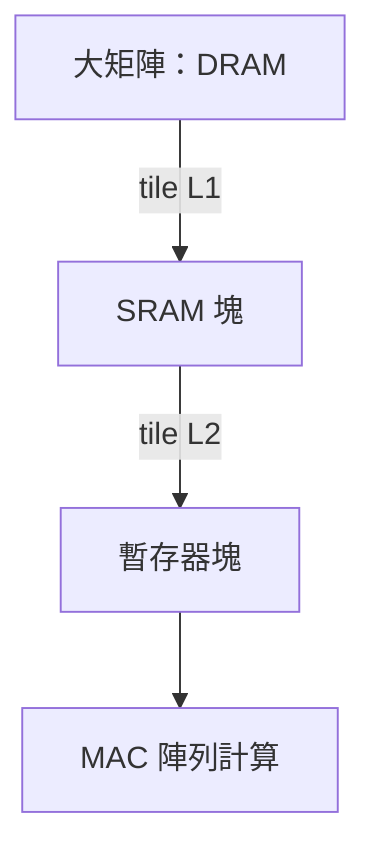
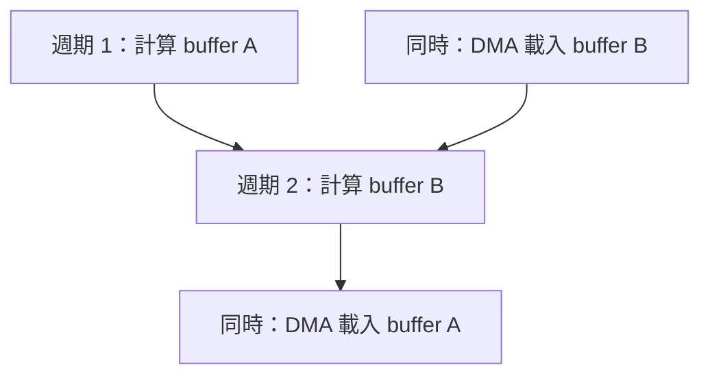
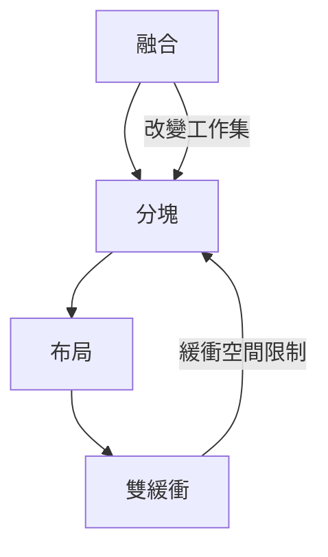

# 4.2　靜態規劃的四把利器：融合分塊布局與雙緩衝

> 本節導論：前一節說 NPU 編譯器「高度依賴靜態規劃」。本節把這句話拆成四個具體技術：算子融合（Fusion）、多級分塊（Tiling）、記憶體布局重排（Layout Transformation）、雙緩衝（Double Buffering）。這四把利器，決定了 NPU 編譯器能否榨出硬體極限。

## 4.2.1 利器一：算子融合（Operator Fusion）

深度學習模型是一連串算子：卷積 → 批歸一化 → 激活 → 池化。若每個算子都獨立執行，就要把中間結果寫回記憶體、再讀出來。這造成巨大的記憶體流量。

**算子融合** 的做法是：把多個算子合併成一個 Kernel，讓中間結果留在暫存器或片上緩衝，不寫回記憶體。

融合的效益可以用「記憶體流量」量化。假設融合 $ k $ 個算子，每個中間結果大小為 $ S $：

* 未融合：記憶體流量約 $ 2kS $（每個中間結果寫一次、讀一次）。
* 融合後：記憶體流量約 $ 2S $（只寫最終輸出、讀輸入）。

在大模型中，這可以減少數倍的記憶體流量，直接轉化為速度。

## 4.2.2 利器二：多級分塊（Multi-level Tiling）

**分塊（tiling）** 是把大計算切成小塊，讓每一塊的工作集符合某級記憶體容量。NPU 通常有多級記憶體（global DRAM → 片上 SRAM → 暫存器），因此需要 **多級分塊**：

* **Level 1**：把大矩陣切成適合 DRAM → SRAM 搬移的塊。
* **Level 2**：把 SRAM 中的塊切成適合暫存器檔案的塊。

多級分塊的難點在於：**每一級的塊大小要同時滿足「容量約束」與「陣列維度約束」**。例如 SRAM 只有 1 MB，陣列是 $ 128 \times 128 $，那麼 tile 必須是陣列維度的整數倍，又要放得進 SRAM。這是一個帶約束的最佳化問題。

## 4.2.3 利器三：記憶體布局重排（Layout Transformation）

資料在記憶體中的排列方式（layout），直接影響存取的效率。常見的布局包括：

* **NCHW**（batch, channel, height, width）：傳統卷積布局。
* **NHWC**：通道在最後，適合某些硬體。
* **分塊布局（tiled layout）**：把矩陣切成小塊，塊內連續。

為什麼要重排？因為 NPU 的 MAC 陣列要求「同一個週期存取的資料，在記憶體中連續或符合 bank 結構」。若布局不對，就會出現 bank conflict 或非連續存取，效能大跌。

編譯器的責任，是 **在降階時自動插入布局轉換（layout conversion）**，或選擇一個對硬體友善的布局。這一步常被稱為 **layout propagation**：把布局需求從硬體往回傳播，盡量在「產生資料的地方」就用對的布局，避免昂貴的轉換。

## 4.2.4 利器四：雙緩衝（Double Buffering）

NPU 的計算單元與記憶體搬移（DMA）可以並行。但要並行，就需要 **雙緩衝**：

* 準備兩塊緩衝區 A、B。
* 當計算單元在算 A 的資料時，DMA 把下一塊資料載入 B。
* 算完 A 後，交換角色：計算 B，DMA 載入 A。

雙緩衝的效益是「隱藏載入延遲」：只要 DMA 的速度不慢於計算，計算單元就永遠不會因等資料而停頓。這是第 4.1 節「零氣泡」的具體實現。

## 4.2.5 四把利器的相互關係

這四把利器不是獨立的，而是互相依賴：

* **融合** 減少記憶體流量，但也改變了分塊的形狀。
* **分塊** 決定工作集大小，進而決定布局與雙緩衝的設計。
* **布局** 影響 DMA 的效率，進而影響雙緩衝能否隱藏延遲。
* **雙緩衝** 需要額外的緩衝空間，反過來限制分塊大小。

這是一個 **聯合最佳化問題**：四個決策必須一起解，不能分開解。這正是為什麼 NPU 編譯器如此複雜——它必須在一個高維空間裡，找到滿足所有約束的解。

## 4.2.6 為什麼靜態規劃能贏

有人會問：為什麼不讓硬體動態決定？答案是：**動態決定的成本太高**。

* 動態分塊需要執行期檢查、分支、額外控制邏輯。
* 動態布局轉換需要執行期判斷資料形狀。
* 動態雙緩衝需要硬體支援複雜的同步。

在 NPU 上，這些成本會直接吃掉「專用硬體」的優勢。所以 NPU 選擇「把複雜度推給編譯器」：編譯時就算好一切，執行時只做最簡單的動作。這是 **「編譯期換執行期」** 的典型交易。

## 4.2.7 本節小結

* 融合：減少記憶體流量，讓中間結果留在片上。
* 多級分塊：匹配多級記憶體容量與陣列維度。
* 布局重排：讓資料存取符合硬體的 bank 結構。
* 雙緩衝：用兩塊緩衝隱藏 DMA 延遲。
* 四者互相依賴，是聯合最佳化問題。

下一節，我們看向外延伸的問題：當 ISA 本身碎片化（如 RISC-V 的自訂擴充），編譯器如何快速適配？
