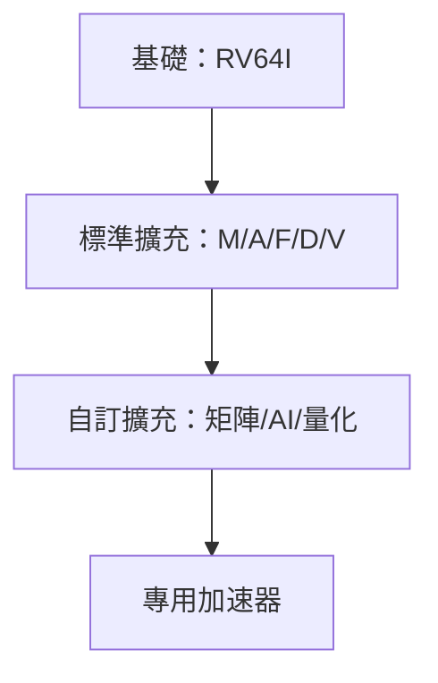
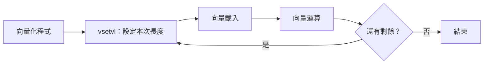

# 4.3　開放 ISA 碎片化與 RISC-V 自訂擴充

> 本節導論：專用硬體帶來了一個新問題——指令集碎片化。每個廠商都有自己的向量擴充、AI 擴充、矩陣擴充。編譯器如何在「一萬種 ISA」之間快速適配？RISC-V 的開放擴充機制，提供了一個關鍵的觀察窗口。

## 4.3.1 碎片化的根源

傳統上，ISA 是「少數幾家」定義的：x86、ARM、PowerPC。編譯器只要支援這幾套，就能覆蓋大部分市場。

但異質算力改變了這一點：

* **AI 加速器** 各家用自訂指令（矩陣乘、卷積、量化）。
* **邊緣裝置** 用精簡的 RISC-V 核心，加上自訂擴充。
* **研究與新創** 用開放 ISA 快速迭代。

結果是：**ISA 的數量爆炸，且變化極快**。若編譯器為每個 ISA 手寫一個後端，成本無法承受。

## 4.3.2 RISC-V 的開放擴充機制

RISC-V 的設計哲學是「模組化」：

* **基礎指令集（base）**：如 RV32I、RV64I。
* **標準擴充（standard extensions）**：如 M（乘除）、A（原子）、F/D（浮點）、V（向量，1.0 版於 2021 年批准）。
* **自訂擴充（custom extensions）**：廠商可在保留的 opcode 空間（如 `custom-0`、`custom-1`）加入自己的指令。

這種「基礎 + 擴充」的模組化，讓廠商能快速定義專用指令，而不必從零設計 ISA。

## 4.3.3 編譯器如何適配碎片化 ISA

面對碎片化，編譯器有三條策略：

**（1）用 IR 統一，後端插件化。**
這是 MLIR 的思路：高階 IR 統一，後端以「目標方言（target dialect）」插件化。每個 ISA 只需要定義自己的指令方言與降階規則，不必重寫整個編譯器。

**（2）用 intrinsic 對接自訂指令。**
對於無法用標準指令表達的操作（如矩陣乘），用 **intrinsic（內建函式）** 對接。編譯器只需知道「這個 intrinsic 對應這條自訂指令」，就能生成它。

**（3）用自動生成減少手寫。**
用 TableGen 等工具，從 ISA 描述自動生成指令選擇規則。這樣，新增一條指令，只需更新描述檔，不必手寫 C++ 程式碼。

## 4.3.4 向量擴充的編譯挑戰

RISC-V 的 V 擴充（向量）是碎片化的典型例子。它的特點是：

* **可變長度向量**：向量長度（VLEN）由硬體決定，程式必須用 `vsetvl` 動態設定。
* **可伸縮（scalable）**：同一份程式碼，可在不同 VLEN 的硬體上執行。
* **遮蔽（masking）**：用遮罩處理尾端不足一個向量的部分。

這對編譯器提出挑戰：**它不能在編譯時假設固定的向量長度**，而必須生成「可適應不同 VLEN」的程式碼。這與 x86 的固定向量長度（如 AVX-512 的 512 位元）形成對比。

## 4.3.5 開放 ISA 與編譯器生態的共生

RISC-V 的開放性，創造了一個正向循環：

* **開放 ISA** 讓更多廠商能定義專用硬體。
* **更多硬體** 讓編譯器的「多目標能力」更有價值。
* **更好的編譯器** 讓廠商更願意用開放 ISA（因為軟體生態跟著來）。

這正是 MLIR 這類「多層 IR + 可插件後端」的架構，能在碎片化時代存活的根本原因。

## 4.3.6 一個現實的張力：標準化 vs 最佳化

碎片化帶來一個根本張力：

* **標準化** 讓軟體可移植，但無法榨出專用硬體的極限。
* **專用化** 能榨出極限，但軟體被綁定在特定硬體。

編譯器的角色，是在這兩者之間找到平衡：用高階 IR 保持可移植性，用 target-specific pass 榨取專用效能。這正是第 7 章「方言生態」與第 8 章「網狀管線」要解決的問題。

## 4.3.7 本節小結

* 異質算力導致 ISA 碎片化，數量爆炸、變化快。
* RISC-V 用「基礎 + 擴充」的模組化，支援自訂指令。
* 編譯器三策略：IR 統一後端插件化、intrinsic 對接、自動生成。
* 向量擴充（V）帶來可變長度與可伸縮的挑戰。
* 開放 ISA 與編譯器生態形成正向循環。

至此，第 2 部的前三種算力形態（CPU、GPU、NPU/TPU）已鋪陳完畢。下一章，我們跨越最後一道邊界：當編譯的終點不再是機器碼，而是電路拓撲。
