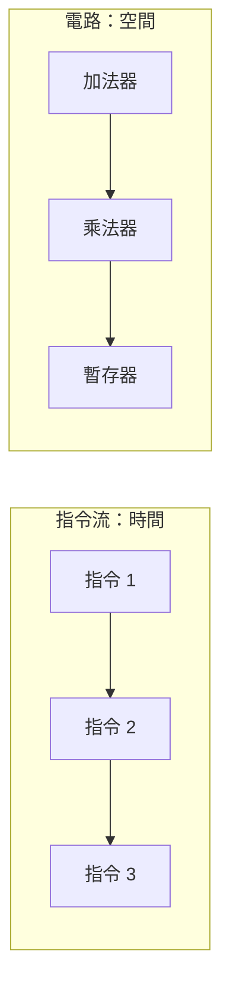
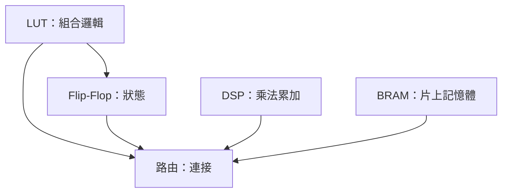
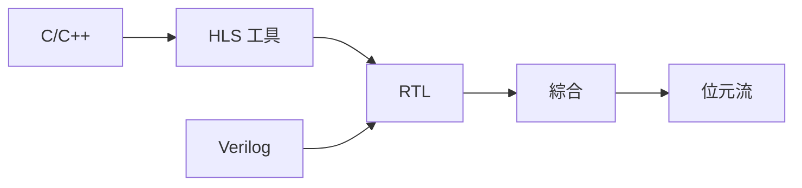

# 5.1　當編譯的終點是電路拓撲

> 本節導論：CPU、GPU、NPU 的編譯終點都是「指令」。但 FPGA 與可重構硬體的編譯終點，是「電路」。這是一個本體論層級的轉變：從「時間上的指令序列」變成「空間上的邏輯連接」。本節說明這個轉變如何重塑編譯器的整個世界觀。

## 5.1.1 指令流 vs 電路拓撲

傳統編譯器的最終產物是指令序列：

* 指令按時間順序執行。
* 每條指令操作暫存器或記憶體。
* 程式是「時間的藝術」：同一個硬體，依序執行不同指令。

FPGA 的最終產物是 **位元流（bitstream）**：

* 位元流描述「哪個邏輯閘連到哪個邏輯閘」。
* 電路是「空間的藝術」：所有運算單元同時存在、同時運作。
* 程式是「配置」：把電路「燒」進晶片。

這個轉變的深遠的意涵是：**編譯器不再只是「翻譯語言」，而是「設計硬體」**。

## 5.1.2 FPGA 的物理結構

FPGA（Field-Programmable Gate Array）由三種基本資源構成：

* **查找表（LUT）**：用於實作組合邏輯（如 AND、OR、XOR）。一個 4 輸入 LUT 可實作任意 4 輸入布林函數。
* **正反器（Flip-Flop, FF）**：用於儲存狀態，構成時序邏輯。
* **路由資源（Routing）**：連接 LUT 與 FF 的連線網路。

此外，現代 FPGA 還有 **DSP 切片**（用於乘法累加）與 **BRAM**（片上記憶體）。

## 5.1.3 從高階語言到電路的兩條路

要把高階計算變成電路，有兩條路：

**（1）RTL 手寫。**
用 Verilog/VHDL 手寫 **暫存器傳輸級（Register Transfer Level, RTL）** 描述，再用綜合工具（synthesis）轉成位元流。這條路控制精確，但生產力低。

**（2）高層次合成（High-Level Synthesis, HLS）。**
用 C/C++ 或更高階語言描述計算，由 HLS 工具自動生成 RTL。這條路生產力高，但時序與資源的控制較難。

## 5.1.4 為什麼電路編譯更難

電路編譯的難度，來自幾個根本差異：

* **空間約束**：指令流只需考慮「時間上的資源」，電路要考慮「空間上的資源」（LUT、FF、BRAM、DSP 的數量）。
* **時序約束**：電路必須滿足時脈頻率（clock frequency）的要求。一條太長的組合邏輯鏈，會限制頻率。
* **並行性**：指令流是「依序」的，電路是「同時」的。編譯器必須決定「哪些運算要平行、哪些要序列」。
* **不可逆性**：位元流一旦「燒」進 FPGA，修改就要重新配置。除錯比軟體困難得多。

## 5.1.5 CGRA：介於 FPGA 與 GPU 之間

除了 FPGA，還有一類 **粗粒度可重構陣列（Coarse-Grained Reconfigurable Array, CGRA）**：

* 運算單元較粗（如 ALU、乘法器），而非細粒度的 LUT。
* 路由較規則，配置較快。
* 適合規則的資料流計算（如卷積、矩陣）。

CGRA 的編譯，介於「指令排程」與「電路布局」之間：既要排時序，又要配置空間。它是理解「空間編譯」的一個好窗口。

## 5.1.6 對編譯器架構的衝擊

這個「從時間到空間」的轉變，對編譯器架構有三個衝擊：

* **IR 必須能表達並行**：傳統 IR 是「序列」的，但電路是「平行」的。IR 必須能表達「這些運算同時發生」。
* **最佳化目標改變**：從「減少指令數」變成「減少資源使用、滿足時序」。
* **驗證方式改變**：從「執行測試」變成「時序分析、資源檢查、形式等價驗證」。

這正是為什麼業界開始用 MLIR 來做 HLS：MLIR 的多層抽象與並行表達能力，比傳統 IR 更適合描述電路（第 8 章會談 CIRCT）。

## 5.1.7 本節小結

* FPGA 的編譯終點是電路拓撲（位元流），而非指令。
* FPGA 由 LUT、FF、路由、DSP、BRAM 構成。
* 兩條路：RTL 手寫、HLS 高階合成。
* 電路編譯更難：空間約束、時序約束、並行性、不可逆性。
* CGRA 介於 FPGA 與 GPU 之間。
* 衝擊：IR 要表達並行、目標變成資源與時序、驗證變成時序與等價。

下一節，我們深入 HLS 的核心挑戰：如何把高階計算，轉化成「時序收斂」的狀態機與管線。
