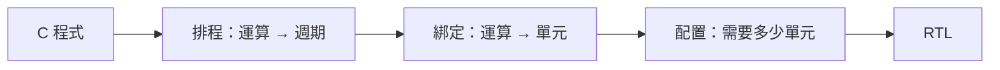
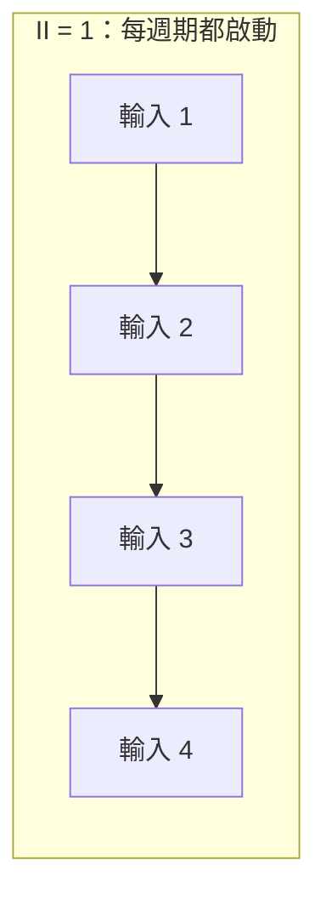
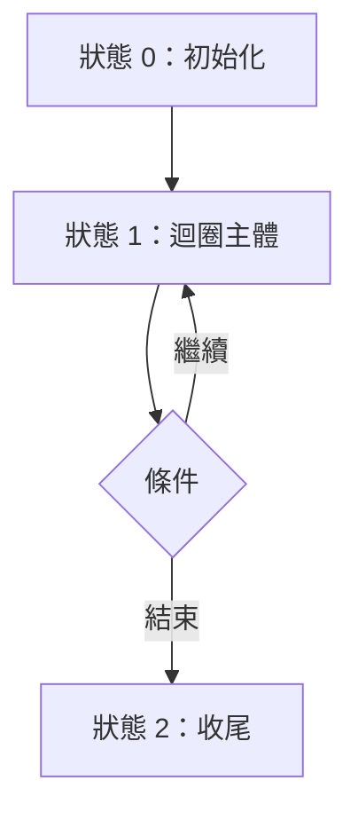

# 5.2　HLS 的核心挑戰：時序收斂與管線化

> 本節導論：高層次合成（HLS）要把「高階計算」變成「時序電路」。這不是簡單的翻譯，而是一連串的排程、綁定與時序調整。本節拆解 HLS 的三個核心步驟（排程、綁定、配置），以及管線化（pipelining）與資料流（dataflow）這兩種關鍵轉換。

## 5.2.1 HLS 的三個步驟

HLS 的骨幹，是三個互相關聯的步驟：

* **排程（Scheduling）**：決定「哪個運算在哪個時脈週期執行」。
* **綁定（Binding）**：決定「哪個運算用哪個硬體單元」。
* **配置（Allocation）**：決定「需要多少硬體單元」。

這三個步驟與指令流編譯的「指令選擇、暫存器配置、指令排程」有相似之處，但目標不同：指令流追求「減少指令與延遲」，HLS 追求「減少資源與滿足時序」。

## 5.2.2 時序收斂：最難的約束

電路有一個硬約束：**時脈頻率**。如果一條組合邏輯鏈太長（例如一個複雜的運算鏈），它無法在一個時脈週期內完成，就會限制頻率。

HLS 必須做 **時序收斂（timing closure）**：確保關鍵路徑（critical path）的延遲，不超過時脈週期。

$$
T_{\text{clock}} \geq T_{\text{critical path}} = \max_{\text{路徑 } p} \sum_{e \in p} \text{delay}(e)
$$

若無法收斂，HLS 有三種手段：

* **插入暫存器（register insertion）**：把長鏈切成多段，每段一個週期。
* **降低頻率**：接受較低的時脈。
* **重構計算**：改變運算結構，縮短關鍵路徑。

## 5.2.3 管線化（Pipelining）：讓每個週期都有產出

管線化的目標是：**讓新的輸入可以每個週期進入，而不必等上一個完成**。這用 **啟動間隔（Initiation Interval, II）** 衡量：

* II = 1：每個週期接受一個新輸入（理想）。
* II = N：每 N 個週期接受一個新輸入。

管線化的難點在於 **循環依賴（loop-carried dependency）**：如果迭代之間有資料依賴（例如累加器），就無法完全重疊。這時 II 會被依賴的延遲限制。

$$
II \geq \max\left(\text{資源限制}, \text{依賴限制}\right)
$$

- **資源限制**：若某種運算單元只有一個，且每次迭代要用它，II 至少是「使用次數」。
- **依賴限制**：若迭代之間有依賴鏈，II 至少是「依賴鏈延遲」。

## 5.2.4 資料流（Dataflow）：讓不同階段並行

除了管線化，HLS 還可以用 **資料流（dataflow）** 模型：把程式拆成多個階段（stage），每個階段有自己的管線，階段之間用 FIFO 連接，全部並行執行。

資料流的優勢是：**不同階段可以同時處理不同的資料**，吞吐量大幅提升。但它要求階段之間的資料流是「單向、無回饋」的，否則會死鎖。

## 5.2.5 狀態機：控制流的電路化

HLS 還要把控制流（if/else、迴圈）變成 **有限狀態機（FSM）**：

* 每個基本塊（basic block）對應一個狀態。
* 狀態轉移由條件決定。
* 資料路徑（datapath）由狀態機控制。

這是「時間上的控制」變成「空間上的狀態機」的過程。狀態機的設計，直接影響電路的資源與時序。

## 5.2.6 HLS 的三大挑戰總結

* **時序收斂**：關鍵路徑不能超過時脈週期。
* **管線化**：要達到 II = 1，必須克服循環依賴。
* **資料流**：要讓不同階段並行，必須保證單向資料流。

這三個挑戰，讓 HLS 遠比「編譯成指令」困難。它不只是翻譯，而是在「時間與空間」的雙重約束下，設計一個能工作的電路。

## 5.2.7 與傳統編譯器的類比

有趣的是，HLS 的步驟，與傳統編譯器有結構上的類比：

| HLS | 傳統編譯器 |
|---|---|
| 排程（Scheduling） | 指令排程 |
| 綁定（Binding） | 指令選擇 |
| 配置（Allocation） | 暫存器配置 |
| 時序收斂 | 延遲約束 |
| 管線化 | 軟體管線 |

這說明：**編譯的核心問題（排程、綁定、配置）是跨領域的**，只是約束不同。理解了指令流編譯，就理解了 HLS 的一半；另一半是「空間與時序」的物理直覺。

## 5.2.8 本節小結

* HLS 三步驟：排程、綁定、配置。
* 時序收斂是最難的約束，關鍵路徑限制頻率。
* 管線化追求 II = 1，但受資源與依賴限制。
* 資料流讓不同階段並行，但要求單向資料流。
* 控制流變成 FSM，時間上的控制變成空間上的狀態機。

下一節，我們看 HLS 的另一半：在 LUT、BRAM、DSP 這些有限的物理資源之間，如何做權衡。
