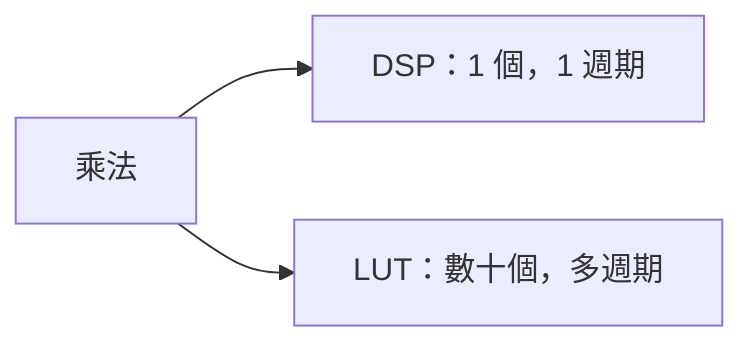
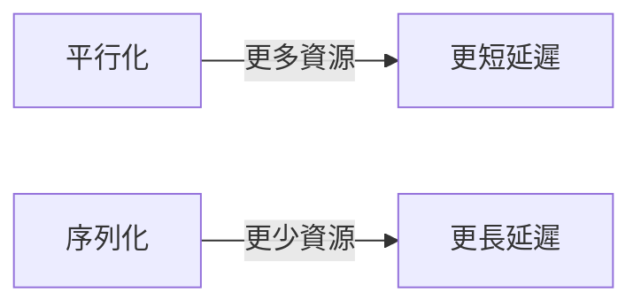

# 5.3　在 LUT 與 BRAM 與 DSP 之間的資源權衡

> 本節導論：FPGA 的資源是有限的：LUT、正反器、BRAM、DSP。每一個電路設計，都是在這些資源之間做取捨。本節說明這些資源的特性，以及 HLS 編譯器如何在「資源、時序、吞吐」三者之間做權衡。

## 5.3.1 四種核心資源

FPGA 的資源，可以分成四類：

* **LUT（查找表）**：實作組合邏輯。數量最多，但每個只能實作小函數。
* **FF（正反器）**：儲存狀態。與 LUT 數量大致相當。
* **BRAM（塊狀 RAM）**：片上記憶體。容量大，但數量有限。
* **DSP（數位訊號處理切片）**：專用乘法累加單元。速度快，但數量最少。

這四種資源，各有各的「稀缺程度」與「適用場景」。編譯器的任務，是在給定的資源預算下，找到最佳的映射。

## 5.3.2 用 LUT 還是 DSP：一個典型權衡

以乘法為例。乘法可以用兩種方式實作：

* **用 DSP**：一個 DSP 切片在一個週期完成乘法。速度快，但消耗稀缺的 DSP 資源。
* **用 LUT 拼**：用多個 LUT 拼出乘法器（如移位相加）。節省 DSP，但消耗大量 LUT，且延遲更長。

這個權衡的選擇，取決於：

* DSP 是否足夠（若不夠，只能用 LUT）。
* 時序是否允許（若 LUT 版本太慢，必須用 DSP）。
* 是否有其他運算也要用 DSP（資源競爭）。

## 5.3.3 BRAM 與暫存器陣列：記憶體的取捨

儲存資料也有取捨：

* **用 BRAM**：容量大（數千到數萬位元），但存取有延遲，且 port 數有限（通常 1–2 個）。
* **用暫存器陣列（register file）**：存取快、port 多，但消耗大量 FF，容量小。

對於小的、頻繁存取的資料（如卷積核），用暫存器陣列；對於大的、批次存取的資料（如特徵圖），用 BRAM。HLS 編譯器要根據存取模式，自動選擇。

## 5.3.4 資源與時序的蹺蹺板

資源與時序，是一組永恆的蹺蹺板：

* **資源換時序**：用更多硬體（平行化），換取更短的延遲。
* **時序換資源**：用更少的硬體（序列化），接受更長的延遲。

HLS 的 **約束驅動合成（constraint-driven synthesis）**，就是讓使用者指定「我要多少資源」或「我要多快」，編譯器據此探索設計空間。

## 5.3.5 設計空間探索（DSE）

由於權衡空間巨大，HLS 通常需要 **設計空間探索（Design Space Exploration, DSE）**：

* **變數**：平行度、管線深度、記憶體映射、運算單元數量。
* **目標**：最小化資源、最大化頻率、最大化吞吐。
* **約束**：LUT/FF/BRAM/DSP 的上限、時序要求。

DSE 本質上是一個多目標最佳化問題。傳統上用啟發式搜尋，現代則逐漸引入機器學習（第 9 章會談）。

## 5.3.6 一個具體例子：卷積加速器

以卷積加速器為例，資源權衡無所不在：

* **平行度**：一次算多少個輸出通道？越多，消耗越多乘法器（DSP 或 LUT）。
* **線緩衝（line buffer）**：卷積需要滑動視窗，用 BRAM 做線緩衝。
* **權重儲存**：權重放 BRAM 還是暫存器？取決於重用程度。
* **管線化**：把卷積、激活、池化做成資料流，提升吞吐。

每一個決策，都牽動資源與時序。編譯器的任務，是找到一組「剛好滿足約束、又不過度消耗資源」的配置。

## 5.3.7 為什麼這是一門「物理」的學問

與指令流編譯不同，HLS 的資源權衡帶有強烈的「物理性」：

* LUT 的面積是物理的（電晶體）。
* 關鍵路徑的延遲是物理的（訊號傳播）。
* BRAM 的 port 數是物理的（硬體結構）。

這意味著，HLS 編譯器不能只做「邏輯最佳化」，還必須有「物理直覺」。這也是為什麼 HLS 至今仍高度依賴專家的經驗，而難以完全自動化。

## 5.3.8 本節小結

* FPGA 四資源：LUT、FF、BRAM、DSP，各有稀缺性。
* 乘法可在 DSP 與 LUT 間取捨，取決於資源與時序。
* 記憶體可在 BRAM 與暫存器陣列間取捨，取決於容量與 port。
* 資源與時序是蹺蹺板，需約束驅動合成。
* DSE 是多目標最佳化，逐漸引入機器學習。
* HLS 帶有物理性，難以完全自動化。

至此，第 2 部結束。我們看過了四種算力形態的物理現實。下一部，我們進入抽象的重建：從單一 IR 的崩壞，到 MLIR 的帝國，再到網狀編譯管線。
