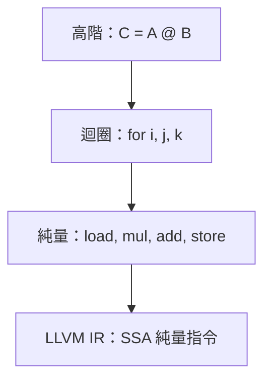
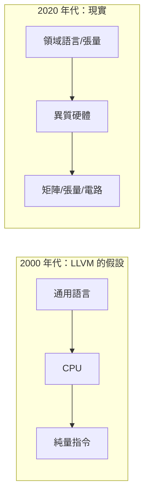

# 6.1　LLVM IR 過早拆解的代價

> 本節導論：LLVM 是過去二十年最成功的編譯器基礎設施，但它的核心 IR 有一個先天限制：太早把高階結構壓成低階純量。這個「語意抹除（semantic erasure）」正是 MLIR 誕生的直接原因。

## 6.1.1 LLVM IR 的輝煌與限制

LLVM 由 Chris Lattner 於 2000 年代初在伊利諾大學開發，後來成為現代編譯器的通用後端。它的核心是 **LLVM IR**：一種基於 SSA 的低階中間表示。

LLVM IR 的成功在於：

* **統一**：C、C++、Rust、Swift 等語言都能降到 LLVM IR。
* **可組合**：最佳化 pass 與後端可自由組合。
* **成熟**：數十年的工程累積，效能與穩定性俱佳。

但 LLVM IR 有一個根本設計選擇：**它在相當低的抽象層次上運作**。它描述的是「記憶體、指標、純量運算、分支」，而非「矩陣、張量、迴圈結構」。

## 6.1.2 語意抹除（Semantic Erasure）

以矩陣乘法為例。在高階語言中，它是：

```
C = A @ B    # 二維矩陣乘法
```

到了 LLVM IR，它被拆成三重迴圈，再拆成純量載入、乘加、寫回：



在這個過程中，**「這是矩陣乘法」的語意被抹除了**。LLVM IR 只知道「一堆純量運算」，不知道它們合起來是一個矩陣乘。

這種「抹除」的代價是：

* **無法做算子級最佳化**：無法把「矩陣乘 + 激活」融合，因為在 IR 裡它們只是散落的純量運算。
* **無法做高階布局最佳化**：無法知道「這是個矩陣」，因此無法選擇矩陣友善的布局。
* **無法映射到專用硬體**：Tensor Core、NPU 陣列需要「矩陣」這個概念，但 LLVM IR 沒有。

## 6.1.3 「只見樹木不見森林」

這個問題，可以概括為「只見樹木不見森林」：

* LLVM IR 看見每一棵「樹」（純量指令）。
* 但看不見「森林」（矩陣運算的結構）。

而現代最佳化，往往需要「森林級」的視野：

* 算子融合需要看到「哪些運算構成一個可融合的子圖」。
* 分塊需要看到「迴圈的結構與記憶體存取模式」。
* 映射到 Tensor Core 需要看到「這是一個 $ M \times N \times K $ 的矩陣乘」。

這些視野，在 LLVM IR 裡已經丟失。

## 6.1.4 為什麼 LLVM 會這樣設計

這不是 LLVM 的「錯誤」，而是它的「設計目標」。LLVM 誕生於 2000 年代初，目標是：

* 作為 C/C++ 等 **通用語言** 的後端。
* 目標是 **CPU**，不是 GPU/NPU。
* 追求 **通用性**，而非特定領域的最佳化。

在「通用語言 + CPU」的世界裡，將高階結構壓成純量，是合理的：因為 CPU 就是執行純量指令。但當目標變成「矩陣引擎」時，這個設計就成了限制。



## 6.1.5 一個具體的損失：多面體資訊

以迴圈最佳化為例。多面體模型（polyhedral model）需要知道「迴圈的迭代空間、存取函數、依賴關係」。這些資訊在 LLVM IR 裡，被拆散成一堆純量指令與分支，難以重建。

結果是：LLVM 的多面體最佳化（如 Polly）必須從 LLVM IR「反推」迴圈結構，這個反推既不完整也不可靠。若 IR 能保留高階的迴圈與張量結構，多面體最佳化就能直接運作。

## 6.1.6 代價的量化

這個代價有多大？可以從幾個角度量化：

* **最佳化機會的損失**：許多算子級融合、布局最佳化，在 LLVM IR 上根本無法表達。
* **編譯時間的浪費**：先降到低階、再試圖重建高階，是雙重浪費。
* **硬體映射的困難**：為 NPU 生成程式碼時，必須從純量指令「猜」出矩陣結構。

這正是 MLIR 要解決的核心問題：**讓高階語意在被需要之前，不要被抹除**。

## 6.1.7 本節小結

* LLVM IR 是低階、SSA、純量的 IR，適合 CPU 通用語言。
* 「語意抹除」：高階結構（矩陣、迴圈）被壓成純量，丟失森林級視野。
* 代價：算子融合、布局最佳化、硬體映射都受限。
* 根因：LLVM 的設計目標是「通用語言 + CPU」。
* MLIR 的動機：保留高階語意，直到它被需要。

下一節，我們看另一個相關的問題：兩種語言問題，以及跨層級最佳化的斷裂。
