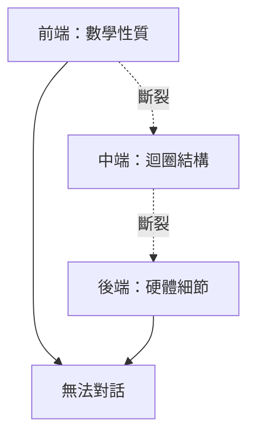

# 6.2　兩種語言問題與跨層級最佳化斷裂

> 本節導論：編譯器領域有一個經典難題——「兩種語言問題（the two-language problem）」。它說的是：高階語言好寫但慢，低階語言快但難寫。在異質編譯的脈絡下，這個問題升級成「跨層級最佳化斷裂」：前端知道數學性質，後端知道硬體細節，卻無法對話。

## 6.2.1 經典的兩種語言問題

「兩種語言問題」最早在科學計算社群被提出：

* **高階語言**（Python、R、MATLAB）：表達力強、開發快，但執行慢。
* **低階語言**（C、Fortran）：執行快，但開發慢、易出錯。

實務上的妥協是「兩層架構」：用高階語言寫邏輯，用低階語言寫熱點。但這帶來「兩種語言、兩套程式碼、兩個團隊」的維護負擔。

## 6.2.2 編譯器內部的兩種語言問題

更有趣的是，這個問題也發生在 **編譯器內部**。編譯器的不同階段，各自「說不同的語言」：

* **前端**：說「高階語意」的語言——矩陣、張量、型別、別名。
* **中端**：說「迴圈與記憶體」的語言——迭代空間、存取函數、依賴。
* **後端**：說「硬體」的語言——暫存器、快取、指令延遲。

每一層都知道一些別人不知道的事：

* 前端知道「這個運算有數學性質（如結合律、交換律）」。
* 中端知道「這個迴圈的依賴結構」。
* 後端知道「這個硬體的快取大小、指令延遲」。

問題是：**它們無法在同一個 IR 裡對話**。

## 6.2.3 跨層級最佳化斷裂

這種「對話困難」，導致 **跨層級最佳化斷裂**：

* 前端知道「這是矩陣乘，可以融合」，但它不知道「GPU 的 Shared Memory 有多大」，所以無法決定「怎麼分塊」。
* 後端知道「Shared Memory 只有 48 KB」，但它不知道「這是矩陣乘」，所以無法做算子級融合。
* 中端知道「迴圈可以交換」，但它不知道「這是卷積」，所以無法選擇卷積友善的布局。

這個斷裂，正是 6.1 節「語意抹除」的另一面：因為高階語意被抹除，所以各層無法共享資訊。

## 6.2.4 為什麼單一 IR 無法解決

有人會問：為什麼不用一份「超級 IR」，同時表達高階與低階？

答案在於 **抽象層次的根本衝突**：

* 高階 IR 需要「保留結構」：矩陣就是矩陣，迴圈就是迴圈。
* 低階 IR 需要「消除結構」：矩陣變成純量，迴圈變成分支。

這兩個需求是矛盾的。一份 IR 不可能同時「保留」與「消除」同一個結構。

更根本的是 **資訊時機（information timing）**：不同的最佳化，需要不同的資訊在不同的時機。太早降到低階，高階資訊就沒了；太晚留在高階，低階最佳化就做不了。

## 6.2.5 一個類比：地圖的縮放

可以用地圖的縮放來類比：

* **高階 IR** 像「世界地圖」：看得到大陸與海洋，但看不到街道。
* **低階 IR** 像「街道地圖」：看得到每一條巷子，但看不到全局。

一份地圖不可能同時是「世界地圖」與「街道地圖」。你需要 **多張地圖**，並在它們之間切換。這就是多層 IR 的核心思想。

## 6.2.6 多層 IR 如何修補斷裂

多層 IR 的解法是：**讓每一層保留該層最重要的資訊，並提供「層間轉換」的機制**。

* 高階方言保留數學結構（`linalg`、`tosa`）。
* 中階方言保留迴圈與記憶體（`scf`、`affine`、`memref`）。
* 低階方言保留硬體細節（`vector`、`gpu`、`llvm`）。

而「漸進式降階」讓資訊在「需要時」才被轉換，而不是「一開始就全部抹除」（第 7 章詳述）。

## 6.2.7 對編譯器工程的意涵

這個洞察，對編譯器工程有三個意涵：

* **不要過早降階**：保留高階語意，直到它不再有用。
* **每層只做該層的事**：不要在低階做高階最佳化，也不要在高階做低階最佳化。
* **提供明確的層間介面**：讓資訊能在層間「有控制地」流動。

這三點，正是 MLIR 設計哲學的核心。

## 6.2.8 本節小結

* 兩種語言問題：高階好寫但慢，低階快但難寫。
* 編譯器內部也有「兩種語言」：前端、中端、後端各說不同語言。
* 跨層級斷裂：各層知道不同的事，卻無法對話。
* 單一 IR 無法解決，因為抽象層次根本衝突。
* 多層 IR + 漸進式降階是解法。

下一節，我們看這個思想如何從 LLVM 演化到 MLIR 的歷史轉折。
