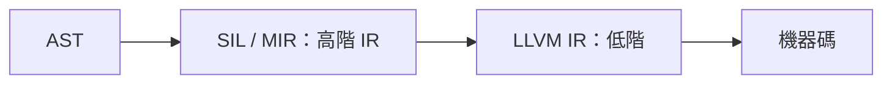
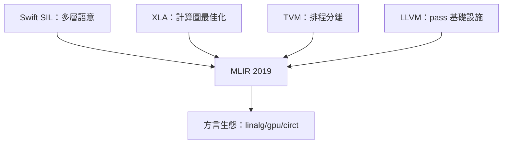

# 6.3　從 LLVM 到 MLIR 的歷史轉折

> 本節導論：MLIR 不是憑空出現的，它是十多年來「多層 IR」思想的結晶。從 Swift 的 SIL、Rust 的 MIR，到 XLA 與 TVM 的實踐，最後匯流成 2019 年發表的 MLIR。本節梳理這條歷史線，理解每個轉折背後的驅動力。

## 6.3.1 前史：各語言的「專屬多層 IR」

在 MLIR 之前，許多語言與框架都各自發明了「多層 IR」：

* **Swift SIL（Swift Intermediate Language，2015）**：在 AST 與 LLVM IR 之間插入 SIL，保留高階語意（如泛型、所有權），讓 Swift 能做高階最佳化。
* **Rust MIR（Mid-level IR，2015 前後）**：在 HIR 與 LLVM IR 之間插入 MIR，用於借用檢查與高階最佳化。
* **GCC GIMPLE**：把高階樹狀 IR 降成 GIMPLE，再做 SSA 最佳化。

這些都是「單一語言、專屬多層 IR」的例子。它們證明了：**在語言與低階 IR 之間插入一層，能保留更多語意**。

## 6.3.2 XLA：計算圖的編譯器

2017 年，Google 開源 **XLA（Accelerated Linear Algebra）**，作為 TensorFlow 的編譯器。XLA 的特點是：

* 以 **計算圖** 為輸入（HLO，High-Level Operations）。
* 做算子融合、布局最佳化。
* 降階到 CPU、GPU、TPU。

XLA 證明了「計算圖級的最佳化」在 AI 工作負載上的巨大價值。但它的 IR（HLO）是為 TensorFlow 量身打造的，缺乏通用性。

## 6.3.3 TVM：跨硬體的張量編譯

2017 年，華盛頓大學的 TVM 專案，提出「張量表達式 + 排程分離 + auto-tuning」的模式。它的核心貢獻是：

* **計算與排程分離**：使用者描述「做什麼」（compute）與「怎麼排」（schedule）。
* **跨硬體**：同一份計算，可降到 CPU、GPU、FPGA。
* **自動調優**：用機器學習或搜尋，找最佳排程。

TVM 證明了「用 IR 表達張量計算，並自動搜尋排程」是可行的。

## 6.3.4 匯流：MLIR 的誕生（2019）

2019 年 4 月，Google 公開 **MLIR（Multi-Level Intermediate Representation）**。它的設計，融合了上述所有經驗：

* **從 Swift SIL 學到**：在語言與 LLVM 之間插入多層 IR，保留高階語意。
* **從 XLA 學到**：計算圖級的最佳化（融合、布局）。
* **從 TVM 學到**：計算與排程分離、跨硬體。
* **從 LLVM 學到**：可組合的 pass、SSA、成熟的基礎設施。

MLIR 的關鍵創新是 **方言（Dialect）**：讓不同的抽象層次，用不同的方言表達，並在同一個框架下共存與降階（第 7 章詳述）。

## 6.3.5 為什麼是「方言」而非「多個 IR」

有人會問：為什麼不設計「多個獨立的 IR」，而要設計「一個框架下的多個方言」？

答案在於 **互操作性**：

* 若有多個獨立 IR，它們之間的轉換需要「翻譯器」，容易丟失資訊。
* 方言共享同一套基礎設施（Operation、Region、Type），轉換只需「改寫 Operation」，資訊不會丟失。
* 方言可以在同一個 pass pipeline 裡混合使用，實現「漸進式降階」。

這是 MLIR 最深遠的設計：**用「統一的資料模型 + 多樣的方言」，取代「多個獨立的 IR」**。

## 6.3.6 歷史的教訓

回顧這段歷史，有幾個教訓：

* **抽象層次不能一刀切**：單一 IR 無法同時滿足高階與低階需求。
* **領域知識需要被保留**：語言、框架、硬體各有自己的「語言」，需要各自的 IR。
* **互操作性是關鍵**：多層 IR 必須能無損地轉換，否則就退回「多個獨立 IR」的老路。
* **漸進式降階是正解**：在需要時才降階，而非一開始就全部抹除。

## 6.3.7 MLIR 之後：生態的爆發

MLIR 發表後，生態快速擴展：

* **Torch-MLIR**：PyTorch 模型 → MLIR。
* **StableHLO**：跨框架的高階算子方言。
* **CIRCT**：用 MLIR 做硬體設計（HLS、RTL）。
* **IREE**：基於 MLIR 的端到端編譯器。
* **Triton**：其 IR 也受 MLIR 思想影響。

這證明了「多層 IR + 方言」不只是理論，而是能支撐整個生態的工程基礎。

## 6.3.8 本節小結

* 前史：Swift SIL、Rust MIR、GCC GIMPLE 都是專屬多層 IR。
* XLA：計算圖級最佳化；TVM：排程分離與跨硬體。
* MLIR（2019）匯流各家經驗，核心創新是「方言」。
* 方言優於多個獨立 IR：共享資料模型、無損轉換、漸進降階。
* 教訓：抽象不能一刀切、領域知識要保留、互操作性是關鍵。

下一章，我們進入 MLIR 的架構核心：方言與漸進式降階究竟如何運作。
