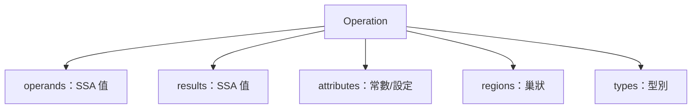
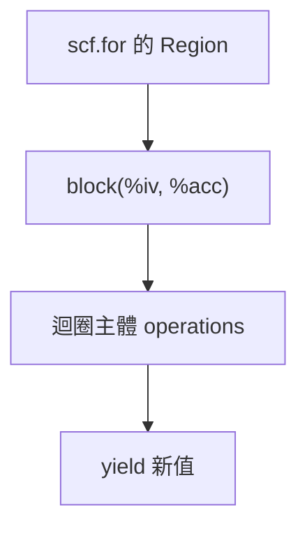
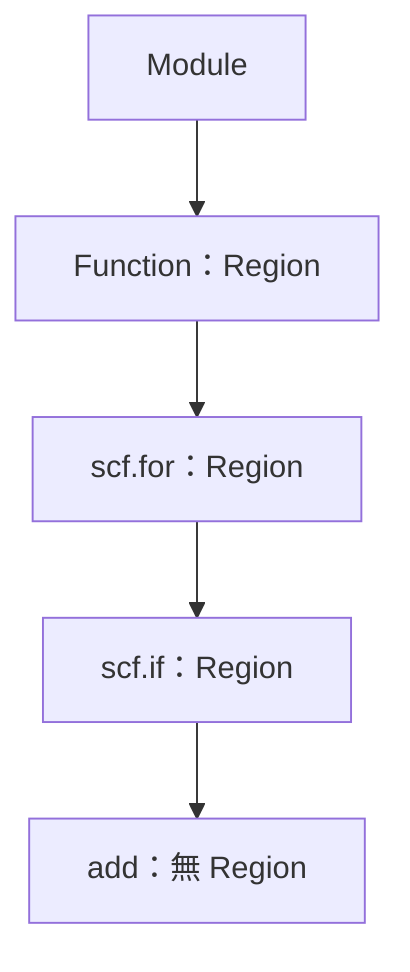
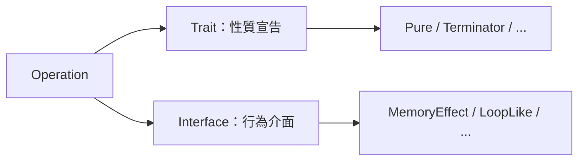

# 7.1　Operation 與 Region 與 Block 的資料模型

> 本節導論：MLIR 的威力，來自一個極簡卻極有彈性的資料模型：一切皆 Operation，Operation 可以包含 Region，Region 裡有 Block。這個「俄羅斯娃娃」式的結構，讓 MLIR 能用同一套機制，表達從數學公式到電路門級的所有抽象層次。

## 7.1.1 一切皆 Operation

MLIR 的第一原則：**一切皆 Operation（operation）**。不論是加法、矩陣乘、迴圈、函式、還是整個函式庫呼叫，都是一個 Operation。

每個 Operation 包含：

* **運算元（operands）**：輸入的 SSA 值。
* **結果（results）**：輸出的 SSA 值。
* **屬性（attributes）**：編譯期的常數或設定。
* **區域（regions）**：可選的巢狀結構。
* **型別（types）**：運算元與結果的型別。



這個設計的精妙之處在於：**加法與矩陣乘、乃至整個函式，都用同一種結構表達**。這讓通用機制（如重寫、降階、驗證）能適用於所有層次。

## 7.1.2 Region 與 Block：結構的基石

**Region** 是一段「包含 Block 的程式碼區」。**Block** 是一串 Operation 的序列，加上參數（block arguments）。

```
operation {
  // 這是一個 Region
  ^block0(%arg0: i32):
    %1 = add %arg0, %arg0
    // 這是另一個 Region（巢狀）
    scf.if %cond {
      ^block1:
        ...
    }
}
```

Region 的兩種語意（第 7.2 節會深入）：

* **SSA 區域（SSA region）**：像函式體或 if 的主體，內部可以定義與使用值。
* **圖區域（Graph region）**：像計算圖，沒有明確的控制流順序。

這種「Region 可以巢狀」的設計，讓 MLIR 能表達任意深度的結構：函式裡有迴圈，迴圈裡有 if，if 裡又有巢狀運算。

## 7.1.3 BlockArgument：Region 的輸入

Block 可以有參數（BlockArgument），這是 Region 與外界交換值的方式。例如 `scf.for` 的迴圈變數，就是 BlockArgument。



BlockArgument 讓 Region 成為一個「可參數化的子圖」，這對表達迴圈、條件、以及更複雜的控制流至關重要。

## 7.1.4 為什麼是「俄羅斯娃娃」

這個模型的深遠意義，可以用「俄羅斯娃娃」來比喻：

* 最外層是「模組（module）」，包含多個函式。
* 函式是 Operation，包含一個 Region（函式體）。
* 函式體裡有迴圈（Operation），包含 Region。
* 迴圈裡有 if（Operation），包含 Region。
* 最內層是純量運算（Operation），沒有 Region。



**同一套資料模型，能表達所有層次**。這是 MLIR 能用一個框架取代「多個獨立 IR」的根本原因。

## 7.1.5 Trait 與 Interface：行為的擴充

Operation 的「語意」，透過兩種機制擴充：

* **Trait（特徵）**：宣告 Operation 具備某種性質（如 `Pure`、`Terminator`、`IsolatedFromAbove`）。
* **Interface（介面）**：宣告 Operation 支援某種操作（如 `MemoryEffectOpInterface`、`LoopLikeOpInterface`）。



Trait 與 Interface 讓通用 pass 能「泛用」地處理不同方言的 Operation，而不必為每個 Operation 寫特例。

## 7.1.6 與 LLVM IR 的對比

| 面向 | LLVM IR | MLIR |
|---|---|---|
| 基本單位 | Instruction | Operation |
| 巢狀結構 | 無（平坦） | Region / Block（可巢狀） |
| 高階語意 | 無 | 方言可自訂 |
| 擴充方式 | 新增 Instruction | 新增 Dialect |

關鍵差異是「巢狀結構」：LLVM IR 是平坦的指令序列，MLIR 是可巢狀的 Operation 樹。這個差異，讓 MLIR 能保留高階結構（第 6.1 節的「森林」）。

## 7.1.7 本節小結

* 一切皆 Operation：operands、results、attributes、regions、types。
* Region 包含 Block，Block 有參數，可任意巢狀。
* 「俄羅斯娃娃」結構：同一套模型表達所有層次。
* Trait 與 Interface 擴充語意，讓通用 pass 能泛用處理。
* 與 LLVM IR 的關鍵差異：巢狀結構保留高階語意。

下一節，我們看方言（Dialect）生態：從高階張量到硬體目標，MLIR 如何用方言覆蓋整個抽象譜系。
