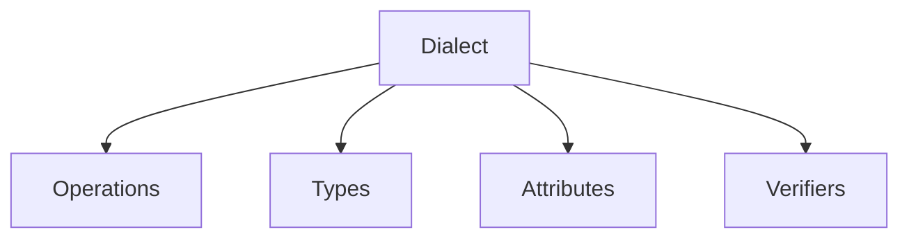
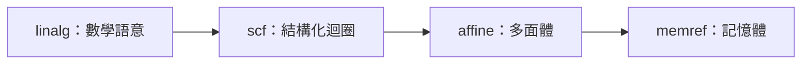
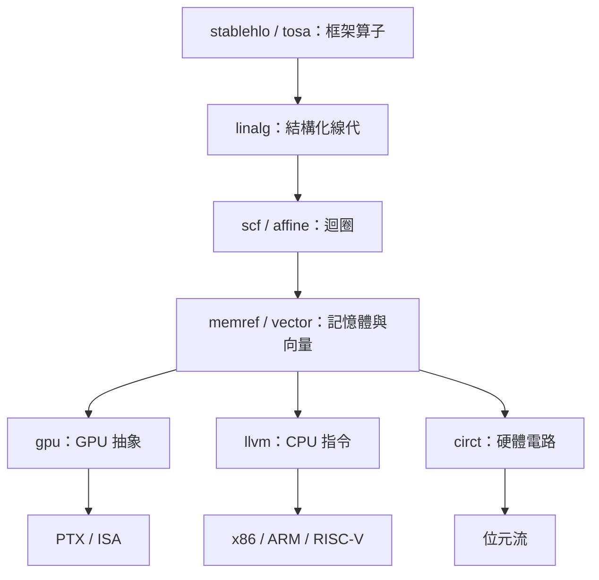

# 7.2　Dialect 生態圖譜

> 本節導論：如果 Operation 是 MLIR 的「原子」，那 Dialect（方言）就是「分子」——它把一組相關的 Operation、型別、屬性打包成一個抽象層次。本節繪製方言生態的圖譜，從高階張量一路到硬體目標，理解每個方言「為何存在」。

## 7.2.1 什麼是 Dialect

**Dialect** 是一組 Operation、Type、Attribute 的命名空間。它定義了「某個抽象層次的詞彙」。例如：

* `linalg` 方言：定義結構化的線性代數運算（矩陣乘、卷積）。
* `scf` 方言：定義結構化控制流（for、if、while）。
* `gpu` 方言：定義 GPU 相關的抽象（block、thread、barrier）。

每個方言可以有自己的：

* **Operation**：如 `linalg.matmul`、`scf.for`。
* **Type**：如 `memref`、`tensor`。
* **Attribute**：如 `affine_map`。
* **驗證規則**：確保 Operation 的合法性。

## 7.2.2 高階張量方言：linalg / tosa / stablehlo

這一層描述「計算的數學語意」，是 AI 編譯的起點：

* **`linalg`**：結構化的線性代數運算，如 `matmul`、`conv`、`pooling`。它保留了「這是什麼運算」的語意，並附帶迭代空間的描述。
* **`tosa`（Tensor Operator Set Architecture）**：標準化的張量算子集，用於跨框架交換。
* **`stablehlo`**：源自 XLA 的 HLO，作為跨框架的高階算子方言，強調穩定性與可移植性。

這一層的關鍵是：**保留「運算的數學結構」**，讓算子融合、布局最佳化有足夠的資訊。

## 7.2.3 迴圈與多面體方言：scf / affine

這一層描述「計算的執行結構」：

* **`scf`（Structured Control Flow）**：結構化控制流，如 `for`、`if`、`while`。它保留「這是一個迴圈」的結構，而非降成 goto。
* **`affine`**：多面體模型友善的迴圈，迭代空間是仿射函數，支援多面體最佳化（如 tiling、fusion、skewing）。

這一層的關鍵是：**保留「迴圈的結構與依賴」**，讓多面體最佳化能運作。

## 7.2.4 記憶體與向量方言：memref / vector

這一層描述「資料的儲存與存取」：

* **`memref`**：多維記憶體緩衝的抽象，帶有形狀、布局（layout）、記憶體空間（memory space）。它是「緩衝區」的一等公民。
* **`vector`**：固定長度的向量型別，用於向量化。它保留「這是一組可平行的元素」的語意。

這一層的關鍵是：**顯式表達記憶體布局**，讓 tiling、向量化、記憶體規劃能運作。

## 7.2.5 硬體目標方言：gpu / llvm / circt

這一層描述「特定硬體的抽象」：

* **`gpu`**：GPU 的抽象，如 `gpu.block`、`gpu.thread`、`gpu.barrier`、`gpu.launch`。它讓 GPU 程式能在 IR 層表達。
* **`llvm`**：LLVM IR 的方言，作為 CPU 後端的最終降階目標。
* **`circt`**：硬體設計方言（Circuit IR Compilers and Tools），包含 `hw`（硬體結構）、`comb`（組合邏輯）、`seq`（時序邏輯）等，用於 HLS 與 RTL 生成。

這一層的關鍵是：**對接真實硬體**，把抽象降階成硬體能執行的形式。

## 7.2.6 完整的降階階梯

把上述方言串起來，就是一條完整的降階階梯：

這條階梯，就是 MLIR 的核心價值：**同一份高階計算，可以沿著不同的路徑，降階到不同的硬體**。

## 7.2.7 方言的設計原則

設計一個新方言時，有幾個原則：

* **單一職責**：一個方言只負責一個抽象層次，不要混合。
* **可驗證**：每個 Operation 都要有清楚的驗證規則。
* **可降階**：要有明確的降階路徑，否則會變成「死胡同」。
* **可組合**：要能與其他方言共存、互操作。

這些原則，確保方言生態不會變成「一堆無法組合的孤島」。

## 7.2.8 本節小結

* Dialect 是一組 Operation、Type、Attribute 的命名空間。
* 高階：`linalg`、`tosa`、`stablehlo`（數學語意）。
* 中階：`scf`、`affine`（迴圈結構）、`memref`、`vector`（記憶體）。
* 低階：`gpu`、`llvm`、`circt`（硬體目標）。
* 方言設計原則：單一職責、可驗證、可降階、可組合。

下一節，我們看「漸進式降階」：為什麼「在每一層只做該層最擅長的事」是 MLIR 的核心哲學。
