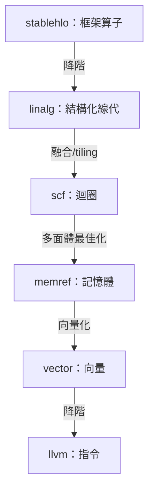
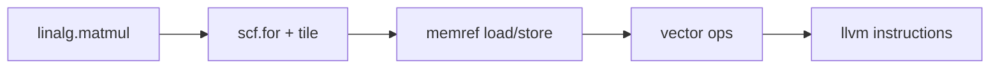
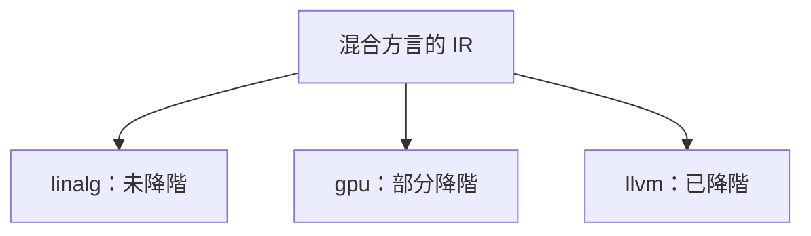

# 7.3　漸進式降階：每層只做該層最擅長的事

> 本節導論：有了方言，還要有一個「降階的哲學」。MLIR 的核心哲學是 **漸進式降階（Progressive Lowering）**：不要一步到位，而是在每一層只做該層最擅長的最佳化，逐步剝離抽象。本節說明這個哲學的原理、實踐與代價。

## 7.3.1 什麼是漸進式降階

傳統編譯器常「一步到位」：高階語言直接降到機器碼，中間只有少數固定的 IR。

MLIR 的做法是「漸進」：

$$
\text{stablehlo} \rightarrow \text{linalg} \rightarrow \text{scf} \rightarrow \text{memref} \rightarrow \text{vector} \rightarrow \text{llvm}
$$

每一步只做「一層的降階」，並在該層做該層的最佳化。這就像下樓梯：**一次下一階，而非直接跳到底**。



## 7.3.2 為什麼「每層只做該層的事」

這是漸進式降階的核心，也是它有效的原因：

* **在 `linalg` 層，做算子融合**：因為此時還保留「這是矩陣乘、這是卷積」的語意，能判斷哪些運算可融合。
* **在 `scf`/`affine` 層，做迴圈最佳化**：因為此時保留「迴圈結構」，能做 tiling、交換、skewing。
* **在 `memref` 層，做記憶體規劃**：因為此時有「緩衝區」的概念，能做布局與重用。
* **在 `vector` 層，做向量化**：因為此時有「可平行元素」的語意，能映射到 SIMD。
* **在 `llvm` 層，做指令選擇與暫存器配置**：因為此時已接近機器碼。

**每個最佳化，都在「資訊最豐富」的層次執行**。太早做，資訊不足；太晚做，結構已失。

## 7.3.3 一個具體例子：矩陣乘的降階

以 `linalg.matmul` 為例，看它如何漸進降階：

**Step 1（linalg）**：保留 `linalg.matmul`，此時可做「與後續激活融合」。

```mlir
%0 = linalg.matmul ins(%A, %B) outs(%C)
%1 = linalg.generic ... // 激活
```

**Step 2（scf）**：tiling 成 `scf.for`，每個 tile 呼叫 `linalg.matmul`。

```mlir
scf.for %i = 0 to M step 32 {
  scf.for %j = 0 to N step 32 {
    linalg.matmul ins(%A_tile, %B_tile) outs(%C_tile)
  }
}
```

**Step 3（memref）**：轉成 `memref` 的載入與儲存，決定布局。

**Step 4（vector）**：向量化，每個 tile 用 SIMD 指令。

**Step 5（llvm）**：降到 LLVM IR，做指令選擇與暫存器配置。



在每一步，都做「該層最擅長的最佳化」，而不是等到最後才做。

## 7.3.4 漸進式降階的三個好處

**（1）資訊保真。**
高階資訊（矩陣、迴圈）在需要時才被降階，不會過早丟失。這解決了 6.1 節的「語意抹除」問題。

**（2）最佳化模組化。**
每個最佳化只依賴一個方言，容易撰寫、測試、組合。改動一個方言，不會影響其他層。

**（3）可除錯。**
可以在任一中間層印出 IR，檢查降階是否正確。這比「一步到位」的黑箱容易除錯得多。

## 7.3.5 漸進式降階的代價

漸進式降階不是免費的：

* **Pass 數量多**：每一步都要寫 pass，工程量大。
* **Pass 順序敏感**：不同順序可能導致不同結果，需要仔細設計 pipeline。
* **IR 轉換開銷**：每次降階都要改寫 IR，有編譯時間成本。
* **方言邊界摩擦**：不同方言的型別、語意不完全一致，轉換時需要「膠水」程式碼。

這些代價，是 MLIR 學習曲線陡峭的原因之一。但相對於「單一 IR」的限制，這些代價是值得的。

## 7.3.6 「部分降階」與混合方言

漸進式降階的一個重要特性是：**允許部分降階、混合方言**。

例如，一份 IR 可以同時包含：

* 已經降到 `llvm` 的部分（如某些純量運算）。
* 還是 `linalg` 的部分（如矩陣乘）。
* 還是 `gpu` 的部分（如 kernel 啟動）。



這種「混合狀態」讓降階可以「按需進行」，而非「全部一起降」。這對異質編譯尤其重要：不同部分可以走不同的降階路徑。

## 7.3.7 一個類比：編譯的「分層施工」

可以用「分層施工」來比喻漸進式降階：

* 蓋房子時，不會「一次把所有東西蓋好」，而是「先打地基、再架結構、再裝修」。
* 每一層施工，都用該層最合適的工具與材料。
* 若地基有問題，可以在結構施工前發現，而不必等到全部蓋完。

漸進式降階就是編譯的「分層施工」：每一層都做該層的事，發現問題也能及早修正。

## 7.3.8 本節小結

* 漸進式降階：一次下一階，而非一步到位。
* 每層只做該層最擅長的事：融合、迴圈、記憶體、向量、指令。
* 三個好處：資訊保真、最佳化模組化、可除錯。
* 代價：pass 多、順序敏感、轉換開銷、邊界摩擦。
* 支援部分降階與混合方言，適合異質編譯。

下一章，我們把這些拼起來：從「線性流水線」升級成「網狀編譯管線」，讓同一份計算分裂、切塊、同步降階到多種硬體。
