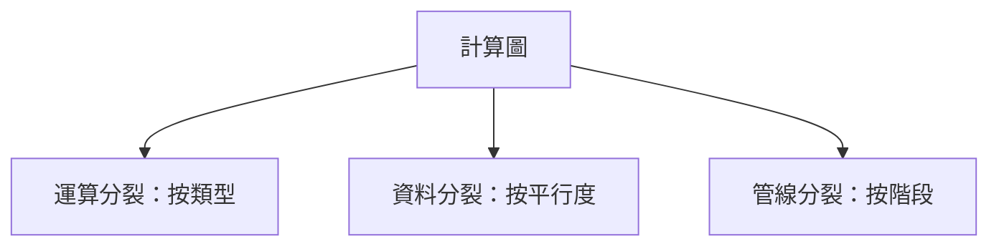
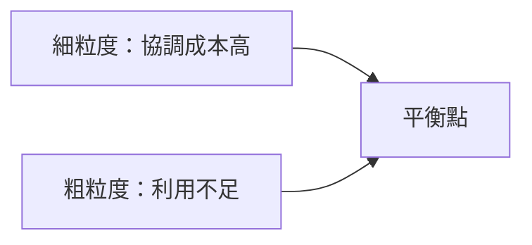
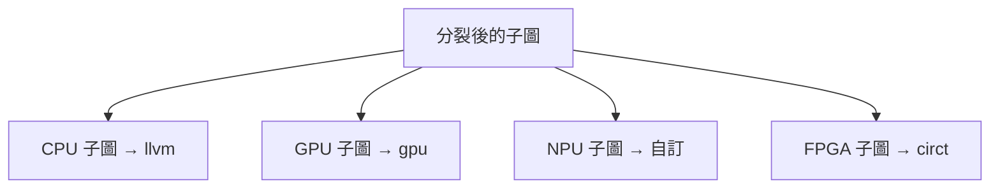

# 8.1　同一份語意的分裂與切塊

> 本節導論：前面幾章談的都是「單一目標」的降階。但異質編譯的核心挑戰是：同一份高階計算，如何分裂、切塊，並同步降階成 CPU 指令、GPU Kernel、NPU 排程、FPGA 位元流的混合輸出？本節從「為什麼要分裂」談起。

## 8.1.1 為什麼不能「全部丟給一個裝置」

最直接的想法是：把整份計算丟給最強的裝置（例如 GPU）。但這行不通，原因有三：

* **裝置能力不匹配**：GPU 擅長資料平行，但不擅長純量控制流；NPU 擅長稠密矩陣，但不擅長稀疏或不規則計算。
* **資料搬移成本**：把資料從 CPU 搬到 GPU，再搬到 NPU，搬移成本可能超過計算本身。
* **資源競爭**：不同工作同時要同一個裝置，需要分工。

所以必須 **分裂（partitioning）**：把計算圖切成子圖，分派給最適合的裝置。

## 8.1.2 三種分裂策略

異質編譯的分裂，有三種基本策略：

**（1）按運算類型分裂（operator-based）。**
把「矩陣乘」給 NPU、「卷積」給 GPU、「控制流」給 CPU。這是最直觀的策略，但可能造成頻繁的跨裝置資料搬移。

**（2）按資料平行度分裂（data-parallel）。**
把大張量切成多塊，分給多個裝置平行處理。適合「同一個運算、大量資料」的場景。

**（3）按管線階段分裂（pipeline）。**
把計算圖切成多個階段，每個階段在不同裝置上，形成管線。適合「階段之間有依賴、但可流水」的場景。

## 8.1.3 切塊的粒度問題

分裂之後，還要決定「切多細」。這是一個經典的權衡：

* **切太細**：跨裝置的協調成本高，資料搬移頻繁，排程開銷大。
* **切太粗**：無法充分利用各裝置的特性，負載不均衡。

理想的粒度，取決於：

* 裝置之間的頻寬（頻寬高，可切細）。
* 運算的計算強度（強度高，可切細）。
* 排程器的能力（能力強，可切細）。

## 8.1.4 分裂的本質是「圖分割」問題

從演算法角度看，分裂是一個 **圖分割（graph partitioning）** 問題：

* 節點是運算，邊是資料依賴。
* 目標是「最小化跨分割的邊（資料搬移）」，同時「平衡各分割的負載」。

這是一個 NP-hard 問題。實務上用啟發式（如 METIS 風格的切割）或學習式方法（第 9 章）。

$$
\min \sum_{e \in \text{cut}} w(e) \quad \text{s.t.} \quad \text{load}(P_i) \leq \text{cap}(D_i)
$$

其中 $ w(e) $ 是邊的資料量，$ \text{load}(P_i) $ 是分割 $ P_i $ 的計算量，$ \text{cap}(D_i) $ 是裝置 $ D_i $ 的容量。

## 8.1.5 一個具體例子：Transformer 的分裂

以 Transformer 的推論為例：

* **Embedding 與 LayerNorm**：記憶體密集、純量操作多 → CPU 或 GPU。
* **矩陣乘（QKV、FFN）**：計算密集、稠密 → NPU/TPU。
* **Attention**：需要大量中間結果 → GPU（Shared Memory 友善）。
* **Softmax**：需要跨維度縮併 → GPU 或 NPU。

一個好的分裂，會把「矩陣乘」集中到 NPU，把「控制流與小運算」留在 CPU，把「Attention」放 GPU，並在階段之間用管線重疊。

## 8.1.6 分裂與降階的同步

分裂之後，每個子圖要「同步降階」到各自的目標：

* CPU 子圖 → `llvm` 方言 → 機器碼。
* GPU 子圖 → `gpu` 方言 → PTX/SASS。
* NPU 子圖 → 自訂方言 → NPU 指令。
* FPGA 子圖 → `circt` 方言 → 位元流。

這就是「網狀」的雛形：不是一條流水線，而是多條並行的降階路徑，最後匯流。

## 8.1.7 本節小結

* 不能全部丟給一個裝置：能力不匹配、搬移成本、資源競爭。
* 三種分裂策略：按運算類型、按資料平行度、按管線階段。
* 切塊粒度是權衡：太細協調成本高，太粗利用不足。
* 分裂是圖分割問題（NP-hard），用啟發式或學習式求解。
* 分裂後各子圖同步降階，形成網狀管線的雛形。

下一節，我們深入「跨異質邊界」的兩個關鍵問題：自動切分，以及資料搬移的消除。
