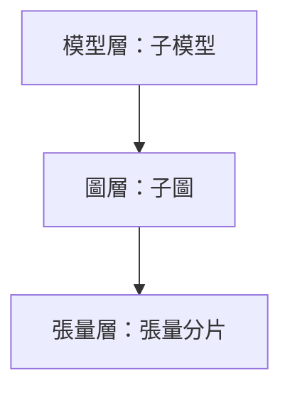
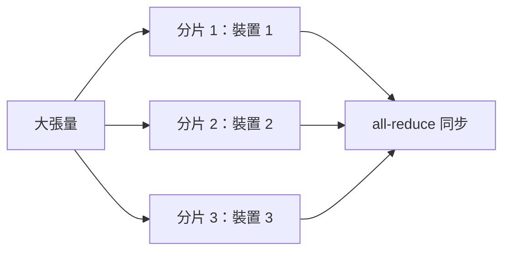
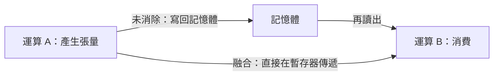
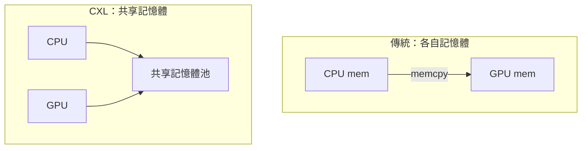

# 8.2　跨異質邊界的自動切分與資料搬移消除

> 本節導論：分裂只是開始。真正的難點在「邊界」：如何在異質裝置之間自動切分計算，以及如何消除跨邊界的資料搬移成本。本節談兩個核心技術：自動切分（auto-sharding）與資料搬移消除（movement elimination），並說明 CXL 統一記憶體如何改變遊戲規則。

## 8.2.1 切分的三個層次

自動切分（auto-sharding），可以在三個層次進行：

* **模型層（model-level）**：把整個模型切成多個子模型，分給不同裝置。
* **圖層（graph-level）**：把計算圖切成子圖，分給不同裝置。
* **張量層（tensor-level）**：把單一巨大的張量切成多片，分給不同裝置（如張量平行）。

這三層常常組合使用：例如「張量平行（tensor parallel）」用於單層太大放不進一個裝置；「管線平行（pipeline parallel）」用於階段太多；「資料平行（data parallel）」用於資料太多。

## 8.2.2 SPMD 與自動分片

現代自動分片的核心模型是 **SPMD（Single Program, Multiple Data）**：同一份程式，在多個裝置上執行，但每個裝置處理不同的資料分片。

編譯器的任務，是自動決定：

* **如何分片（sharding）**：張量沿哪個維度切、切幾片。
* **如何擺放（placement）**：每個分片放在哪個裝置。
* **如何通訊（communication）**：分片之間何時需要交換資料（如 all-reduce）。

## 8.2.3 分片的代價：通訊

分片不是免費的。分片之後，裝置之間需要 **通訊** 來交換資料。通訊的成本，取決於：

* **資料量**：要交換多少位元組。
* **頻寬**：裝置之間的連線速度（如 NVLink、PCIe、網路）。
* **延遲**：每次通訊的固定開銷。

$$
T_{\text{comm}} = \alpha + \frac{\text{Bytes}}{\text{bandwidth}}
$$

其中 $ \alpha $ 是延遲（latency），第二項是傳輸時間。對於小訊息，$ \alpha $ 主導；對於大訊息，頻寬主導。

## 8.2.4 資料搬移消除：編譯器的核心任務

既然通訊很貴，編譯器的核心任務之一，就是 **消除不必要的資料搬移**。手法包括：

* **算子融合**：把「產生資料」與「消費資料」的運算融合，避免中間結果寫回記憶體。
* **布局傳播（layout propagation）**：讓資料在「產生時」就用「消費時」需要的布局，避免轉換。
* **原位運算（in-place）**：若輸入不再需要，直接在原地寫入輸出，避免額外緩衝。
* **記憶體重用（memory reuse）**：分析生命週期，讓不同張量重用同一塊緩衝。

## 8.2.5 CXL 統一記憶體如何改變遊戲規則

**CXL（Compute Express Link）** 是 2019 年提出的高速互連標準，其中一個關鍵能力是 **記憶體共享（memory pooling / sharing）**：不同裝置可以共享同一個記憶體池，形成「統一記憶體」的假象。

這對資料搬移有深遠影響：

* **傳統**：CPU 與 GPU 各有獨立記憶體，必須 `cudaMemcpy` 搬移。
* **CXL**：CPU 與 GPU 可以「直接存取」同一塊記憶體，搬移變成「指標傳遞」。

但 CXL 不是萬靈丹：共享記憶體的 **頻寬與延遲** 仍不如本地記憶體，「遠端存取」有額外成本。所以編譯器仍需做「資料擺放最佳化」：把熱資料放在本地，冷資料放在共享池。

## 8.2.6 編譯器與作業系統的分工

這裡再次呼應姊妹作：**資料搬移的最佳化，是編譯期與執行期的分工**。

* **編譯期**：決定「哪些運算融合、哪些布局、哪些原位運算」——這是靜態可決定的。
* **執行期**：決定「執行時資料實際在哪、如何調度」——這是動態的。

CXL 統一記憶體，讓「編譯期的最佳化」能更激進：因為編譯器可以假設「資料在同一個位址空間」，不必擔心搬移的介面。但「實際的延遲與頻寬」，仍需執行期調度來最佳化。

## 8.2.7 一個具體例子：跨裝置的卷積

以「卷積 + 激活 + 池化」為例：

* **未最佳化**：卷積在 GPU、激活在 NPU、池化在 CPU，每個階段都要搬移中間結果。
* **最佳化**：三個運算融合在 GPU 上（若 GPU 適合），或全部放 NPU（若 NPU 有對應單元），避免跨裝置搬移。

編譯器的任務，是權衡「裝置能力」與「搬移成本」，找到全域最優的分裂。

## 8.2.8 本節小結

* 切分三層次：模型層、圖層、張量層。
* SPMD 自動分片：決定分片、擺放、通訊。
* 分片的代價是通訊，成本 = 延遲 + 資料量/頻寬。
* 資料搬移消除：融合、布局傳播、原位運算、記憶體重用。
* CXL 統一記憶體改變遊戲規則，但仍有遠端存取成本。
* 編譯期與執行期分工：靜態最佳化 + 動態調度。

下一節，我們看「生態編譯」：從 Modular/Mojo 到現代 AI 編譯器堆疊，如何把整個計算生態直接對接異質算力。
